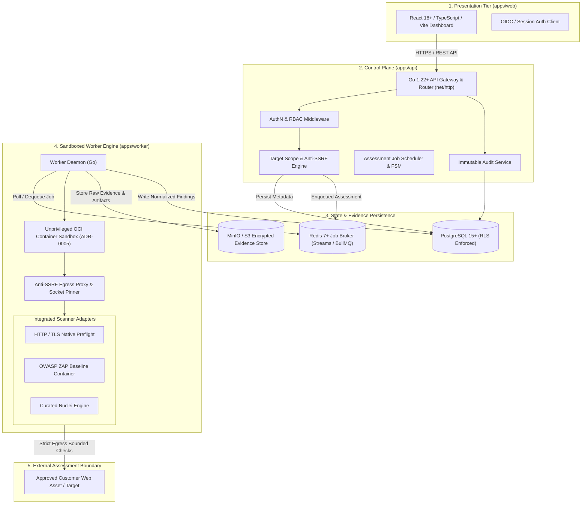
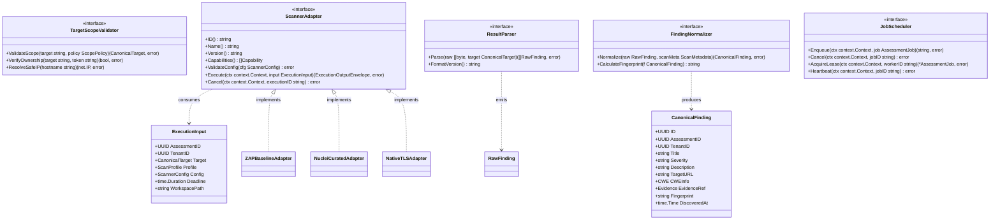

# 🏛️ [EPIC] Feature Specification & Architectural Design Baseline

## 1. Executive Summary & Problem Statement

**Kelvin** is an enterprise-grade, modular security assessment and vulnerability management platform designed exclusively for authorized assessments. Security operations and application security teams frequently struggle with fragmented tooling, inconsistent command-line runners, unvalidated scan boundaries (leading to accidental SSRF or legal liability), unstandardized finding formats, and security hazards associated with running scanner processes directly on orchestration hosts.

This issue establishes the formal architectural blueprint and feature baseline for the Kelvin platform, ensuring that all subsequent engine, worker, and scanner implementations strictly conform to zero-trust principles, tenant isolation, and modular execution standards.

---

## 2. Architecture & System Structure Diagrams

### 2.1 Component Interaction & Tiered Architecture Diagram
The platform follows a layered, micro-modular topology separating the user interface, authenticated API control plane, distributed job broker, unprivileged execution workers, persistent relational storage, and target boundaries.



---

### 2.2 Data Ingestion & Scan Orchestration Pipeline (Flowchart)
The following flowchart details the end-to-end lifecycle of an assessment request from user submission to canonical findings generation:

```mermaid
flowchart TD
    Start([User Initiates Assessment]) --> AuthCheck{Authorized Role?}
    AuthCheck -- No --> RejectAuth[Return 403 Forbidden & Log Audit Event]
    AuthCheck -- Yes --> ParseTarget[Parse Target Domain / IP / URL]

    ParseTarget --> ScopeCheck{Strict Scope & Anti-SSRF Valid?}
    ScopeCheck -- Fails (RFC 1918 / Loopback) --> RejectScope[Reject Request: 400 Bad Target Scope]
    ScopeCheck -- Passed --> CheckOwnership{Asset Ownership Verified?}
    
    CheckOwnership -- Unverified Aggressive Mode --> RejectOwnership[Reject: Verification Required]
    CheckOwnership -- Verified / Non-Aggressive --> CreateAssessment[Create Assessment Record in PostgreSQL]

    CreateAssessment --> EnqueueJob[Dispatch Job to Redis Queue]
    EnqueueJob --> WorkerAcquire[Worker Daemon Claims Job Lease]
    
    WorkerAcquire --> ExecPreflight[Run Native HTTP/TLS Preflight Checks]
    ExecPreflight --> PreflightValid{Target Reachable & Responsive?}
    
    PreflightValid -- No --> MarkJobFailed[Record Diagnostic Failure & Release Slot]
    PreflightValid -- Yes --> SpawnAdapters[Execute Containerized Scanner Adapters (ZAP / Nuclei)]

    SpawnAdapters --> BoundedCapture[Capture Stdout / Stderr in Bounded Ring Buffers]
    BoundedCapture --> ParseOutput[Parse Raw Results via Dedicated Parsers]
    ParseOutput --> ScopeFilter{Extracted Targets In Scope?}
    
    ScopeFilter -- Out-of-Scope Target --> QuarantineResult[Log Security Diagnostic & Drop Target]
    ScopeFilter -- In-Scope Target --> NormalizeFinding[Map to Canonical Finding Schema v1]
    
    NormalizeFinding --> PersistEvidence[Store Proof-of-Concept Payloads in S3]
    PersistEvidence --> Deduplicate[Fingerprint & Save Finding in DB]
    Deduplicate --> CompleteJob([Mark Assessment Completed & Emit Event])
```

---

### 2.3 Core Domain Model & Interface Hierarchy (Class/Object Diagram)
Kelvin leverages clean hexagonal architecture in Go 1.22+. The domain core defines strict interfaces implemented by scanner adapters, job workers, and repository layers:



---

## 3. Core Feature Matrix & Architectural Invariants

### 3.1 Strict Scope & Target Validation Engine
* **Anti-SSRF & DNS Pinning:** Resolves target hostnames at validation time and pins IP addresses during worker HTTP handshakes. Rejects RFC 1918 (private), RFC 3927 (link-local), loopback (`127.0.0.0/8`), AWS/GCP/Azure cloud metadata endpoints (`169.254.169.254`), and multicast ranges.
* **Redirect Boundary Enforcement:** Follows redirects strictly within the authorized domain and port boundary; halts and quarantines scan if a redirect escapes scope.
* **Verification Proofs:** Aggressive active assessment profiles require cryptographically verifiable proof of target ownership (DNS TXT token `_kelvin-challenge` or HTTP `.well-known/kelvin-challenge`).

### 3.2 Sandboxed Execution Workers (ADR-0005)
* **Rootless OCI Execution:** Scanner binaries and engines execute inside ephemeral, unprivileged container sandboxes. Workers drop all Linux capabilities (`CAP_SYS_ADMIN`, `CAP_NET_RAW`), run as non-root user (`UID 10001`), and mount file systems as read-only with a private `tmpfs`.
* **Resource Quotas & Process Trees:** Hard kernel limits on worker memory (max 1.5 GB per scanner), CPU shares (max 1.0 core), maximum open file descriptors, and maximum process count (`pids.max=128`) to mitigate fork-bombs and memory exhaustion.
* **Bounded Output Ring Buffers:** Subprocess stdout/stderr are ingested through size-bounded ring buffers (maximum 25 MB) preventing memory exhaustion from noisy scanner tools.

### 3.3 Unified Canonical Finding Pipeline (v1 Schema, ADR-0002)
* **Heterogeneous Scanner Normalization:** Decouples scanner-specific output formats (ZAP alerts, Nuclei JSON, built-in TLS results) into a unified JSON Schema (`packages/schemas/finding.v1.json`).
* **Deterministic Deduplication:** Generates cryptographic finding fingerprints based on `SHA256(tenant_id + target_host + endpoint_path + cwe_id + vulnerability_class)`.
* **Evidence Preservation:** Stores raw HTTP request/response evidence, certificate chains, and stdout fragments in object storage with automatic redaction of session cookies, bearer tokens, and credentials.

### 3.4 Multi-Tenancy & Immutable Audit Governance
* **PostgreSQL Row-Level Security (RLS):** All queries enforce tenant isolation via `tenant_id = current_setting('app.current_tenant_id')`. Cross-tenant data leakage is strictly prohibited at the database engine level.
* **Append-Only Audit Log:** Security-critical operations (assessment creation, target addition, scan cancellation, finding export, role modifications) are recorded in an append-only audit table with cryptographic chaining.

---

## 4. Architectural Decision Records (ADRs) Index

| ADR ID | Decision Title | Status | Link |
| :--- | :--- | :--- | :--- |
| **ADR-0001** | Selection of Go 1.22+ Standard Library for Core API Service | Approved | [`docs/architecture/decisions/ADR-0001.md`](../../docs/architecture/decisions/ADR-0001.md) |
| **ADR-0002** | Adoption of JSON Schema v1 for Canonical Finding Normalization | Approved | [`docs/architecture/decisions/ADR-0002.md`](../../docs/architecture/decisions/ADR-0002.md) |
| **ADR-0003** | Asynchronous Job Scheduling via Redis 7+ Reliable Queues | Approved | [`docs/architecture/decisions/ADR-0003.md`](../../docs/architecture/decisions/ADR-0003.md) |
| **ADR-0004** | React 18+ / TypeScript SPA Architecture for Web Dashboard | Approved | [`docs/architecture/decisions/ADR-0004.md`](../../docs/architecture/decisions/ADR-0004.md) |
| **ADR-0005** | Rootless OCI Container Sandboxing for Scanner Worker Execution | Approved | [`docs/architecture/decisions/ADR-0005.md`](../../docs/architecture/decisions/ADR-0005.md) |

---

## 5. Acceptance Criteria & Definition of Done

- [x] All 5 primary architecture tiers are specified with concrete technology stacks.
- [x] Mermaid Architecture, Pipeline Flowchart, and Domain Class diagrams render natively in GitHub.
- [x] Strict Anti-SSRF, DNS pinning, and Scope Verification invariants are formally documented.
- [x] Sandboxed execution limits (CPU, RAM, PIDs, read-only root) are codified.
- [x] Canonical finding v1 schema alignment and deduplication strategy are confirmed.
- [x] Row-Level Security (RLS) tenant isolation rules are defined.
- [x] Peer review and architectural approval obtained from Lead Security Engineer.

