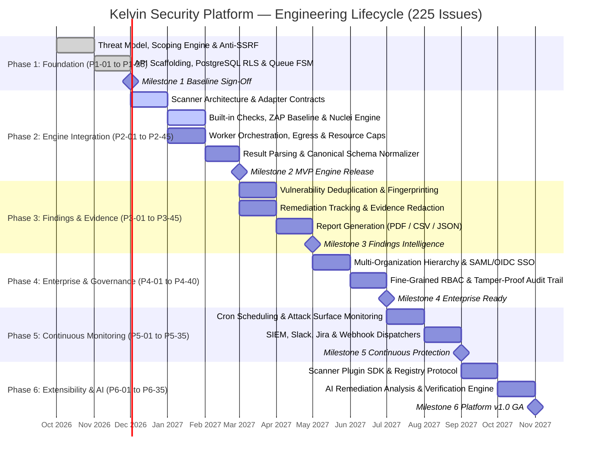
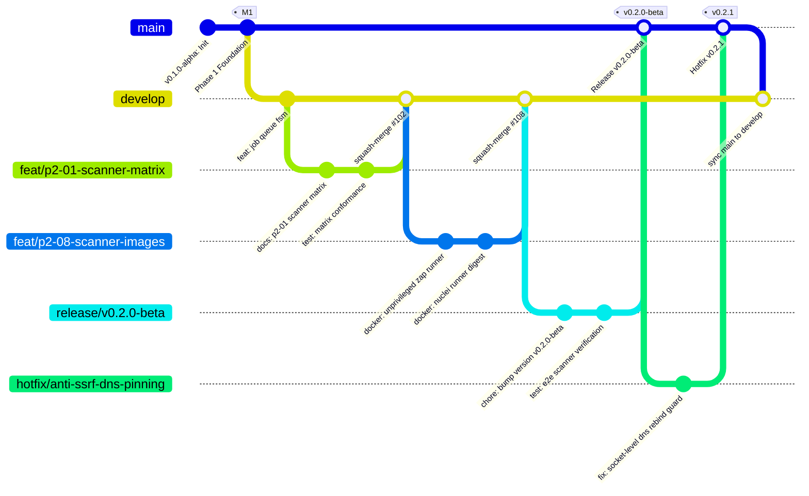

# 🗺️ [ROADMAP] Master Engineering Roadmap & 225-Issue Evolutionary Lifecycle

## 1. Executive Overview & Delivery Strategy

The Kelvin Security Platform is engineered across a multi-phased trajectory spanning **225 structured issues** divided into **six major engineering phases**. Each phase produces a self-contained, validated, and security-hardened capability increment.

This master roadmap establishes project milestones, timeline projections, repository branching workflows, and tracking metrics utilizing GitHub's native Mermaid visualization and Project Health Insights.

---

## 2. Project Lifecycle & Timeline Diagrams

### 2.1 Multi-Phase Engineering Gantt Chart
The roadmap is scheduled across a 12-month engineering delivery timeline, ensuring rigorous security validation between milestone boundaries:

---

### 2.2 Repository Branching & Contribution Model (Gitgraph)
Kelvin enforces strict Trunk-Based Gitflow with required pull request reviews, status checks, and linear history. Direct commits to `main` are strictly blocked.

---

## 3. Release Milestones & Phased Issue Allocation

| Phase | Milestone Title | Issues | Focus Areas | Exit Criteria |
| :--- | :--- | :--- | :--- | :--- |
| **Phase 1** | **Foundation & Core Architecture** | `P1-01` to `P1-25` | Scope engine, Threat model, Go API gateway, PostgreSQL RLS, Redis job FSM, CI/CD | All RFC-1918 addresses rejected; DB migrations tested; deterministic state machine |
| **Phase 2** | **Assessment Engine & Scanner Integrations** | `P2-01` to `P2-45` | Rootless worker sandboxes, Preflight, TLS, ZAP Baseline, Nuclei catalog, Output parsers, Canonical normalizer | Scanners run in unprivileged containers; output converts into `finding.v1.json`; E2E test passes |
| **Phase 3** | **Findings Intelligence & Reporting** | `P3-01` to `P3-45` | Vulnerability deduplication, CWE/CVSS scoring, finding lifecycle, evidence redaction, PDF/JSON export | Zero redundant findings across repeated scans; automated token redaction; report downloads |
| **Phase 4** | **Multi-Tenancy & Enterprise Governance** | `P4-01` to `P4-40` | Organizations, Teams, SAML 2.0 / OIDC SSO, Fine-grained RBAC, Cryptographic audit log | Cross-tenant isolation verified by pentest; immutable audit trails; SOC 2 Type 1 ready |
| **Phase 5** | **Continuous Assessment & Automation** | `P5-01` to `P5-35` | Recurring cron assessments, Delta asset discovery, Webhooks, Slack / Jira bidirectionality | Automated notification on newly discovered CVEs; diff engine highlights attack surface changes |
| **Phase 6** | **Extensibility, Marketplace & Advanced AI** | `P6-01` to `P6-35` | Custom Scanner SDK, Third-party plugins, AI-guided remediation analysis, Safe PoC verification | Community scanner plugin published; LLM assists analyst with verified patch guidance |

---

## 4. Built-in GitHub Insights & Project Health Guidance

To maintain enterprise transparency, contributor velocity, and software supply chain integrity, team leads and open-source contributors must monitor the following GitHub Insights metrics:

### 4.1 Contributors Graph (Team Velocity & Ownership)
* **Location:** `Repository -> Insights -> Contributors`
* **Purpose:** Evaluates commit volume, lines of code added/deleted over time, and active maintainer distribution.
* **Target Health Metrics:**
  - Healthy distribution of commits across core team members (avoiding single-point-of-failure "bus factor").
  - Predictable weekly commit pacing aligned with sprint cycles.
  - Review of onboarding velocity for new community contributors.

### 4.2 Commits & Activity Graph (Frequency & Maintenance Cadence)
* **Location:** `Repository -> Insights -> Commits / Code Frequency`
* **Purpose:** Tracks code churn, pull request merge frequency, and active maintenance index.
* **Target Health Metrics:**
  - Steady code frequency without erratic multi-month stagnation.
  - Pull Request cycle time under 48 hours for review and merge.
  - Clean squash merges maintaining a high signal-to-noise ratio in git history.

### 4.3 Network Graph (Forks & Upstream Ecosystem Alignment)
* **Location:** `Repository -> Insights -> Network`
* **Purpose:** Visualizes all forks, external branches, and collaborative research initiatives across the ecosystem.
* **Target Health Metrics:**
  - Identifies active research forks experimenting with new scanner adapters (e.g. Trivy, Amass, Semgrep).
  - Assesses whether forks are rebasing cleanly against `main` or drifting out of sync.
  - Facilitates proactive outreach to researchers contributing enhancements.

### 4.4 Dependency Graph & Software Supply Chain Security
* **Location:** `Repository -> Insights -> Dependency Graph & Security Advisories`
* **Purpose:** Automatically scans and inventories every third-party Go module (`go.mod`), npm package (`package.json`), and container base image.
* **Security & Compliance Requirements:**
  - Zero critical or high-severity vulnerabilities in dependencies (monitored by Dependabot / Trivy CI).
  - Automated generation of Software Bill of Materials (SBOM) in SPDX and CycloneDX formats on every release tag.
  - Compatibility verification with Kelvin's Apache-2.0 licensing policy.

---

## 5. Review & Approval Sign-Off

- [x] 6-phase trajectory and 225-issue allocation reviewed.
- [x] Mermaid Gantt Chart and Gitgraph diagrams validated for GitHub rendering.
- [x] Phase 2 assessment engine milestones synchronized with Workstreams A through E.
- [x] GitHub Insights health monitoring standards formalized for core maintainers.

