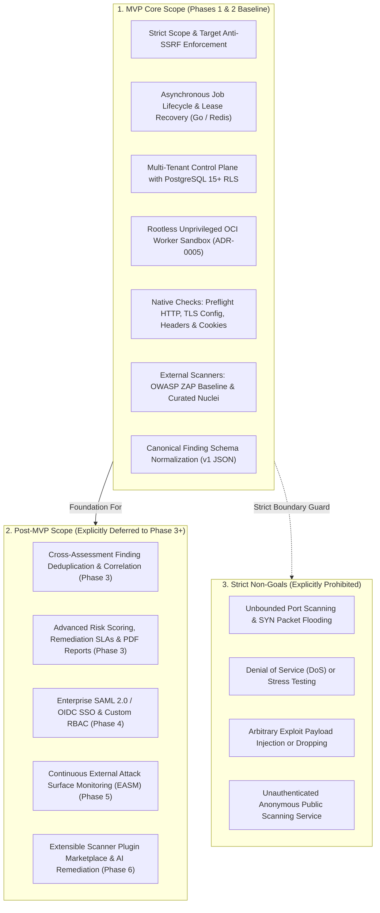
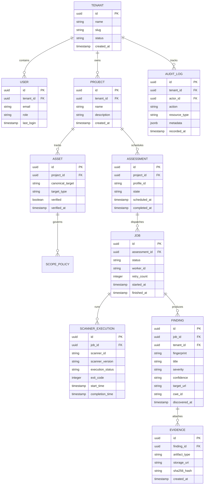
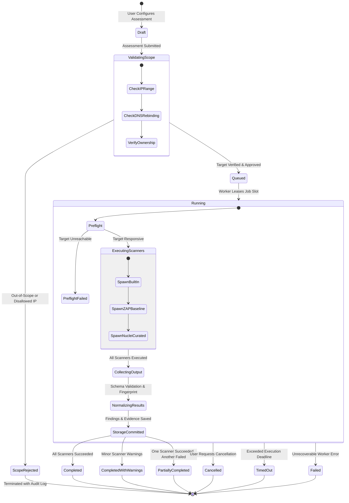
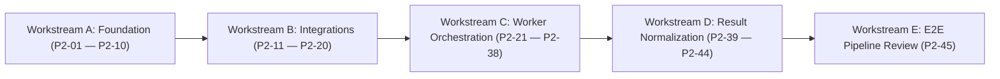

# 🎯 [EPIC] MVP Definition, Scope Bifurcation & Phase 2 Scanner Engine Execution Plan

## 1. Executive Summary & Objective

This epic defines the boundaries of the **Kelvin Minimum Viable Product (MVP)**, establishes the strict **Scope Bifurcation Framework**, models the core domain data and state machine, and provides the exhaustive **Phase 2 Assessment Engine & Scanner Integrations execution plan (Issues P2-01 through P2-45)**.

### Primary Phase 2 Objective
Build the core assessment execution engine, integrate the selected security scanners, execute assessments through isolated workers, and convert scanner output into Kelvin's canonical result format (`finding.v1.json`).

---

## 2. Scope Bifurcation & Relational Architecture Diagrams

### 2.1 Scope Bifurcation Flowchart (MVP vs Post-MVP vs Non-Goals)
Kelvin enforces absolute architectural discipline by separating immediate MVP capabilities from deferred enhancements and strict platform non-goals:

---

### 2.2 Relational Data Model (Entity-Relationship Diagram — ERD)
The database enforces referential integrity, foreign key cascading policies, and PostgreSQL Row-Level Security (RLS) across all core entities:

---

### 2.3 Assessment & Job Lifecycle State Machine (State Diagram)
Every assessment execution transitions through deterministic states managed by the Go finite-state machine (FSM) in `apps/api/pkg/job`:

---

## 3. Phase 2 Scope Boundaries & Deferrals

### In Scope for Phase 2:
- Scanner integration architecture and Go adapter contracts (`ScannerAdapter`).
- Scanner selection, packaging, configuration schema, and pinned version management.
- Built-in HTTP and TLS assessment capabilities (preflight, headers, cookies, TLS versions).
- OWASP ZAP Baseline and curated Nuclei integrations.
- Scanner execution through the unprivileged container worker architecture.
- Execution limits, cancellation trees, concurrency caps, rate pacing, retries, and failure taxonomy.
- Scanner output collection in bounded ring buffers, safe parsing, validation, and normalization to `finding.v1.json`.
- Integration and end-to-end conformance tests for the assessment pipeline.

### Explicitly Deferred to Phase 3:
- Advanced finding management and lifecycle workflows (Open, In-Review, False-Positive, Resolved).
- Finding deduplication and cross-assessment correlation.
- Advanced risk scoring, CVSS v3.1 calculators, and business prioritization.
- Remediation tracking and ticket synchronization.
- Historical scan comparisons and vulnerability trend analysis.
- Executive reporting and PDF/HTML export engines.
- Advanced analytics dashboards and faceted search interfaces.

---

## 4. Phase 2 Detailed Workstream Breakdown (Issues P2-01 to P2-45)

---

### Workstream A — Scanner Architecture & Integration Foundation

#### [P2-01] Define the MVP Scanner Selection and Capability Matrix
* **Parent Issue:** Phase 2 — Assessment Engine & Scanner Integrations  
* **Purpose:** Select the initial scanner technologies supported in Kelvin MVP; prevent bloat and maintain architectural purity.
* **Requirements:**
  - Evaluate scanners based on licensing (Apache-2.0 compatible), maintenance, resource footprint, and container compatibility.
  - Finalize MVP lineup: Built-in HTTP/HTTPS preflight, Built-in TLS configuration assessment, Built-in HTTP security header/cookie checks, OWASP ZAP Baseline, and Nuclei (curated safe template set).
  - Explicitly exclude unrestricted port scanning, arbitrary template execution, exploit execution, and DoS testing.
* **Acceptance Criteria:** Approved scanner capability matrix documented in `docs/architecture/SCAN_PROFILES.md`; capability boundaries and licensing recorded.

#### [P2-02] Define the Scanner Adapter Interface
* **Parent Issue:** Phase 2 — Assessment Engine & Scanner Integrations  
* **Purpose:** Establish a consistent Go interface (`ScannerAdapter`) isolating external scanner runtimes from domain and application layers.
* **Requirements:**
  - Define Go operations: `Initialize()`, `ValidateConfig()`, `Capabilities()`, `Execute()`, `Cancel()`, `Health()`, and `Result()`.
  - Isolate scanner-specific logic from direct database access.
  - Establish standard error and execution-status semantics.
* **Acceptance Criteria:** Documented Go adapter interface in `apps/worker/internal/adapter/`; reference implementation passing contract tests.

#### [P2-03] Define the Scanner Invocation Input Contract
* **Parent Issue:** Phase 2 — Assessment Engine & Scanner Integrations  
* **Purpose:** Define strictly typed inputs passed to scanners; prevent arbitrary parameter injection.
* **Requirements:**
  - Structure: Assessment ID, Tenant ID, Canonical Target, Approved Scope, Scan Profile, Config, Deadline, Correlation/Trace IDs.
  - Prohibit passing raw user CLI arguments to subprocesses.
* **Acceptance Criteria:** Versioned Go struct and JSON contract; contract tests rejecting invalid or scope-violating inputs.

#### [P2-04] Define the Scanner Output Envelope
* **Parent Issue:** Phase 2 — Assessment Engine & Scanner Integrations  
* **Purpose:** Create a consistent output envelope for raw results, normalized findings, and execution diagnostics.
* **Requirements:**
  - Structure: Assessment ID, Scanner ID & version, Execution Status, Start/End timestamps, Findings collection, Diagnostics, Partial-result flag.
  - Keep raw output clearly separated from normalized findings.
* **Acceptance Criteria:** Versioned envelope struct; contract tests verifying serialization/deserialization across success, partial, and error states.

#### [P2-05] Define the Scanner Configuration Schema
* **Parent Issue:** Phase 2 — Assessment Engine & Scanner Integrations  
* **Purpose:** Establish validated configuration models for scanners with strict boundaries.
* **Requirements:**
  - Supported parameters: Request timeout, max request rate, max scan duration, approved ruleset/template reference.
  - Reject unknown or unsafe configuration fields before execution starts.
* **Acceptance Criteria:** JSON Schema and Go validation for each scanner; unsafe settings rejected by unit tests.

#### [P2-06] Implement the Scanner Registry and Capability Discovery
* **Parent Issue:** Phase 2 — Assessment Engine & Scanner Integrations  
* **Purpose:** Provide a thread-safe registry to discover and manage registered scanner adapters.
* **Requirements:**
  - Register adapters with ID, Display Name, Version, Supported Target Types, Capabilities, and Availability status.
  - Deterministic error handling for missing or duplicate scanner registrations.
* **Acceptance Criteria:** Thread-safe registry in `apps/worker/internal/registry/`; automated unit tests for lookup, duplication, and capability resolution.

#### [P2-07] Implement Scanner Version and Compatibility Management
* **Parent Issue:** Phase 2 — Assessment Engine & Scanner Integrations  
* **Purpose:** Ensure Kelvin executes pinned, compatible scanner versions and records versions in assessment provenance.
* **Requirements:**
  - Define pinned versions for all scanners; verify version during startup readiness checks.
  - Block executions if a scanner binary differs from the pinned version.
* **Acceptance Criteria:** Pinned version configuration; runtime compatibility check; version recorded in assessment manifests.

#### [P2-08] Package Scanners as Controlled Runtime Images
* **Parent Issue:** Phase 2 — Assessment Engine & Scanner Integrations  
* **Purpose:** Create reproducible, minimal, unprivileged container images for external scanner execution.
* **Requirements:**
  - Dockerfiles with pinned base images (Alpine/Distroless), non-root users (`UID 10001`), stripped compilers and debugging shells.
  - CI verification and digest pinning.
* **Acceptance Criteria:** Reproducible container images for ZAP Baseline and Nuclei; image digests recorded and tested in CI.

#### [P2-09] Implement Safe Scanner Process Invocation
* **Parent Issue:** Phase 2 — Assessment Engine & Scanner Integrations  
* **Purpose:** Shared Go process invocation library preventing shell command injection.
* **Requirements:**
  - Use structured argument arrays (`exec.CommandContext`), never raw shell strings (`sh -c`).
  - Strict bounded stdout/stderr buffers; propagation of execution deadlines and cancellation signals.
* **Acceptance Criteria:** Safe invocation abstraction in `apps/worker/internal/runner/`; security tests verifying immunity to command injection.

#### [P2-10] Build the Scanner Adapter Conformance Test Harness
* **Parent Issue:** Phase 2 — Assessment Engine & Scanner Integrations  
* **Purpose:** Reusable test harness verifying that adapters strictly adhere to Kelvin's integration contracts.
* **Requirements:**
  - Harness verifying initialization, execution, timeout, cancellation, malformed output, and correlation propagation.
  - Faked process runners for deterministic, network-free CI testing.
* **Acceptance Criteria:** Reusable test suite; verified on both built-in and external scanner adapters.

---

### Workstream B — MVP Scanner Integrations

#### [P2-11] Implement the HTTP/HTTPS Preflight Assessment Adapter
* **Parent Issue:** Phase 2 — Assessment Engine & Scanner Integrations  
* **Purpose:** Built-in adapter confirming web target reachability and protocol parameters before triggering expensive tools.
* **Requirements:**
  - Perform bounded TCP/TLS handshakes and HTTP HEAD/GET request; capture response timing and status.
  - Enforce strict Phase 1 scope and anti-SSRF protections during preflight.
* **Acceptance Criteria:** Native adapter returning structured reachability diagnostics; network failure states handled safely.

#### [P2-12] Implement Safe Redirect Chain Evaluation
* **Parent Issue:** Phase 2 — Assessment Engine & Scanner Integrations  
* **Purpose:** Ensure HTTP redirects do not escape approved target scopes or create redirect loops.
* **Requirements:**
  - Inspect every redirect hop; validate target host, IP, scheme, and port against the approved scope policy.
  - Cap maximum redirect hops at 5; detect and abort redirect loops.
* **Acceptance Criteria:** Automated tests verifying redirect chain validation; out-of-scope redirects cleanly blocked and logged.

#### [P2-13] Implement the TLS Configuration Assessment Adapter
* **Parent Issue:** Phase 2 — Assessment Engine & Scanner Integrations  
* **Purpose:** Built-in adapter evaluating SSL/TLS configuration of HTTPS targets.
* **Requirements:**
  - Inspect certificate chain, expiration, SANs, TLS protocol versions (TLS 1.0/1.1 deprecation), and cipher suite security.
  - Differentiate handshake network errors from cryptographic security findings.
* **Acceptance Criteria:** Native TLS adapter emitting normalized configuration findings; unit tests for expired certs, weak ciphers, and protocol issues.

#### [P2-14] Implement HTTP Security Header and Cookie Checks
* **Parent Issue:** Phase 2 — Assessment Engine & Scanner Integrations  
* **Purpose:** Built-in checks for missing or misconfigured security headers and cookie flags.
* **Requirements:**
  - Evaluate HSTS, CSP, X-Frame-Options, X-Content-Type-Options, Referrer-Policy, and Permissions-Policy.
  - Inspect cookies for `Secure`, `HttpOnly`, and `SameSite` attributes.
  - Assign preliminary severity and confidence with complete evidence payloads.
* **Acceptance Criteria:** Native adapter executing header and cookie rules; automated test fixtures verifying correct severity assignments.

#### [P2-15] Integrate OWASP ZAP Baseline Scanner
* **Parent Issue:** Phase 2 — Assessment Engine & Scanner Integrations  
* **Purpose:** Implement Go adapter for the containerized OWASP ZAP Baseline scanner.
* **Requirements:**
  - Pass validated target URL and safe profile parameters; collect JSON output via the common envelope.
  - Enforce execution deadlines and process cancellation.
* **Acceptance Criteria:** ZAP Baseline adapter executing in worker sandbox; results captured in output envelope; unit and mock tests passing.

#### [P2-16] Define and Enforce the ZAP Baseline Safety Profile
* **Parent Issue:** Phase 2 — Assessment Engine & Scanner Integrations  
* **Purpose:** Enforce bounded, passive baseline scanning; strictly prohibit active attacks or unbounded spiders.
* **Requirements:**
  - Enforce crawl depth limits, max scan duration (max 10 minutes), request rate limits, and passive alert rules.
  - Block switching to active scanning through user configuration.
* **Acceptance Criteria:** Versioned safety configuration profile; test cases asserting rejection of unsafe flags.

#### [P2-17] Integrate Nuclei Through a Controlled Adapter
* **Parent Issue:** Phase 2 — Assessment Engine & Scanner Integrations  
* **Purpose:** Integrate ProjectDiscovery Nuclei while strictly barring arbitrary or unsafe template execution.
* **Requirements:**
  - Implement Nuclei adapter using structured JSON output mode (`-jsonl`).
  - Restrict template paths strictly to Kelvin's pre-approved curated catalog.
* **Acceptance Criteria:** Nuclei adapter operating in rootless container; output successfully ingested; arbitrary template execution blocked.

#### [P2-18] Establish a Curated Nuclei Template Catalog
* **Parent Issue:** Phase 2 — Assessment Engine & Scanner Integrations  
* **Purpose:** Define and version-control an approved, safe subset of Nuclei templates.
* **Requirements:**
  - Curate low-impact, safe templates (exposed panels, known CVEs without DoS/destructive payloads, misconfigurations).
  - Version catalog with git submodules or pinned tarballs; verify SHA256 integrity in CI.
* **Acceptance Criteria:** Pinned template catalog; automated CI linter validating absence of intrusive or destructive templates.

#### [P2-19] Implement MVP Assessment Profile Definitions
* **Parent Issue:** Phase 2 — Assessment Engine & Scanner Integrations  
* **Purpose:** Connect Phase 1 scan profile definitions (`Passive Discovery`, `Standard Baseline`, `Authorized Deep`) to concrete scanner adapter configurations.
* **Requirements:**
  - Map each profile to its permitted scanner adapters, ordering, and execution dependencies.
  - Validate profile combinations before job dispatch.
* **Acceptance Criteria:** Profile configuration registry; validation tests preventing unsupported or dangerous profile combinations.

#### [P2-20] Implement Scanner Availability and Runtime Readiness Checks
* **Parent Issue:** Phase 2 — Assessment Engine & Scanner Integrations  
* **Purpose:** Provide readiness probes to ensure required container images and templates exist before claiming jobs.
* **Requirements:**
  - Implement worker readiness checks verifying docker socket/daemon, container image presence, and catalog paths.
  - Prevent worker from claiming jobs requiring unavailable scanners.
* **Acceptance Criteria:** Internal readiness endpoint reporting per-scanner availability; tests covering missing binary/image conditions.

---

### Workstream C — Worker Execution & Orchestration

#### [P2-21] Integrate Scanner Adapters with the Assessment Worker
* **Parent Issue:** Phase 2 — Assessment Engine & Scanner Integrations  
* **Purpose:** Wire the Phase 1 worker task daemon to the registered scanner adapters.
* **Requirements:**
  - Worker dequeues job, parses assessment context, executes selected scanners sequentially or in parallel based on profile.
  - Update job status in Redis/Postgres state machine across execution stages.
* **Acceptance Criteria:** End-to-end worker execution loop verified with mock and real adapters; proper error propagation.

#### [P2-22] Implement Per-Assessment Workspace Management
* **Parent Issue:** Phase 2 — Assessment Engine & Scanner Integrations  
* **Purpose:** Provide strictly isolated, ephemeral filesystem workspaces for intermediate scanner data and output.
* **Requirements:**
  - Create directory `/tmp/kelvin/workspaces/<assessment-id>/<execution-id>/` with `0700` permissions.
  - Robust cleanup on success, failure, timeout, or cancellation; prevent path traversal.
* **Acceptance Criteria:** Ephemeral workspace manager with cleanup hook; automated tests verifying cleanup and path traversal immunity.

#### [P2-23] Apply Scanner-Specific Network Egress Policies
* **Parent Issue:** Phase 2 — Assessment Engine & Scanner Integrations  
* **Purpose:** Enforce Phase 1 network egress rules across all containerized and native scanner processes.
* **Requirements:**
  - Route scanner network traffic through an anti-SSRF egress proxy or iptables/cgroups sandbox.
  - Block loopback, RFC 1918, metadata IP destinations, and arbitrary non-HTTP outbound ports.
* **Acceptance Criteria:** Egress policy enforcement verified; tests demonstrating automatic blocking of private IP connections from scanners.

#### [P2-24] Apply Scanner-Specific Resource Limits
* **Parent Issue:** Phase 2 — Assessment Engine & Scanner Integrations  
* **Purpose:** Enforce CPU, memory, and process count ceilings for scanner processes.
* **Requirements:**
  - Set container resource limits (e.g. Memory: 1.5GB, CPU: 1.0 core, PIDs: 128).
  - Detect OOM or resource starvation and map to structured diagnostic failure rather than silent crash.
* **Acceptance Criteria:** Resource limit enforcement verified; test cases verifying graceful failure reporting under OOM conditions.

#### [P2-25] Enforce Scanner Execution Deadlines
* **Parent Issue:** Phase 2 — Assessment Engine & Scanner Integrations  
* **Purpose:** Ensure all scanner invocations are strictly bounded by context deadlines.
* **Requirements:**
  - Pass hierarchical timeouts (Scan Profile Deadline > Scanner Adapter Timeout > Socket Timeout).
  - Terminate hung scanners cleanly upon deadline expiration.
* **Acceptance Criteria:** Timeout propagation tests; hung mock scanners reliably terminated with `EXECUTION_TIMEOUT` status.

#### [P2-26] Implement Full Scanner Process Cancellation
* **Parent Issue:** Phase 2 — Assessment Engine & Scanner Integrations  
* **Purpose:** Ensure cancelling an assessment immediately and completely kills scanner processes and child processes.
* **Requirements:**
  - Listen for Redis cancellation events; send `SIGTERM` followed by `SIGKILL` to entire process group or container.
  - Prevent orphaned scanner processes from remaining alive on worker nodes.
* **Acceptance Criteria:** Cancellation tests verifying zero orphan processes; execution marked as `CANCELLED`.

#### [P2-27] Integrate Scanner Progress Reporting
* **Parent Issue:** Phase 2 — Assessment Engine & Scanner Integrations  
* **Purpose:** Publish honest, non-fabricated progress updates during multi-stage assessments.
* **Requirements:**
  - Report normalized stages: `PREFLIGHT`, `SCANNER_INITIALIZING`, `SCANNER_RUNNING`, `COLLECTING_OUTPUT`, `NORMALIZING`, `COMPLETED`.
  - Stream progress events over Redis Pub/Sub for real-time frontend visibility.
* **Acceptance Criteria:** Stage transition events emitted with timestamps; verified under both smooth and interrupted executions.

#### [P2-28] Implement Assessment Concurrency Controls
* **Parent Issue:** Phase 2 — Assessment Engine & Scanner Integrations  
* **Purpose:** Prevent worker node exhaustion and avoid overwhelming target infrastructure with simultaneous scans.
* **Requirements:**
  - Enforce global worker pool limits, per-tenant concurrency limits (max 3 concurrent scans), and per-target lockouts.
  - Maintain queue ordering for excess assessments.
* **Acceptance Criteria:** Concurrency semaphore tests; verified rate limits per tenant and prevention of duplicate scans against the same target.

#### [P2-29] Implement Per-Target Request Pacing
* **Parent Issue:** Phase 2 — Assessment Engine & Scanner Integrations  
* **Purpose:** Enforce strict request-rate limits (e.g. max 10 requests/sec) to prevent inadvertent target denial of service.
* **Requirements:**
  - Configure token bucket rate limiters for built-in checks and pass rate flags (`--rate-limit`, `--delay`) to external scanners.
  - Prevent user configuration from overriding platform ceiling.
* **Acceptance Criteria:** Target request pacing enforced across built-in and external tools; verified by mock HTTP target access logs.

#### [P2-30] Define Scanner Failure Classification
* **Parent Issue:** Phase 2 — Assessment Engine & Scanner Integrations  
* **Purpose:** Standardize failure taxonomy across heterogeneous scanners.
* **Requirements:**
  - Define taxonomy: `INVALID_CONFIG`, `VERSION_MISMATCH`, `TARGET_UNREACHABLE`, `SCOPE_VIOLATION`, `PROCESS_CRASHED`, `TIMEOUT`, `RESOURCE_EXHAUSTED`, `OUTPUT_MALFORMED`, `INFRASTRUCTURE_ERROR`.
  - Map scanner exit codes and error logs into standard enum.
* **Acceptance Criteria:** Failure taxonomy implemented in Go; unit tests covering exit code mapping for ZAP, Nuclei, and native checks.

#### [P2-31] Implement Safe Scanner Retry Policies
* **Parent Issue:** Phase 2 — Assessment Engine & Scanner Integrations  
* **Purpose:** Define bounded, safe retry policies strictly for transient infrastructure failures.
* **Requirements:**
  - Retry only safe transient failures (e.g., worker container startup failure); never retry target errors, timeouts, or scope rejections.
  - Exponential backoff with jitter; max 2 retries; respect overall assessment deadline.
* **Acceptance Criteria:** Retry policy unit tests; zero retry attempts on non-transient or target-side errors.

#### [P2-32] Define Partial Assessment Completion Semantics
* **Parent Issue:** Phase 2 — Assessment Engine & Scanner Integrations  
* **Purpose:** Handle multi-scanner profiles where one scanner completes successfully while another fails.
* **Requirements:**
  - Support `PARTIALLY_COMPLETED` status; retain valid findings from successful scanners.
  - Provide granular execution metadata per scanner in the assessment summary.
* **Acceptance Criteria:** Mixed-outcome integration tests; valid findings persisted while recording failed scanner diagnostics.

#### [P2-33] Implement Bounded Scanner Output Capture
* **Parent Issue:** Phase 2 — Assessment Engine & Scanner Integrations  
* **Purpose:** Prevent verbose or malicious scanner output from exhausting worker memory or disk space.
* **Requirements:**
  - Capture stdout and stderr into separate fixed-size ring buffers (max 25 MB).
  - Flag truncated output with `OUTPUT_TRUNCATED` diagnostic warning.
* **Acceptance Criteria:** Bounded buffer tests with high-volume generators; worker memory stays stable during large output streams.

#### [P2-34] Implement Raw Scanner Output Staging and Cleanup
* **Parent Issue:** Phase 2 — Assessment Engine & Scanner Integrations  
* **Purpose:** Securely stage raw scanner output files during processing and guarantee their cleanup.
* **Requirements:**
  - Write temporary raw outputs into tenant-isolated workspaces.
  - Automatically wipe temporary raw outputs upon completion or transfer to encrypted object storage.
* **Acceptance Criteria:** Workspace cleanup tests under success, error, and abrupt termination conditions.

#### [P2-35] Record Immutable Assessment Execution Manifests
* **Parent Issue:** Phase 2 — Assessment Engine & Scanner Integrations  
* **Purpose:** Guarantee assessment reproducibility and forensic auditability.
* **Requirements:**
  - Generate execution manifest capturing: Profile ID, Scanner versions, Container image digests, Template catalog git commit, Target IP/URL, Resource limits, and Start/Finish timestamps.
  - Persist manifest as an immutable record in PostgreSQL.
* **Acceptance Criteria:** Execution manifest schema and persistence logic implemented; verified tamper-resistant in database.

#### [P2-36] Implement Scanner Execution Provenance and Diagnostics
* **Parent Issue:** Phase 2 — Assessment Engine & Scanner Integrations  
* **Purpose:** Provide comprehensive operational diagnostics without leaking sensitive authentication tokens or credentials.
* **Requirements:**
  - Record execution duration, exit codes, retry counts, and system metrics per scanner.
  - Automatically redact credentials, API keys, and session cookies from diagnostic logs.
* **Acceptance Criteria:** Diagnostic event logging implemented; redaction tests passing for common credential and token formats.

#### [P2-37] Validate Scanner-Reported Targets Against Assessment Scope
* **Parent Issue:** Phase 2 — Assessment Engine & Scanner Integrations  
* **Purpose:** Prevent scanners from crawling or reporting findings against unauthorized third-party targets.
* **Requirements:**
  - Run all URLs, endpoints, and hosts reported in scanner outputs through Phase 1 scope validation.
  - Quarantine out-of-scope finding records and record an audit warning.
* **Acceptance Criteria:** Post-scan scope filtering tests; scanner findings pointing to third-party domains cleanly quarantined.

#### [P2-38] Harden Scanner Output Parsing Against Untrusted Data
* **Parent Issue:** Phase 2 — Assessment Engine & Scanner Integrations  
* **Purpose:** Treat all scanner outputs as untrusted data; prevent JSON/XML parsing attacks or path traversals.
* **Requirements:**
  - Enforce maximum document size, max JSON recursion depth, and field character limits.
  - Disallow unsafe deserialization and sanitize string inputs before storage.
* **Acceptance Criteria:** Parser fuzzing and security tests with malformed, deeply nested, and oversized payloads.

---

### Workstream D — Result Parsing & Normalization

#### [P2-39] Implement OWASP ZAP Output Parser
* **Parent Issue:** Phase 2 — Assessment Engine & Scanner Integrations  
* **Purpose:** Parse ZAP Baseline JSON/XML reports into Kelvin raw finding records.
* **Requirements:**
  - Parse alert names, risk codes, confidence levels, CWE IDs, WASC IDs, affected URLs, and evidence parameters.
  - Safely handle missing optional fields and malformed structures.
* **Acceptance Criteria:** ZAP parser unit tests with real baseline report fixtures; all alerts extracted accurately.

#### [P2-40] Implement Nuclei Output Parser
* **Parent Issue:** Phase 2 — Assessment Engine & Scanner Integrations  
* **Purpose:** Parse streaming Nuclei JSONL output into Kelvin raw finding records.
* **Requirements:**
  - Parse template ID, template name, severity, extracted results, matched URL/host, request/response dumps, and CVE/CWE metadata.
  - Handle partial or interrupted JSONL streams gracefully.
* **Acceptance Criteria:** Nuclei parser unit tests with JSONL fixtures; robust handling of malformed trailing lines.

#### [P2-41] Implement Built-In HTTP and TLS Result Parsers
* **Parent Issue:** Phase 2 — Assessment Engine & Scanner Integrations  
* **Purpose:** Convert built-in HTTP header, cookie, and TLS checks into raw finding records.
* **Requirements:**
  - Normalize missing security headers, insecure cookie attributes, expired certs, and deprecated TLS protocol versions.
  - Distinguish negative/clean checks from confirmed configuration vulnerabilities.
* **Acceptance Criteria:** Unit tests covering all native check outputs; clean separation between diagnostic data and findings.

#### [P2-42] Normalize Scanner Results into the Canonical Finding Schema
* **Parent Issue:** Phase 2 — Assessment Engine & Scanner Integrations  
* **Purpose:** Map heterogeneous raw findings into Kelvin's unified `finding.v1.json` schema.
* **Requirements:**
  - Map Title, Description, Severity, CWE, Target URL, Scanner Source, and Redacted Evidence.
  - Guarantee schema conformance before passing records to persistence layers.
* **Acceptance Criteria:** Normalizer implementation; JSON schema validation tests passing across all three scanner sources.

#### [P2-43] Implement Severity and Confidence Mapping
* **Parent Issue:** Phase 2 — Assessment Engine & Scanner Integrations  
* **Purpose:** Standardize disparate scanner severity and confidence ratings into Kelvin's canonical enum.
* **Requirements:**
  - Canonical Severities: `INFORMATIONAL`, `LOW`, `MEDIUM`, `HIGH`, `CRITICAL`.
  - Canonical Confidences: `LOW`, `MEDIUM`, `HIGH`, `CONFIRMED`.
  - Preserve original tool severity in metadata for auditability.
* **Acceptance Criteria:** Documented and tested mapping matrix; edge cases (e.g. ZAP informational, Nuclei unknown) handled deterministically.

#### [P2-44] Implement Normalized Result Validation and Completeness Checks
* **Parent Issue:** Phase 2 — Assessment Engine & Scanner Integrations  
* **Purpose:** Guarantee data integrity of normalized findings before database insertion.
* **Requirements:**
  - Verify required fields (Assessment ID, Tenant ID, Title, Target URL, Severity, Fingerprint).
  - Detect and discard intra-scan duplicate records.
* **Acceptance Criteria:** Validation middleware; invalid or incomplete finding records rejected with detailed error logs.

---

### Workstream E — Integration Testing & Phase 2 Completion

#### [P2-45] Complete Phase 2 End-to-End Assessment Pipeline and Readiness Review
* **Parent Issue:** Phase 2 — Assessment Engine & Scanner Integrations  
* **Purpose:** Verify the complete, integrated assessment pipeline in an isolated test environment and conduct Phase 2 sign-off.
* **Requirements:**
  - **End-to-End Workflow:** Assessment initiation -> Scope validation -> Queue dispatch -> Sandboxed worker execution (Preflight + ZAP + Nuclei) -> Bounded output capture -> Parsing & Normalization -> Database & Evidence persistence.
  - **Security Verification:** Validate anti-SSRF blocking, redirect scope containment, container rootless isolation, and cancellation process termination.
  - **Reliability Verification:** Verify scanner failure handling, partial completion, retry bounds, and workspace cleanup.
  - **Documentation & Review:** Finalize scanner integration guides, profile limits, and Phase 2 Readiness Report.
* **Acceptance Criteria:**
  - Fully automated E2E pipeline test passing against `mock-target`.
  - All 45 Phase 2 issues verified and closed.
  - Zero critical security regressions.
  - Formal sign-off and approval to proceed to Phase 3 (Findings Intelligence & Reporting).

---

## 5. Phase 2 Definition of Done (DoD) Checklist

Phase 2 is formally completed only when all of the following requirements are met:
- [ ] 1. Scanner adapter Go interface and registry implemented and tested.
- [ ] 2. OWASP ZAP Baseline and Nuclei packaged as unprivileged, pinned container images.
- [ ] 3. Native preflight, TLS configuration, and HTTP header/cookie checks implemented.
- [ ] 4. Assessment worker executes scanners in isolated workspaces with hard resource and network constraints.
- [ ] 5. Process cancellation and deadline propagation verified with zero orphan processes.
- [ ] 6. Raw scanner outputs captured in bounded buffers and parsed safely.
- [ ] 7. All scanner findings normalized and validated against `packages/schemas/finding.v1.json`.
- [ ] 8. Comprehensive automated test suite passes (Unit, Integration, and E2E against mock target).
- [ ] 9. Execution manifests and provenance recorded for all assessments.
- [ ] 10. Formal Phase 2 Readiness Report approved by Lead Security Engineer.

