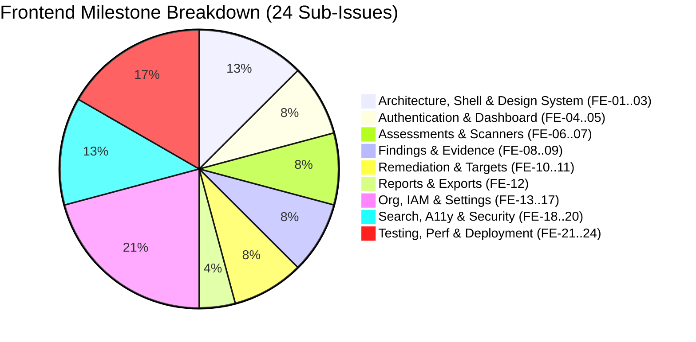

# 🏆 Milestone: Frontend Development & Product Experience

**Milestone ID:** `frontend`  
**Target Completion:** Q4 2027 (`2027-12-31`)  
**Parent Roadmap:** [ISSUE-02: Engineering Roadmap](ISSUE-02_ENGINEERING_ROADMAP.md)  
**Parent Epic:** [FE-EPIC-01: Design & Implement Complete KELVIN Frontend Application](frontend/FE-EPIC-01_DESIGN_AND_IMPLEMENT_COMPLETE_KELVIN_FRONTEND_APPLICATION.md)  
**Total Issues:** 25 (1 Epic + 24 Sub-issues)  
**Current Status:** `READY FOR DEV`  

---

## 🎯 Milestone Objective

Design, architect, implement, test and deliver the complete production-grade frontend application for the KELVIN Enterprise Security Assessment Platform. Connect all user interfaces to live Go control plane APIs, enforcing enterprise cybersecurity design standards, WCAG 2.2 AA accessibility, and seamless sub-path routing under `https://eozka.com/services/kelvin`.

---

## 📊 Milestone Workstream Breakdown

---

## 🗂️ Frontend Issue Index

### Master Epic
- [ ] [FE-EPIC-01: Design & Implement Complete KELVIN Frontend Application](frontend/FE-EPIC-01_DESIGN_AND_IMPLEMENT_COMPLETE_KELVIN_FRONTEND_APPLICATION.md)

### Child Implementation Issues
- [ ] [FE-01: Frontend Architecture & API Integration Foundation](frontend/FE-01_FRONTEND_ARCHITECTURE_AND_API_INTEGRATION_FOUNDATION.md) — `critical`
- [ ] [FE-02: KELVIN Design System & Shared Component Library](frontend/FE-02_KELVIN_DESIGN_SYSTEM_AND_SHARED_COMPONENT_LIBRARY.md) — `critical`
- [ ] [FE-03: Application Shell, Navigation & Responsive Layout](frontend/FE-03_APPLICATION_SHELL_NAVIGATION_AND_RESPONSIVE_LAYOUT.md) — `critical`
- [ ] [FE-04: Authentication & Account Management UI](frontend/FE-04_AUTHENTICATION_AND_ACCOUNT_MANAGEMENT_UI.md) — `critical`
- [ ] [FE-05: Security Overview Dashboard](frontend/FE-05_SECURITY_OVERVIEW_DASHBOARD.md) — `critical`
- [ ] [FE-06: Assessment Management & Creation Wizard](frontend/FE-06_ASSESSMENT_MANAGEMENT_AND_CREATION_WIZARD.md) — `critical`
- [ ] [FE-07: Assessment Execution Monitoring & Details](frontend/FE-07_ASSESSMENT_EXECUTION_MONITORING_AND_DETAILS.md) — `critical`
- [ ] [FE-08: Findings Management & Search Interface](frontend/FE-08_FINDINGS_MANAGEMENT_AND_SEARCH_INTERFACE.md) — `critical`
- [ ] [FE-09: Finding Detail & Evidence Viewer](frontend/FE-09_FINDING_DETAIL_AND_EVIDENCE_VIEWER.md) — `critical`
- [ ] [FE-10: Remediation Management Workspace](frontend/FE-10_REMEDIATION_MANAGEMENT_WORKSPACE.md) — `high`
- [ ] [FE-11: Targets & Asset Management](frontend/FE-11_TARGETS_AND_ASSET_MANAGEMENT.md) — `critical`
- [ ] [FE-12: Assessment Reports & PDF Viewer](frontend/FE-12_ASSESSMENT_REPORTS_AND_PDF_VIEWER.md) — `high`
- [ ] [FE-13: Organization & Team Management](frontend/FE-13_ORGANIZATION_AND_TEAM_MANAGEMENT.md) — `high`
- [ ] [FE-14: Roles, Permissions & SSO Management UI](frontend/FE-14_ROLES_PERMISSIONS_AND_SSO_MANAGEMENT_UI.md) — `high`
- [ ] [FE-15: Integrations & Notification Center](frontend/FE-15_INTEGRATIONS_AND_NOTIFICATION_CENTER.md) — `high`
- [ ] [FE-16: Audit Logs & Activity Interface](frontend/FE-16_AUDIT_LOGS_AND_ACTIVITY_INTERFACE.md) — `high`
- [ ] [FE-17: Workspace & Platform Settings](frontend/FE-17_WORKSPACE_AND_PLATFORM_SETTINGS.md) — `high`
- [ ] [FE-18: Global Search, Filters & Data Navigation](frontend/FE-18_GLOBAL_SEARCH_FILTERS_AND_DATA_NAVIGATION.md) — `high`
- [ ] [FE-19: Frontend Accessibility & Responsive Optimization](frontend/FE-19_FRONTEND_ACCESSIBILITY_AND_RESPONSIVE_OPTIMIZATION.md) — `critical`
- [ ] [FE-20: Frontend Security Verification & Error Handling](frontend/FE-20_FRONTEND_SECURITY_VERIFICATION_AND_ERROR_HANDLING.md) — `critical`
- [ ] [FE-21: Frontend Unit, Integration & E2E Testing](frontend/FE-21_FRONTEND_UNIT_INTEGRATION_AND_E2E_TESTING.md) — `critical`
- [ ] [FE-22: Frontend Performance Optimization](frontend/FE-22_FRONTEND_PERFORMANCE_OPTIMIZATION.md) — `high`
- [ ] [FE-23: Production Routing & Deployment Integration](frontend/FE-23_PRODUCTION_ROUTING_AND_DEPLOYMENT_INTEGRATION.md) — `critical`
- [ ] [FE-24: Final Frontend QA Audit & Acceptance](frontend/FE-24_FINAL_FRONTEND_QA_AUDIT_AND_ACCEPTANCE.md) — `critical`
