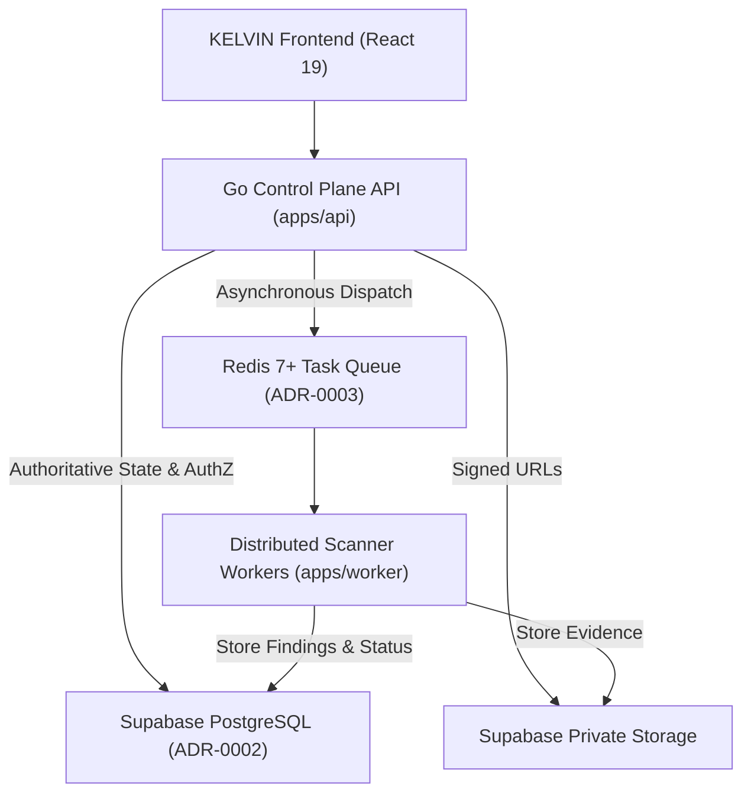

# 🏆 Milestone: Post-Phase 5 — Infrastructure & Production Integration

**Milestone ID:** `infrastructure`  
**Target Completion:** November 2027 (`2027-11-30`)  
**Parent Roadmap:** [ISSUE-02: Engineering Roadmap](ISSUE-02_ENGINEERING_ROADMAP.md)  
**Total Issues:** 1  
**Current Status:** `COMPLETED`  

---

## 🎯 Milestone Objective

Implement and integrate enterprise production infrastructure into KELVIN: managed PostgreSQL and private object storage via Supabase, distributed task queuing, concurrency control and caching via Redis 7+, and end-to-end production readiness.

---

## 📊 Infrastructure Architecture Topology

---

## 🗂️ Infrastructure Issue Index

- [x] [INFRA-01: Implement Redis & Supabase Infrastructure Integration](infra/INFRA-01_IMPLEMENT_REDIS_AND_SUPABASE_INFRASTRUCTURE_INTEGRATION.md)
