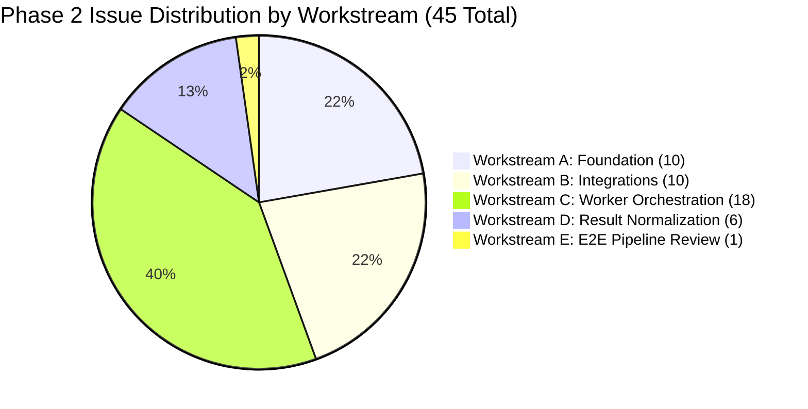

# 🏆 Milestone: Phase 2 — Assessment Engine & Scanner Integrations

**Milestone ID:** `phase-2`  
**Phase:** 2 of 6  
**Parent Roadmap:** [ISSUE-02: Engineering Roadmap](ISSUE-02_ENGINEERING_ROADMAP.md)  
**Parent Epic:** [ISSUE-03: MVP & Phase Bifurcation Framework](ISSUE-03_MVP_AND_PHASE_BIFURCATION.md)  
**Total Issues:** 45  
**Target Completion:** Q1 2027  
**Current Status:** `IN PROGRESS`  

---

## 🎯 Milestone Objective

Build the core assessment execution engine, integrate the selected security scanners, execute assessments through isolated workers, and convert scanner output into KELVIN's canonical result format (`finding.v1.json`).

---

## 📊 Milestone Workstream Progress & Issue Index

---

### Workstream A — Scanner Architecture & Integration Foundation (10 Issues)

- [ ] [P2-01: Define the MVP Scanner Selection and Capability Matrix](phase-2/P2-01_DEFINE_MVP_SCANNER_SELECTION_AND_CAPABILITY_MATRIX.md)
- [ ] [P2-02: Define the Scanner Adapter Interface](phase-2/P2-02_DEFINE_SCANNER_ADAPTER_INTERFACE.md)
- [ ] [P2-03: Define the Scanner Invocation Input Contract](phase-2/P2-03_DEFINE_SCANNER_INVOCATION_INPUT_CONTRACT.md)
- [ ] [P2-04: Define the Scanner Output Envelope](phase-2/P2-04_DEFINE_SCANNER_OUTPUT_ENVELOPE.md)
- [ ] [P2-05: Define the Scanner Configuration Schema](phase-2/P2-05_DEFINE_SCANNER_CONFIGURATION_SCHEMA.md)
- [ ] [P2-06: Implement the Scanner Registry and Capability Discovery](phase-2/P2-06_IMPLEMENT_SCANNER_REGISTRY_AND_CAPABILITY_DISCOVERY.md)
- [ ] [P2-07: Implement Scanner Version and Compatibility Management](phase-2/P2-07_IMPLEMENT_SCANNER_VERSION_AND_COMPATIBILITY_MANAGEMENT.md)
- [ ] [P2-08: Package Scanners as Controlled Runtime Images](phase-2/P2-08_PACKAGE_SCANNERS_AS_CONTROLLED_RUNTIME_IMAGES.md)
- [ ] [P2-09: Implement Safe Scanner Process Invocation](phase-2/P2-09_IMPLEMENT_SAFE_SCANNER_PROCESS_INVOCATION.md)
- [ ] [P2-10: Build the Scanner Adapter Conformance Test Harness](phase-2/P2-10_BUILD_SCANNER_ADAPTER_CONFORMANCE_TEST_HARNESS.md)

---

### Workstream B — MVP Scanner Integrations (10 Issues)

- [ ] [P2-11: Implement the HTTP/HTTPS Preflight Assessment Adapter](phase-2/P2-11_IMPLEMENT_HTTP_HTTPS_PREFLIGHT_ASSESSMENT_ADAPTER.md)
- [ ] [P2-12: Implement Safe Redirect Chain Evaluation](phase-2/P2-12_IMPLEMENT_SAFE_REDIRECT_CHAIN_EVALUATION.md)
- [ ] [P2-13: Implement the TLS Configuration Assessment Adapter](phase-2/P2-13_IMPLEMENT_TLS_CONFIGURATION_ASSESSMENT_ADAPTER.md)
- [ ] [P2-14: Implement HTTP Security Header and Cookie Checks](phase-2/P2-14_IMPLEMENT_HTTP_SECURITY_HEADER_AND_COOKIE_CHECKS.md)
- [ ] [P2-15: Integrate OWASP ZAP Baseline Scanner](phase-2/P2-15_INTEGRATE_OWASP_ZAP_BASELINE_SCANNER.md)
- [ ] [P2-16: Define and Enforce the ZAP Baseline Safety Profile](phase-2/P2-16_DEFINE_AND_ENFORCE_ZAP_BASELINE_SAFETY_PROFILE.md)
- [ ] [P2-17: Integrate Nuclei Through a Controlled Adapter](phase-2/P2-17_INTEGRATE_NUCLEI_THROUGH_A_CONTROLLED_ADAPTER.md)
- [ ] [P2-18: Establish a Curated Nuclei Template Catalog](phase-2/P2-18_ESTABLISH_CURATED_NUCLEI_TEMPLATE_CATALOG.md)
- [ ] [P2-19: Implement MVP Assessment Profile Definitions](phase-2/P2-19_IMPLEMENT_MVP_ASSESSMENT_PROFILE_DEFINITIONS.md)
- [ ] [P2-20: Implement Scanner Availability and Runtime Readiness Checks](phase-2/P2-20_IMPLEMENT_SCANNER_AVAILABILITY_AND_RUNTIME_READINESS_CHECKS.md)

---

### Workstream C — Worker Execution & Orchestration (18 Issues)

- [ ] [P2-21: Integrate Scanner Adapters with the Assessment Worker](phase-2/P2-21_INTEGRATE_SCANNER_ADAPTERS_WITH_THE_ASSESSMENT_WORKER.md)
- [ ] [P2-22: Implement Per-Assessment Workspace Management](phase-2/P2-22_IMPLEMENT_PER_ASSESSMENT_WORKSPACE_MANAGEMENT.md)
- [ ] [P2-23: Apply Scanner-Specific Network Egress Policies](phase-2/P2-23_APPLY_SCANNER_SPECIFIC_NETWORK_EGRESS_POLICIES.md)
- [ ] [P2-24: Apply Scanner-Specific Resource Limits](phase-2/P2-24_APPLY_SCANNER_SPECIFIC_RESOURCE_LIMITS.md)
- [ ] [P2-25: Enforce Scanner Execution Deadlines](phase-2/P2-25_ENFORCE_SCANNER_EXECUTION_DEADLINES.md)
- [ ] [P2-26: Implement Full Scanner Process Cancellation](phase-2/P2-26_IMPLEMENT_FULL_SCANNER_PROCESS_CANCELLATION.md)
- [ ] [P2-27: Integrate Scanner Progress Reporting](phase-2/P2-27_INTEGRATE_SCANNER_PROGRESS_REPORTING.md)
- [ ] [P2-28: Implement Assessment Concurrency Controls](phase-2/P2-28_IMPLEMENT_ASSESSMENT_CONCURRENCY_CONTROLS.md)
- [ ] [P2-29: Implement Per-Target Request Pacing](phase-2/P2-29_IMPLEMENT_PER_TARGET_REQUEST_PACING.md)
- [ ] [P2-30: Define Scanner Failure Classification](phase-2/P2-30_DEFINE_SCANNER_FAILURE_CLASSIFICATION.md)
- [ ] [P2-31: Implement Safe Scanner Retry Policies](phase-2/P2-31_IMPLEMENT_SAFE_SCANNER_RETRY_POLICIES.md)
- [ ] [P2-32: Define Partial Assessment Completion Semantics](phase-2/P2-32_DEFINE_PARTIAL_ASSESSMENT_COMPLETION_SEMANTICS.md)
- [ ] [P2-33: Implement Bounded Scanner Output Capture](phase-2/P2-33_IMPLEMENT_BOUNDED_SCANNER_OUTPUT_CAPTURE.md)
- [ ] [P2-34: Implement Raw Scanner Output Staging and Cleanup](phase-2/P2-34_IMPLEMENT_RAW_SCANNER_OUTPUT_STAGING_AND_CLEANUP.md)
- [ ] [P2-35: Record Immutable Assessment Execution Manifests](phase-2/P2-35_RECORD_IMMUTABLE_ASSESSMENT_EXECUTION_MANIFESTS.md)
- [ ] [P2-36: Implement Scanner Execution Provenance and Diagnostics](phase-2/P2-36_IMPLEMENT_SCANNER_EXECUTION_PROVENANCE_AND_DIAGNOSTICS.md)
- [ ] [P2-37: Validate Scanner-Reported Targets Against Assessment Scope](phase-2/P2-37_VALIDATE_SCANNER_REPORTED_TARGETS_AGAINST_ASSESSMENT_SCOPE.md)
- [ ] [P2-38: Harden Scanner Output Parsing Against Untrusted Data](phase-2/P2-38_HARDEN_SCANNER_OUTPUT_PARSING_AGAINST_UNTRUSTED_DATA.md)

---

### Workstream D — Result Parsing & Normalization (6 Issues)

- [ ] [P2-39: Implement OWASP ZAP Output Parser](phase-2/P2-39_IMPLEMENT_OWASP_ZAP_OUTPUT_PARSER.md)
- [ ] [P2-40: Implement Nuclei Output Parser](phase-2/P2-40_IMPLEMENT_NUCLEI_OUTPUT_PARSER.md)
- [ ] [P2-41: Implement Built-In HTTP and TLS Result Parsers](phase-2/P2-41_IMPLEMENT_BUILT_IN_HTTP_AND_TLS_RESULT_PARSERS.md)
- [ ] [P2-42: Normalize Scanner Results into the Canonical Finding Schema](phase-2/P2-42_NORMALIZE_SCANNER_RESULTS_INTO_CANONICAL_FINDING_SCHEMA.md)
- [ ] [P2-43: Implement Severity and Confidence Mapping](phase-2/P2-43_IMPLEMENT_SEVERITY_AND_CONFIDENCE_MAPPING.md)
- [ ] [P2-44: Implement Normalized Result Validation and Completeness Checks](phase-2/P2-44_IMPLEMENT_NORMALIZED_RESULT_VALIDATION_AND_COMPLETENESS_CHECKS.md)

---

### Workstream E — Integration Testing & Phase 2 Completion (1 Issue)

- [ ] [P2-45: Complete Phase 2 End-to-End Assessment Pipeline and Readiness Review](phase-2/P2-45_COMPLETE_PHASE_2_E2E_PIPELINE_AND_READINESS_REVIEW.md)

---

## 🛡️ Scope Boundaries & Defers

### Explicitly in Scope for Milestone:
- Scanner integration architecture and adapter contracts (`ScannerAdapter`).
- Scanner selection, packaging, configuration, and version management.
- Built-in HTTP, cookie, header, and TLS assessment capabilities.
- OWASP ZAP Baseline and curated Nuclei integrations.
- Scanner execution through the existing worker and queue architecture.
- Execution limits, cancellation, concurrency, retries, and failure handling.
- Scanner output collection, parsing, validation, and normalization.
- Integration and end-to-end tests for the assessment pipeline.

### Explicitly Deferred to Phase 3:
- Advanced finding management and lifecycle workflows.
- Finding deduplication and cross-assessment correlation.
- Advanced risk scoring and prioritization.
- Remediation tracking.
- Historical comparison and trend analysis.
- Full reporting and PDF generation.
- Advanced dashboards, analytics, and search interfaces.

---

## 🏁 Phase 2 Definition of Done (Exit Criteria)

Milestone 2 is signed off and closed only when all 10 conditions are satisfied:
1. The scanner adapter architecture is implemented and documented.
2. The approved MVP scanners are integrated and version-controlled.
3. Assessment jobs execute through the Phase 1 worker and queue foundations.
4. Scanner execution is bounded by scope, network, time, resource, and request-rate restrictions.
5. Cancellation and failure handling work reliably.
6. Scanner output is captured, parsed, validated, and normalized.
7. Normalized results conform to the canonical Phase 1 data model (`packages/schemas/finding.v1.json`).
8. Automated unit, adapter, integration, security, and end-to-end tests pass.
9. Scanner versions, configurations, and execution provenance are traceable.
10. The Phase 2 readiness review is approved.

