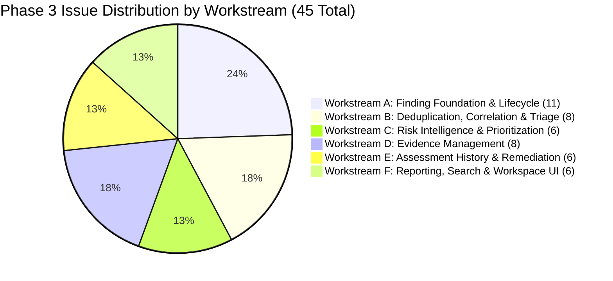

# 🏆 Milestone: Phase 3 — Findings Intelligence, Evidence & Reporting

**Milestone ID:** `phase-3`  
**Phase:** 3 of 6  
**Parent Roadmap:** [ISSUE-02: Engineering Roadmap](ISSUE-02_ENGINEERING_ROADMAP.md)  
**Total Issues:** 45  
**Target Completion:** Q2 2027 (`2027-06-30`)  
**Current Status:** `IN PROGRESS`  

---

## 🎯 Milestone Objective

Transform normalized assessment results into a complete findings management system. KELVIN must ingest scanner results, preserve assessment history, identify recurring findings, support analyst triage, manage evidence, calculate explainable risk, track remediation, and present results through search, dashboards, and downloadable reports.

---

## 📊 Milestone Workstream Distribution

---

## 🗂️ Phase 3 Issue Index

### Workstream A — Finding Foundation & Lifecycle (11 Issues)
- [ ] [P3-01: Define the Finding Management Domain and Lifecycle](phase-3/P3-01_DEFINE_FINDING_MANAGEMENT_DOMAIN_AND_LIFECYCLE.md)
- [ ] [P3-02: Define the Finding Identity and Observation Model](phase-3/P3-02_DEFINE_FINDING_IDENTITY_AND_OBSERVATION_MODEL.md)
- [ ] [P3-03: Implement Deterministic Finding Fingerprinting](phase-3/P3-03_IMPLEMENT_DETERMINISTIC_FINDING_FINGERPRINTING.md)
- [ ] [P3-04: Implement the Finding Ingestion Service](phase-3/P3-04_IMPLEMENT_THE_FINDING_INGESTION_SERVICE.md)
- [ ] [P3-05: Implement Finding and Observation Persistence](phase-3/P3-05_IMPLEMENT_FINDING_AND_OBSERVATION_PERSISTENCE.md)
- [ ] [P3-06: Enforce Idempotent Finding Ingestion](phase-3/P3-06_ENFORCE_IDEMPOTENT_FINDING_INGESTION.md)
- [ ] [P3-07: Enforce Tenant-Scoped Finding Repository Boundaries](phase-3/P3-07_ENFORCE_TENANT_SCOPED_FINDING_REPOSITORY_BOUNDARIES.md)
- [ ] [P3-08: Implement Finding Detail Retrieval API](phase-3/P3-08_IMPLEMENT_FINDING_DETAIL_RETRIEVAL_API.md)
- [ ] [P3-09: Implement the Finding Lifecycle State Machine](phase-3/P3-09_IMPLEMENT_THE_FINDING_LIFECYCLE_STATE_MACHINE.md)
- [ ] [P3-10: Implement Finding Status Transition Commands and API](phase-3/P3-10_IMPLEMENT_FINDING_STATUS_TRANSITION_COMMANDS_AND_API.md)
- [ ] [P3-11: Implement an Immutable Finding Activity Timeline](phase-3/P3-11_IMPLEMENT_AN_IMMUTABLE_FINDING_ACTIVITY_TIMELINE.md)

### Workstream B — Deduplication, Correlation & Triage (8 Issues)
- [ ] [P3-12: Implement Same-Assessment Duplicate Detection](phase-3/P3-12_IMPLEMENT_SAME_ASSESSMENT_DUPLICATE_DETECTION.md)
- [ ] [P3-13: Implement Cross-Assessment Recurring Finding Detection](phase-3/P3-13_IMPLEMENT_CROSS_ASSESSMENT_RECURRING_FINDING_DETECTION.md)
- [ ] [P3-14: Define the Finding Correlation Group Model](phase-3/P3-14_DEFINE_THE_FINDING_CORRELATION_GROUP_MODEL.md)
- [ ] [P3-15: Implement Cross-Scanner Finding Correlation Rules](phase-3/P3-15_IMPLEMENT_CROSS_SCANNER_FINDING_CORRELATION_RULES.md)
- [ ] [P3-16: Define Finding Triage Decisions and Dispositions](phase-3/P3-16_DEFINE_FINDING_TRIAGE_DECISIONS_AND_DISPOSITIONS.md)
- [ ] [P3-17: Implement False-Positive Review and Management](phase-3/P3-17_IMPLEMENT_FALSE_POSITIVE_REVIEW_AND_MANAGEMENT.md)
- [ ] [P3-18: Implement Finding Suppression Rules with Expiry](phase-3/P3-18_IMPLEMENT_FINDING_SUPPRESSION_RULES_WITH_EXPIRY.md)
- [ ] [P3-19: Implement Bulk Finding Triage Operations](phase-3/P3-19_IMPLEMENT_BULK_FINDING_TRIAGE_OPERATIONS.md)

### Workstream C — Risk Intelligence & Prioritization (6 Issues)
- [ ] [P3-20: Define the KELVIN Risk Assessment Model](phase-3/P3-20_DEFINE_THE_KELVIN_RISK_ASSESSMENT_MODEL.md)
- [ ] [P3-21: Implement the Deterministic Risk Scoring Engine](phase-3/P3-21_IMPLEMENT_THE_DETERMINISTIC_RISK_SCORING_ENGINE.md)
- [ ] [P3-22: Implement Contextual Risk Factors](phase-3/P3-22_IMPLEMENT_CONTEXTUAL_RISK_FACTORS.md)
- [ ] [P3-23: Implement Confidence and Severity Interpretation Rules](phase-3/P3-23_IMPLEMENT_CONFIDENCE_AND_SEVERITY_INTERPRETATION_RULES.md)
- [ ] [P3-24: Implement Risk Score Explainability](phase-3/P3-24_IMPLEMENT_RISK_SCORE_EXPLAINABILITY.md)
- [ ] [P3-25: Implement Versioned Risk Recalculation and History](phase-3/P3-25_IMPLEMENT_VERSIONED_RISK_RECALCULATION_AND_HISTORY.md)

### Workstream D — Evidence Management (8 Issues)
- [ ] [P3-26: Define the Evidence Management Domain and Lifecycle](phase-3/P3-26_DEFINE_THE_EVIDENCE_MANAGEMENT_DOMAIN_AND_LIFECYCLE.md)
- [ ] [P3-27: Implement Evidence Ingestion and Finding Association](phase-3/P3-27_IMPLEMENT_EVIDENCE_INGESTION_AND_FINDING_ASSOCIATION.md)
- [ ] [P3-28: Implement Secure Evidence Storage Service](phase-3/P3-28_IMPLEMENT_SECURE_EVIDENCE_STORAGE_SERVICE.md)
- [ ] [P3-29: Implement Evidence Redaction and Sanitization](phase-3/P3-29_IMPLEMENT_EVIDENCE_REDACTION_AND_SANITIZATION.md)
- [ ] [P3-30: Implement Evidence Integrity and Provenance Verification](phase-3/P3-30_IMPLEMENT_EVIDENCE_INTEGRITY_AND_PROVENANCE_VERIFICATION.md)
- [ ] [P3-31: Implement Authorized Evidence Retrieval and Access Controls](phase-3/P3-31_IMPLEMENT_AUTHORIZED_EVIDENCE_RETRIEVAL_AND_ACCESS_CONTROLS.md)
- [ ] [P3-32: Enforce Evidence Retention, Expiry and Deletion Policies](phase-3/P3-32_ENFORCE_EVIDENCE_RETENTION_EXPIRY_AND_DELETION_POLICIES.md)
- [ ] [P3-33: Implement Evidence Access and Lifecycle Audit Events](phase-3/P3-33_IMPLEMENT_EVIDENCE_ACCESS_AND_LIFECYCLE_AUDIT_EVENTS.md)

### Workstream E — Assessment History & Remediation (6 Issues)
- [ ] [P3-34: Implement Assessment History and Finding Observation Timeline](phase-3/P3-34_IMPLEMENT_ASSESSMENT_HISTORY_AND_FINDING_OBSERVATION_TIMELINE.md)
- [ ] [P3-35: Implement Assessment-to-Assessment Comparison](phase-3/P3-35_IMPLEMENT_ASSESSMENT_TO_ASSESSMENT_COMPARISON.md)
- [ ] [P3-36: Define the Remediation Tracking Domain and Data Model](phase-3/P3-36_DEFINE_THE_REMEDIATION_TRACKING_DOMAIN_AND_DATA_MODEL.md)
- [ ] [P3-37: Implement the Remediation Lifecycle Workflow](phase-3/P3-37_IMPLEMENT_THE_REMEDIATION_LIFECYCLE_WORKFLOW.md)
- [ ] [P3-38: Implement Remediation Assignment, Ownership and Due Dates](phase-3/P3-38_IMPLEMENT_REMEDIATION_ASSIGNMENT_OWNERSHIP_AND_DUE_DATES.md)
- [ ] [P3-39: Implement Remediation Verification Through Follow-Up Assessments](phase-3/P3-39_IMPLEMENT_REMEDIATION_VERIFICATION_THROUGH_FOLLOW_UP_ASSESSMENTS.md)

### Workstream F — Reporting, Search & User Experience (6 Issues)
- [ ] [P3-40: Define Assessment Report Structure and Template Contracts](phase-3/P3-40_DEFINE_ASSESSMENT_REPORT_STRUCTURE_AND_TEMPLATE_CONTRACTS.md)
- [ ] [P3-41: Implement Report Snapshot and Data Assembly Service](phase-3/P3-41_IMPLEMENT_REPORT_SNAPSHOT_AND_DATA_ASSEMBLY_SERVICE.md)
- [ ] [P3-42: Implement HTML and PDF Assessment Report Generation](phase-3/P3-42_IMPLEMENT_HTML_AND_PDF_ASSESSMENT_REPORT_GENERATION.md)
- [ ] [P3-43: Implement Secure Report Storage, Export and Download](phase-3/P3-43_IMPLEMENT_SECURE_REPORT_STORAGE_EXPORT_AND_DOWNLOAD.md)
- [ ] [P3-44: Implement Findings Search, Filtering and Dashboard APIs](phase-3/P3-44_IMPLEMENT_FINDINGS_SEARCH_FILTERING_AND_DASHBOARD_APIS.md)
- [ ] [P3-45: Build the Findings Workspace UI and Complete Phase 3 Readiness Review](phase-3/P3-45_BUILD_FINDINGS_WORKSPACE_UI_AND_COMPLETE_READINESS_REVIEW.md)
