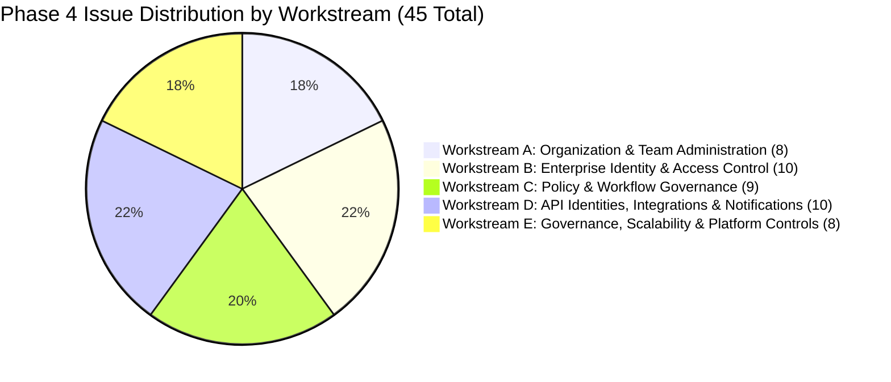

# 🏆 Milestone: Phase 4 — Enterprise Platform, Security & Scalability

**Milestone ID:** `phase-4`  
**Phase:** 4 of 6  
**Parent Roadmap:** [ISSUE-02: Engineering Roadmap](ISSUE-02_ENGINEERING_ROADMAP.md)  
**Total Issues:** 45  
**Target Completion:** Q3 2027 (`2027-09-30`)  
**Current Status:** `IN PROGRESS`  

---

## 🎯 Milestone Objective

Expand KELVIN's existing assessment and findings capabilities to support enterprise organizations with multiple users, teams, roles, identity providers, security policies, service identities, integrations, and larger workloads. Phase 4 preserves the modular Go backend and TypeScript frontend architecture, existing tenant isolation model, canonical assessment and finding schemas, and foundational security controls.

---

## 📊 Milestone Workstream Distribution

---

## 🗂️ Phase 4 Issue Index

### Workstream A — Organization & Team Administration (8 Issues)
- [ ] [P4-01: Define the Enterprise Organization and Workspace Hierarchy](phase-4/P4-01_DEFINE_ENTERPRISE_ORGANIZATION_AND_WORKSPACE_HIERARCHY.md)
- [ ] [P4-02: Implement Organization Lifecycle Management](phase-4/P4-02_IMPLEMENT_ORGANIZATION_LIFECYCLE_MANAGEMENT.md)
- [ ] [P4-03: Implement Team and Group Management](phase-4/P4-03_IMPLEMENT_TEAM_AND_GROUP_MANAGEMENT.md)
- [ ] [P4-04: Implement Workspace Creation, Configuration and Scoping](phase-4/P4-04_IMPLEMENT_WORKSPACE_CREATION_CONFIGURATION_AND_SCOPING.md)
- [ ] [P4-05: Implement Cross-Workspace Isolation Verification](phase-4/P4-05_IMPLEMENT_CROSS_WORKSPACE_ISOLATION_VERIFICATION.md)
- [ ] [P4-06: Implement Enterprise Invitation and User Onboarding](phase-4/P4-06_IMPLEMENT_ENTERPRISE_INVITATION_AND_USER_ONBOARDING.md)
- [ ] [P4-07: Implement Organization and Workspace Administration APIs](phase-4/P4-07_IMPLEMENT_ORGANIZATION_AND_WORKSPACE_ADMINISTRATION_APIS.md)
- [ ] [P4-08: Build Enterprise Organization and Team Management UI](phase-4/P4-08_BUILD_ENTERPRISE_ORGANIZATION_AND_TEAM_MANAGEMENT_UI.md)

### Workstream B — Enterprise Identity & Access Control (10 Issues)
- [ ] [P4-09: Define the Enterprise IAM and RBAC Domain Model](phase-4/P4-09_DEFINE_ENTERPRISE_IAM_AND_RBAC_DOMAIN_MODEL.md)
- [ ] [P4-10: Implement SAML 2.0 Identity Provider Integration](phase-4/P4-10_IMPLEMENT_SAML_20_IDENTITY_PROVIDER_INTEGRATION.md)
- [ ] [P4-11: Implement OIDC Identity Provider Integration](phase-4/P4-11_IMPLEMENT_OIDC_IDENTITY_PROVIDER_INTEGRATION.md)
- [ ] [P4-12: Implement Just-In-Time (JIT) User Provisioning](phase-4/P4-12_IMPLEMENT_JUST_IN_TIME_JIT_USER_PROVISIONING.md)
- [ ] [P4-13: Implement SCIM 2.0 Automated User and Group Provisioning](phase-4/P4-13_IMPLEMENT_SCIM_20_AUTOMATED_USER_AND_GROUP_PROVISIONING.md)
- [ ] [P4-14: Implement Fine-Grained Role and Permission Enforcement](phase-4/P4-14_IMPLEMENT_FINE_GRAINED_ROLE_AND_PERMISSION_ENFORCEMENT.md)
- [ ] [P4-15: Implement Custom Role Definition](phase-4/P4-15_IMPLEMENT_CUSTOM_ROLE_DEFINITION.md)
- [ ] [P4-16: Implement Enterprise Session Management and Revocation](phase-4/P4-16_IMPLEMENT_ENTERPRISE_SESSION_MANAGEMENT_AND_REVOCATION.md)
- [ ] [P4-17: Implement Enterprise MFA Enforcement Policies](phase-4/P4-17_IMPLEMENT_ENTERPRISE_MFA_ENFORCEMENT_POLICIES.md)
- [ ] [P4-18: Build Enterprise SSO and Access Control Management UI](phase-4/P4-18_BUILD_ENTERPRISE_SSO_AND_ACCESS_CONTROL_MANAGEMENT_UI.md)

### Workstream C — Policy & Workflow Governance (9 Issues)
- [ ] [P4-19: Define the Enterprise Policy and Compliance Governance Model](phase-4/P4-19_DEFINE_ENTERPRISE_POLICY_AND_COMPLIANCE_GOVERNANCE_MODEL.md)
- [ ] [P4-20: Implement Policy Definition, Versioning and Scoping](phase-4/P4-20_IMPLEMENT_POLICY_DEFINITION_VERSIONING_AND_SCOPING.md)
- [ ] [P4-21: Implement Policy Evaluation Engine](phase-4/P4-21_IMPLEMENT_POLICY_EVALUATION_ENGINE.md)
- [ ] [P4-22: Implement Remediation SLA Policies and Breach Tracking](phase-4/P4-22_IMPLEMENT_REMEDIATION_SLA_POLICIES_AND_BREACH_TRACKING.md)
- [ ] [P4-23: Implement Automated Finding Assignment Rules](phase-4/P4-23_IMPLEMENT_AUTOMATED_FINDING_ASSIGNMENT_RULES.md)
- [ ] [P4-24: Implement Risk Acceptance Approval Workflows](phase-4/P4-24_IMPLEMENT_RISK_ACCEPTANCE_APPROVAL_WORKFLOWS.md)
- [ ] [P4-25: Implement Assessment Scheduling and Recurring Execution Policies](phase-4/P4-25_IMPLEMENT_ASSESSMENT_SCHEDULING_AND_RECURRING_EXECUTION_POLICIES.md)
- [ ] [P4-26: Implement Enterprise Target Blacklists and Scope Restriction Policies](phase-4/P4-26_IMPLEMENT_ENTERPRISE_TARGET_BLACKLISTS_AND_SCOPE_RESTRICTION_POLICIES.md)
- [ ] [P4-27: Build Enterprise Policy and SLA Management UI](phase-4/P4-27_BUILD_ENTERPRISE_POLICY_AND_SLA_MANAGEMENT_UI.md)

### Workstream D — API Identities, Integrations & Notifications (10 Issues)
- [ ] [P4-28: Define the Service Identity and Machine API Domain](phase-4/P4-28_DEFINE_SERVICE_IDENTITY_AND_MACHINE_API_DOMAIN.md)
- [ ] [P4-29: Implement Enterprise API Key Management](phase-4/P4-29_IMPLEMENT_ENTERPRISE_API_KEY_MANAGEMENT.md)
- [ ] [P4-30: Implement OAuth2 Client Credentials for Service Identities](phase-4/P4-30_IMPLEMENT_OAUTH2_CLIENT_CREDENTIALS_FOR_SERVICE_IDENTITIES.md)
- [ ] [P4-31: Implement Outbound Webhook Notification Service](phase-4/P4-31_IMPLEMENT_OUTBOUND_WEBHOOK_NOTIFICATION_SERVICE.md)
- [ ] [P4-32: Implement Webhook Delivery Retries, Circuit Breaking and Dead-Letter Queues](phase-4/P4-32_IMPLEMENT_WEBHOOK_DELIVERY_RETRIES_CIRCUIT_BREAKING_AND_DEAD_LETTER_QUEUES.md)
- [ ] [P4-33: Implement Jira Two-Way Ticket Synchronization](phase-4/P4-33_IMPLEMENT_JIRA_TWO_WAY_TICKET_SYNCHRONIZATION.md)
- [ ] [P4-34: Implement GitHub Issues Integration](phase-4/P4-34_IMPLEMENT_GITHUB_ISSUES_INTEGRATION.md)
- [ ] [P4-35: Implement Slack and Teams Security Alerts Integration](phase-4/P4-35_IMPLEMENT_SLACK_AND_TEAMS_SECURITY_ALERTS_INTEGRATION.md)
- [ ] [P4-36: Implement Enterprise SIEM and Syslog Streaming](phase-4/P4-36_IMPLEMENT_ENTERPRISE_SIEM_AND_SYSLOG_STREAMING.md)
- [ ] [P4-37: Build Enterprise Integrations and Webhook Management UI](phase-4/P4-37_BUILD_ENTERPRISE_INTEGRATIONS_AND_WEBHOOK_MANAGEMENT_UI.md)

### Workstream E — Governance, Scalability & Platform Controls (8 Issues)
- [ ] [P4-38: Define Enterprise Scalability, Partitioning and Multi-Tenant Storage Strategy](phase-4/P4-38_DEFINE_ENTERPRISE_SCALABILITY_PARTITIONING_AND_MULTI_TENANT_STORAGE_STRATEGY.md)
- [ ] [P4-39: Implement Distributed Worker Autoscaling and Fair Resource Scheduling](phase-4/P4-39_IMPLEMENT_DISTRIBUTED_WORKER_AUTOSCALING_AND_FAIR_RESOURCE_SCHEDULING.md)
- [ ] [P4-40: Implement Tenant Quotas, Rate Limiting and Fair-Use Throttling](phase-4/P4-40_IMPLEMENT_TENANT_QUOTAS_RATE_LIMITING_AND_FAIR_USE_THROTTLING.md)
- [ ] [P4-41: Implement Organization-Wide Immutable Audit Trail Export and Retention](phase-4/P4-41_IMPLEMENT_ORGANIZATION_WIDE_IMMUTABLE_AUDIT_TRAIL_EXPORT_AND_RETENTION.md)
- [ ] [P4-42: Implement Data Residency and Geolocation Routing Enforcement](phase-4/P4-42_IMPLEMENT_DATA_RESIDENCY_AND_GEOLOCATION_ROUTING_ENFORCEMENT.md)
- [ ] [P4-43: Implement Enterprise Analytics and Executive Security Posture Aggregation](phase-4/P4-43_IMPLEMENT_ENTERPRISE_ANALYTICS_AND_EXECUTIVE_SECURITY_POSTURE_AGGREGATION.md)
- [ ] [P4-44: Implement System Health, Metrics Exporters and Operational Observability](phase-4/P4-44_IMPLEMENT_SYSTEM_HEALTH_METRICS_EXPORTERS_AND_OPERATIONAL_OBSERVABILITY.md)
- [ ] [P4-45: Conduct Enterprise Platform Verification and Phase 4 Readiness Review](phase-4/P4-45_CONDUCT_ENTERPRISE_PLATFORM_VERIFICATION_AND_PHASE_4_READINESS_REVIEW.md)
