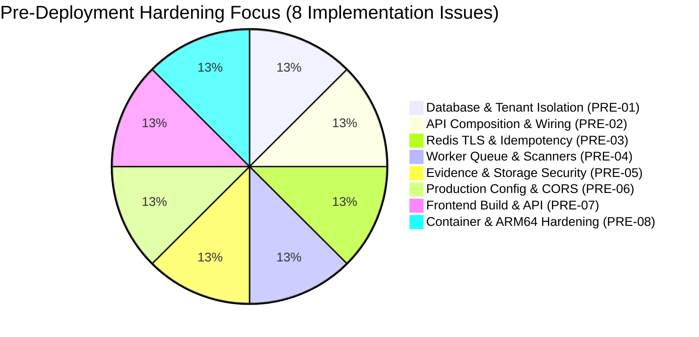

# 🏆 Milestone: Pre-Deployment Production Hardening

**Milestone ID:** `pre-deployment`  
**Target Completion:** November 2027 (`2027-11-20`)  
**Parent Roadmap:** [ISSUE-02: Engineering Roadmap](ISSUE-02_ENGINEERING_ROADMAP.md)  
**Parent Epic:** [PRE-DEPLOY-EPIC: KELVIN Pre-Deployment Engineering Hardening](pre-deployment/PRE-DEPLOY-EPIC_KELVIN_PRE_DEPLOYMENT_ENGINEERING_HARDENING.md)  
**Total Issues:** 9 (1 Epic + 8 Implementation PRs)  
**Current Status:** `READY FOR DEV`  

---

## 🎯 Milestone Objective

Execute a release-blocking pre-deployment engineering pass across the database, backend API composition, Redis TLS, worker runtime, evidence signing, production configuration, frontend build, and container security before authorizing live production deployment to Oracle Cloud Linux ARM64 and Vercel.

---

## 📊 Pre-Deployment Hardening Breakdown

---

## 🗂️ Pre-Deployment Issue Index

### Master Epic
- [ ] [PRE-DEPLOY-EPIC: KELVIN Pre-Deployment Engineering Hardening & Production Gate](pre-deployment/PRE-DEPLOY-EPIC_KELVIN_PRE_DEPLOYMENT_ENGINEERING_HARDENING.md)

### Implementation PR Issues
- [ ] [PRE-01: Tenant Isolation and Database Security](pre-deployment/PRE-01_TENANT_ISOLATION_AND_DATABASE_SECURITY.md) — `critical`
- [ ] [PRE-02: API Composition and Repository Wiring](pre-deployment/PRE-02_API_COMPOSITION_AND_REPOSITORY_WIRING.md) — `critical`
- [ ] [PRE-03: Redis TLS and Idempotency Integration](pre-deployment/PRE-03_REDIS_TLS_AND_IDEMPOTENCY_INTEGRATION.md) — `critical`
- [ ] [PRE-04: Worker Queue and Scanner Adapter Registration](pre-deployment/PRE-04_WORKER_QUEUE_AND_SCANNER_ADAPTER_REGISTRATION.md) — `critical`
- [ ] [PRE-05: Evidence Security and Supabase Storage](pre-deployment/PRE-05_EVIDENCE_SECURITY_AND_SUPABASE_STORAGE.md) — `critical`
- [ ] [PRE-06: Production Configuration, CORS and Observability](pre-deployment/PRE-06_PRODUCTION_CONFIGURATION_CORS_AND_OBSERVABILITY.md) — `critical`
- [ ] [PRE-07: Frontend Release Readiness and API Integration](pre-deployment/PRE-07_FRONTEND_RELEASE_READINESS_AND_API_INTEGRATION.md) — `critical`
- [ ] [PRE-08: Container and Deployment Hardening](pre-deployment/PRE-08_CONTAINER_AND_DEPLOYMENT_HARDENING.md) — `high`
