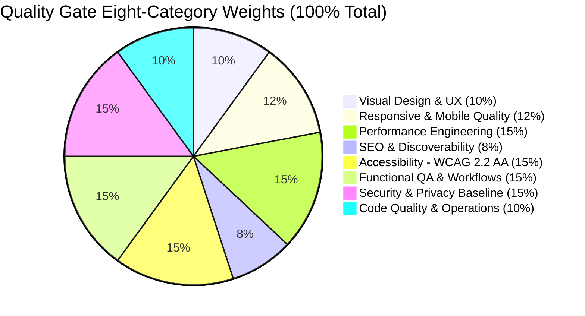

# 🏆 Milestone: Pre-Phase 5 — Final Audit & Phase Transition

**Milestone ID:** `pre-phase-5`  
**Quality Gate:** Cross-Phase Quality Gate (Phase 4 → Phase 5)  
**Parent Roadmap:** [ISSUE-02: Engineering Roadmap](ISSUE-02_ENGINEERING_ROADMAP.md)  
**Audit Standard:** Website Quality Assurance & Design Audit Standard v1.0  
**Target Completion:** October 2027 (`2027-10-15`)  
**Current Status:** `IN PROGRESS`  

---

## 🎯 Milestone Objective

Conduct a comprehensive, evidence-based quality assurance and design audit of the KELVIN web application before beginning Phase 5 — Production Hardening, Deployment & Release. Verify that all features and user journeys implemented across Phases 1–4 are fully functional, responsive, accessible (WCAG 2.2 AA), performant, secure, and maintainable under realistic user conditions.

---

## 📊 Quality Gate Workstream & Category Breakdown

---

## 🗂️ Pre-Phase 5 Quality Gate Issue Index

- [ ] [PRE-P5-01: Conduct the KELVIN Website Quality Assurance, UX, Accessibility & Functional Audit](pre-phase-5/PRE-P5-01_CONDUCT_KELVIN_WEBSITE_QUALITY_ASSURANCE_UX_ACCESSIBILITY_FUNCTIONAL_AUDIT.md)
