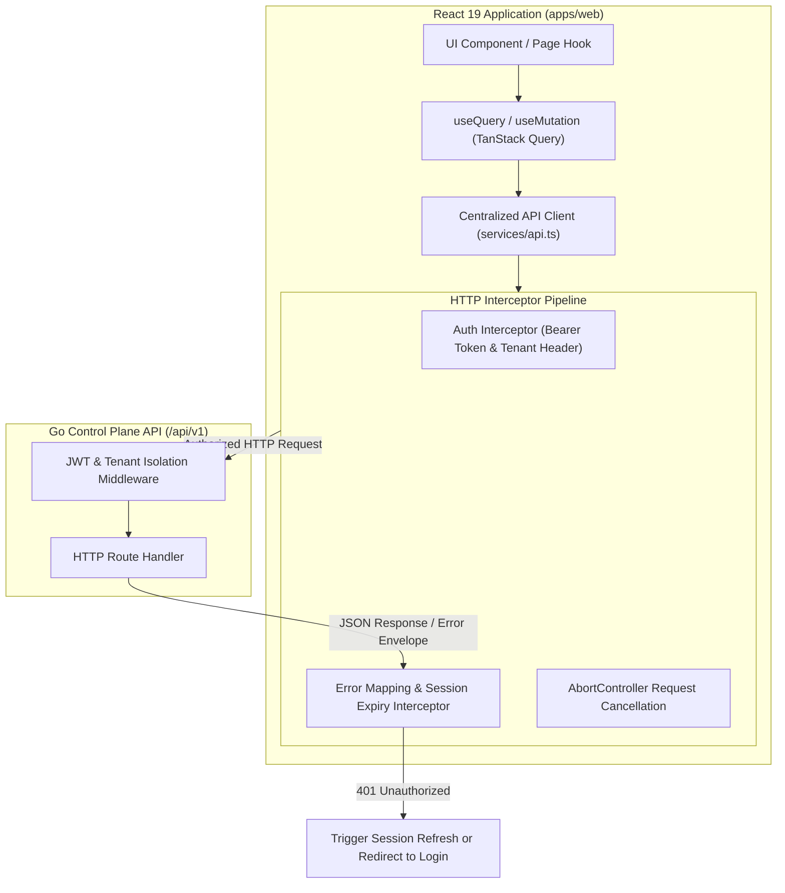

# FE-01 — Frontend Architecture & API Integration Foundation

**Parent Epic:** [FE-EPIC-01: Complete KELVIN Frontend Application](FE-EPIC-01_DESIGN_AND_IMPLEMENT_COMPLETE_KELVIN_FRONTEND_APPLICATION.md) (Parent Epic #399)  
**Milestone:** [Frontend Development & Product Experience](../MILESTONE_FRONTEND.md)  
**Issue ID:** `FE-01`  
**Priority:** `critical`  
**Status:** `ready-for-dev`  

---

## 🎯 Purpose

Establish the foundational frontend architecture, strictly-typed API client layer, central authentication interceptors, environment configuration, and query state management for the KELVIN web application.

---

## 📐 Architecture & Workflow Diagram

---

## 📋 Detailed Requirements

- Audit and refine the existing Vite + React 19 + TypeScript configuration in apps/web with strict type checking.
- Implement a typed HTTP client layer supporting baseUrl configuration, request timeouts, and AbortController cancellation.
- Integrate TanStack React Query for declarative server state caching, pagination, deduplication, and garbage collection.
- Implement request interceptors for Authorization: Bearer <token> and X-Tenant-ID / X-Workspace-ID headers.
- Implement response error interceptors that normalize API errors into standard application error envelopes and handle 401 token expirations gracefully.
- Configure environment variable management via Vite (import.meta.env) with schema validation at boot time.
- Establish feature-based directory conventions (features/{auth,assessments,findings,remediation,admin}/).
- Support production base-path routing configuration (/services/kelvin) out of the box.

---

## 🛡️ Security & Architectural Invariants

- **Client-Side Data Integrity:** Form inputs must undergo strict validation before submission and reflect real backend states.
- **Sanitized Presentation:** All dynamic scanner results and evidence payloads must be sanitized to eliminate any XSS vulnerability risk.
- **Fail-Safe Error Boundaries:** Component crashes must be caught by React Error Boundaries without crashing the global application shell.
- **Responsive & Accessible:** Viewport reflow must support 320px to 1920px without horizontal scrollbars, complying with WCAG 2.2 Level AA.

---

## ✅ Acceptance Criteria

- [ ] Typed API client supports all core HTTP methods with full TypeScript generic response typing.
- [ ] Authentication token injection and automatic 401 handling function without memory leaks.
- [ ] TanStack Query cache defaults are tuned for security data (no stale cache leaks across tenants).
- [ ] Environment validation throws actionable errors if critical API URLs are misconfigured.
- [ ] Vitest unit tests cover API client interceptors, error mapping, and cancellation logic.

---

## 🔗 Related Documentation & Links

- Web Client Codebase: [`apps/web/`](../../../../apps/web/)
- Parent Milestone: [`MILESTONE_FRONTEND.md`](../MILESTONE_FRONTEND.md)
- Backend API Specification: [`docs/api/API_SPECIFICATION.md`](../../../../docs/api/API_SPECIFICATION.md)
