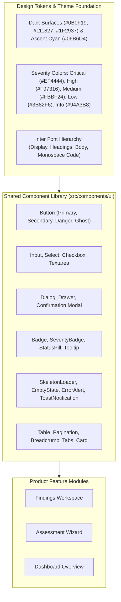

# FE-02 — KELVIN Design System & Shared Component Library

**Parent Epic:** [FE-EPIC-01: Complete KELVIN Frontend Application](FE-EPIC-01_DESIGN_AND_IMPLEMENT_COMPLETE_KELVIN_FRONTEND_APPLICATION.md) (Parent Epic #399)  
**Milestone:** [Frontend Development & Product Experience](../MILESTONE_FRONTEND.md)  
**Issue ID:** `FE-02`  
**Priority:** `critical`  
**Status:** `ready-for-dev`  

---

## 🎯 Purpose

Build a distinctive, professional enterprise cybersecurity design system and reusable, accessible component library based on Tailwind CSS and semantic design tokens.

---

## 📐 Architecture & Workflow Diagram

---

## 📋 Detailed Requirements

- Define cybersecurity-oriented design tokens: deep charcoal/navy background surfaces, restrained cyan/blue accents, and standard severity colors.
- Implement reusable accessible component primitives: Button (with loading spinner & variants), Input, Select, Checkbox, Textarea.
- Build accessible overlays: Dialog/Modal with focus trapping, Drawer, Confirmation Dialog, and Dropdown Menus.
- Build data display primitives: SeverityBadge (Critical, High, Medium, Low, Info), StatusPill (Queued, Running, Completed, Failed), Tooltip, Badge.
- Build feedback components: Skeleton loaders for tables/cards, EmptyState with illustrations/action buttons, ErrorBanner, and Toast notifications.
- Build tabular data components: Accessible Table with sorting headers, column customization, row selection, and Pagination controls.
- Integrate Lucide React icon set with consistent sizing and accessibility labeling.
- Ensure all primitives support keyboard navigation, visible focus rings (ring-offset), and reduced-motion media queries.

---

## 🛡️ Security & Architectural Invariants

- **Client-Side Data Integrity:** Form inputs must undergo strict validation before submission and reflect real backend states.
- **Sanitized Presentation:** All dynamic scanner results and evidence payloads must be sanitized to eliminate any XSS vulnerability risk.
- **Fail-Safe Error Boundaries:** Component crashes must be caught by React Error Boundaries without crashing the global application shell.
- **Responsive & Accessible:** Viewport reflow must support 320px to 1920px without horizontal scrollbars, complying with WCAG 2.2 Level AA.

---

## ✅ Acceptance Criteria

- [ ] All components conform to dark-mode enterprise cybersecurity styling without generic admin template aesthetics.
- [ ] Severity and status badge colors map 1:1 to canonical backend severity types.
- [ ] Dialogs and menus trap focus properly and close on Escape key.
- [ ] Component unit tests and storybook/spec tests verify rendering, variants, and accessibility attributes.

---

## 🔗 Related Documentation & Links

- Web Client Codebase: [`apps/web/`](../../../../apps/web/)
- Parent Milestone: [`MILESTONE_FRONTEND.md`](../MILESTONE_FRONTEND.md)
- Backend API Specification: [`docs/api/API_SPECIFICATION.md`](../../../../docs/api/API_SPECIFICATION.md)
