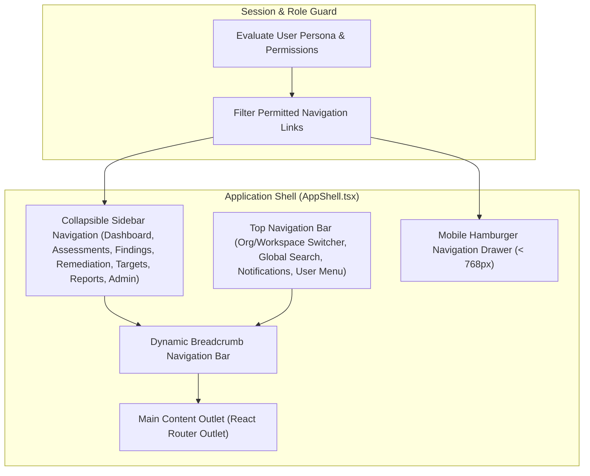

# FE-03 — Application Shell, Navigation & Responsive Layout

**Parent Epic:** [FE-EPIC-01: Complete KELVIN Frontend Application](FE-EPIC-01_DESIGN_AND_IMPLEMENT_COMPLETE_KELVIN_FRONTEND_APPLICATION.md) (Parent Epic #399)  
**Milestone:** [Frontend Development & Product Experience](../MILESTONE_FRONTEND.md)  
**Issue ID:** `FE-03`  
**Priority:** `critical`  
**Status:** `ready-for-dev`  

---

## 🎯 Purpose

Implement the responsive master application shell, sidebar navigation, tenant/workspace switcher, user menu, breadcrumbs, and route-level authorization boundaries.

---

## 📐 Architecture & Workflow Diagram

---

## 📋 Detailed Requirements

- Implement AppShell component containing top bar, collapsible sidebar navigation, breadcrumbs, and main viewport outlet.
- Provide hierarchical navigation groupings: Primary (Dashboard, Assessments, Findings, Remediation, Targets, Reports, Activity), Admin (Org, Teams, Roles, Policies, Integrations, API Keys, Usage), and Account.
- Implement Organization and Workspace Switcher dropdown reflecting the authenticated user's assigned tenants.
- Implement dynamic breadcrumb navigation derived from the active route hierarchy.
- Implement responsive mobile layout: hide desktop sidebar on viewports < 768px and provide touch-friendly mobile drawer with backdrop.
- Ensure navigation links dynamically hide or display according to user roles (e.g. hide Org Admin links from standard members).
- Integrate theme selector (dark-first default with system preference toggle) and notification indicator trigger.
- Implement user profile dropdown with account profile link, active tenant label, and secure Logout button.

---

## 🛡️ Security & Architectural Invariants

- **Client-Side Data Integrity:** Form inputs must undergo strict validation before submission and reflect real backend states.
- **Sanitized Presentation:** All dynamic scanner results and evidence payloads must be sanitized to eliminate any XSS vulnerability risk.
- **Fail-Safe Error Boundaries:** Component crashes must be caught by React Error Boundaries without crashing the global application shell.
- **Responsive & Accessible:** Viewport reflow must support 320px to 1920px without horizontal scrollbars, complying with WCAG 2.2 Level AA.

---

## ✅ Acceptance Criteria

- [ ] Sidebar collapses and expands smoothly with state persisted in local storage.
- [ ] Mobile drawer operates cleanly across 320px to 768px viewports with zero horizontal document overflow.
- [ ] Unpermitted navigation links are hidden from unauthorized user personas.
- [ ] Active route is clearly highlighted with accessible aria-current='page' indicator.

---

## 🔗 Related Documentation & Links

- Web Client Codebase: [`apps/web/`](../../../../apps/web/)
- Parent Milestone: [`MILESTONE_FRONTEND.md`](../MILESTONE_FRONTEND.md)
- Backend API Specification: [`docs/api/API_SPECIFICATION.md`](../../../../docs/api/API_SPECIFICATION.md)
