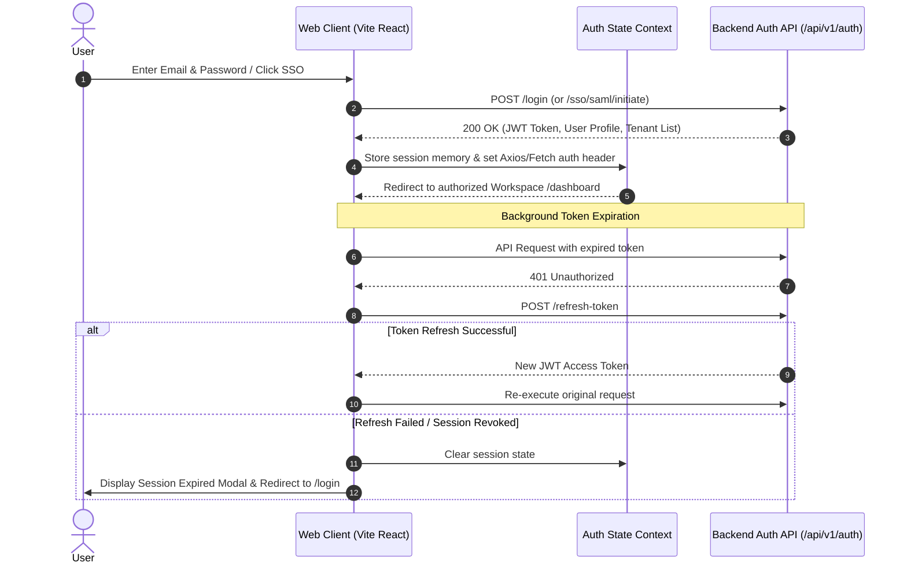

# FE-04 — Authentication & Account Management UI

**Parent Epic:** [FE-EPIC-01: Complete KELVIN Frontend Application](FE-EPIC-01_DESIGN_AND_IMPLEMENT_COMPLETE_KELVIN_FRONTEND_APPLICATION.md) (Parent Epic #399)  
**Milestone:** [Frontend Development & Product Experience](../MILESTONE_FRONTEND.md)  
**Issue ID:** `FE-04`  
**Priority:** `critical`  
**Status:** `ready-for-dev`  

---

## 🎯 Purpose

Deliver the end-to-end user authentication, enterprise SSO login redirects, token refresh, session lifecycle management, and account profile management interfaces.

---

## 📐 Architecture & Workflow Diagram

---

## 📋 Detailed Requirements

- Implement Login page with email/password authentication and enterprise Single Sign-On (SAML/OIDC) buttons.
- Implement OAuth/SAML SSO callback handler route (/auth/callback) to parse authentication redirect responses safely.
- Implement secure token management: store access tokens in memory or secure HTTP-only cookies; never persist sensitive secrets in localStorage.
- Implement automatic background token refresh flow and seamless request retry upon 401 response.
- Implement Session Expiration modal alerting user before abrupt logout with option to renew or re-authenticate.
- Implement Password Reset / Account Recovery request and reset confirmation workflows.
- Build User Account Profile view displaying personal info, assigned roles, active sessions, and password change form.
- Implement Access Denied (403 Forbidden) and Unauthorized (401) fallback screens explaining permission boundaries.

---

## 🛡️ Security & Architectural Invariants

- **Client-Side Data Integrity:** Form inputs must undergo strict validation before submission and reflect real backend states.
- **Sanitized Presentation:** All dynamic scanner results and evidence payloads must be sanitized to eliminate any XSS vulnerability risk.
- **Fail-Safe Error Boundaries:** Component crashes must be caught by React Error Boundaries without crashing the global application shell.
- **Responsive & Accessible:** Viewport reflow must support 320px to 1920px without horizontal scrollbars, complying with WCAG 2.2 Level AA.

---

## ✅ Acceptance Criteria

- [ ] User can successfully authenticate via credentials and mock/live SSO provider.
- [ ] Session expiration prompts the user gracefully without dropping unsaved form state where possible.
- [ ] Logout cleanly terminates server session and purges local query caches and tenant context.
- [ ] Protected routes automatically redirect unauthenticated visitors to /login with returnUrl preserved.

---

## 🔗 Related Documentation & Links

- Web Client Codebase: [`apps/web/`](../../../../apps/web/)
- Parent Milestone: [`MILESTONE_FRONTEND.md`](../MILESTONE_FRONTEND.md)
- Backend API Specification: [`docs/api/API_SPECIFICATION.md`](../../../../docs/api/API_SPECIFICATION.md)
