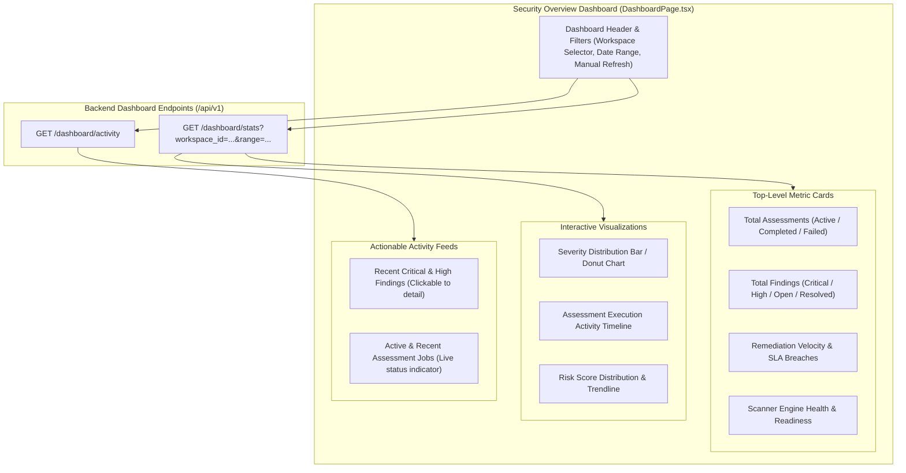

# FE-05 — Security Overview Dashboard

**Parent Epic:** [FE-EPIC-01: Complete KELVIN Frontend Application](FE-EPIC-01_DESIGN_AND_IMPLEMENT_COMPLETE_KELVIN_FRONTEND_APPLICATION.md) (Parent Epic #399)  
**Milestone:** [Frontend Development & Product Experience](../MILESTONE_FRONTEND.md)  
**Issue ID:** `FE-05`  
**Priority:** `critical`  
**Status:** `ready-for-dev`  

---

## 🎯 Purpose

Build a real-time, interactive executive security dashboard presenting vulnerability posture, active assessment metrics, severity distributions, and remediation SLA trends.

---

## 📐 Architecture & Workflow Diagram

---

## 📋 Detailed Requirements

- Connect the dashboard to real backend statistics endpoints with workspace-level scoping.
- Build high-level KPI cards: Total Assessments, Active Running Jobs, Total Findings, Critical/High Counts, SLA Breaches.
- Implement interactive severity distribution chart (Critical, High, Medium, Low, Info) utilizing an accessible charting library.
- Implement historical assessment activity timeline showing execution frequency and outcome trends.
- Implement Recent Critical Findings table showing latest verified issues with direct links to finding details.
- Implement Live Assessment Progress card showing ongoing scans with spinner and stage indicators.
- Provide global dashboard filters: Workspace selection, Date range (Last 7d, 30d, 90d, Custom), and manual refresh button.
- Implement robust skeleton loading states and zero-data empty states with actionable 'Start First Assessment' call-to-action.

---

## 🛡️ Security & Architectural Invariants

- **Client-Side Data Integrity:** Form inputs must undergo strict validation before submission and reflect real backend states.
- **Sanitized Presentation:** All dynamic scanner results and evidence payloads must be sanitized to eliminate any XSS vulnerability risk.
- **Fail-Safe Error Boundaries:** Component crashes must be caught by React Error Boundaries without crashing the global application shell.
- **Responsive & Accessible:** Viewport reflow must support 320px to 1920px without horizontal scrollbars, complying with WCAG 2.2 Level AA.

---

## ✅ Acceptance Criteria

- [ ] All metrics are calculated from real backend API data with zero hardcoded placeholder values.
- [ ] Charts resize responsively without layout shifts or text truncation across viewports.
- [ ] Changing workspace or date filter triggers immediate query invalidation and refetch.
- [ ] Empty state displays clear instructions when no assessments have been run in the tenant.

---

## 🔗 Related Documentation & Links

- Web Client Codebase: [`apps/web/`](../../../../apps/web/)
- Parent Milestone: [`MILESTONE_FRONTEND.md`](../MILESTONE_FRONTEND.md)
- Backend API Specification: [`docs/api/API_SPECIFICATION.md`](../../../../docs/api/API_SPECIFICATION.md)
