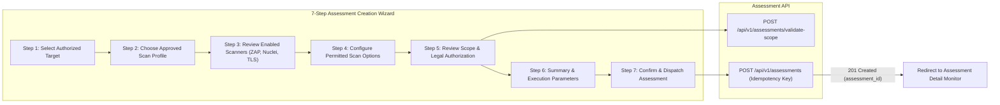

# FE-06 — Assessment Management & Creation Wizard

**Parent Epic:** [FE-EPIC-01: Complete KELVIN Frontend Application](FE-EPIC-01_DESIGN_AND_IMPLEMENT_COMPLETE_KELVIN_FRONTEND_APPLICATION.md) (Parent Epic #399)  
**Milestone:** [Frontend Development & Product Experience](../MILESTONE_FRONTEND.md)  
**Issue ID:** `FE-06`  
**Priority:** `critical`  
**Status:** `ready-for-dev`  

---

## 🎯 Purpose

Build the assessment management catalog and a controlled 7-step assessment creation wizard enforcing authorized scope boundaries, profile selection, and duplicate prevention.

---

## 📐 Architecture & Workflow Diagram

---

## 📋 Detailed Requirements

- Implement Assessment Catalog view displaying assessment ID, target, profile, trigger user, status badge, finding counts, duration, and actions.
- Implement comprehensive filtering (status, profile, date, target) and full-text search with pagination.
- Build 7-step Assessment Creation Wizard with linear step indicator and form validation at each step:
-   - Step 1: Target selector displaying only verified, authorized targets.
-   - Step 2: Assessment Profile selector (e.g. Web Baseline, Full Active, API Security) with descriptions.
-   - Step 3: Scanner capability inspection showing enabled tools (ZAP, Nuclei, HTTP Preflight, TLS).
-   - Step 4: Permitted options configuration (safe concurrency, custom headers, rate limits; no arbitrary shell injection).
-   - Step 5: Scope & Authorization confirmation requiring explicit checkbox acknowledgment.
-   - Step 6: Full summary review showing target, profile, timeout, and expected impact.
-   - Step 7: Final dispatch button with duplicate submission prevention via idempotency keys.
- Provide immediate cancellation and navigation back to catalog with confirmation prompt if form is dirty.

---

## 🛡️ Security & Architectural Invariants

- **Client-Side Data Integrity:** Form inputs must undergo strict validation before submission and reflect real backend states.
- **Sanitized Presentation:** All dynamic scanner results and evidence payloads must be sanitized to eliminate any XSS vulnerability risk.
- **Fail-Safe Error Boundaries:** Component crashes must be caught by React Error Boundaries without crashing the global application shell.
- **Responsive & Accessible:** Viewport reflow must support 320px to 1920px without horizontal scrollbars, complying with WCAG 2.2 Level AA.

---

## ✅ Acceptance Criteria

- [ ] Wizard prevents advancing to subsequent steps if required parameters are missing or invalid.
- [ ] Arbitrary shell commands or unsanitized flags cannot be submitted through the UI.
- [ ] Double-clicking submit button is prevented; duplicate submission returns existing job or blocks duplicate dispatch.
- [ ] Successful submission immediately transitions user to the live assessment execution monitor.

---

## 🔗 Related Documentation & Links

- Web Client Codebase: [`apps/web/`](../../../../apps/web/)
- Parent Milestone: [`MILESTONE_FRONTEND.md`](../MILESTONE_FRONTEND.md)
- Backend API Specification: [`docs/api/API_SPECIFICATION.md`](../../../../docs/api/API_SPECIFICATION.md)
