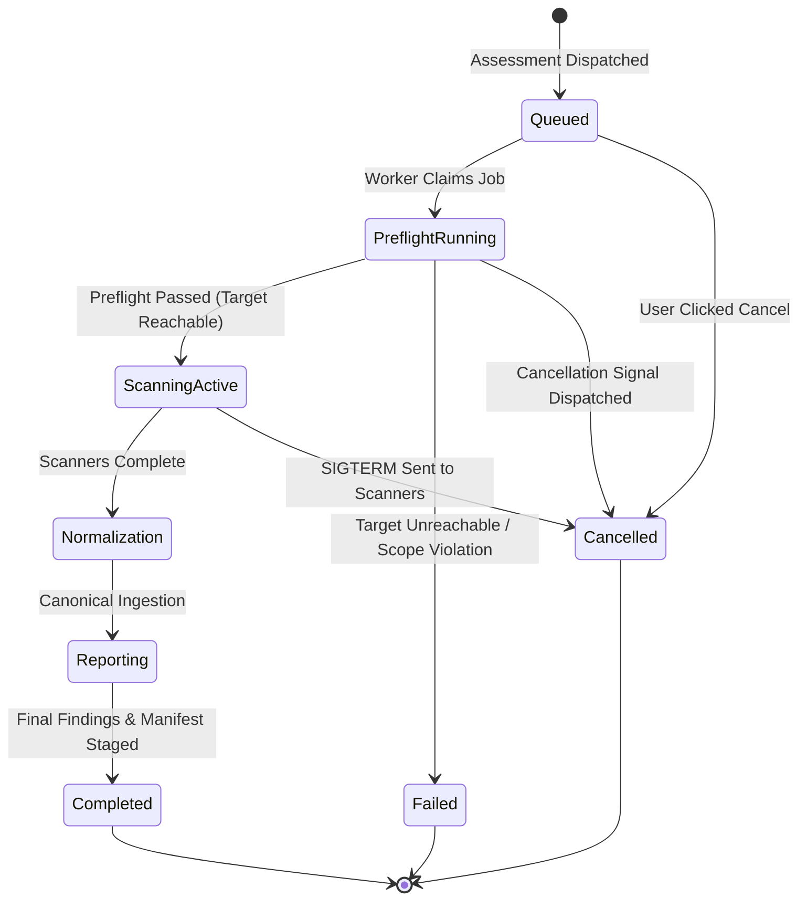

# FE-07 — Assessment Execution Monitoring & Details

**Parent Epic:** [FE-EPIC-01: Complete KELVIN Frontend Application](FE-EPIC-01_DESIGN_AND_IMPLEMENT_COMPLETE_KELVIN_FRONTEND_APPLICATION.md) (Parent Epic #399)  
**Milestone:** [Frontend Development & Product Experience](../MILESTONE_FRONTEND.md)  
**Issue ID:** `FE-07`  
**Priority:** `critical`  
**Status:** `ready-for-dev`  

---

## 🎯 Purpose

Deliver real-time assessment execution tracking, multi-stage progress indicators, streaming logs viewer, diagnostic warnings, cancellation controls, and post-run summary.

---

## 📐 Architecture & Workflow Diagram

---

## 📋 Detailed Requirements

- Build the Assessment Detail view displaying metadata, target host/IP, profile, timing, and current state.
- Implement a visual Multi-Stage Execution Timeline tracking stages: Queued -> Preflight -> Scanning -> Normalizing -> Completed.
- Implement polling/SSE state synchronization with automatic exponential backoff and cleanup on component unmount.
- Build real-time Scanner Progress cards showing per-scanner status (e.g. ZAP running, Nuclei queued, TLS completed).
- Build secure, read-only Execution Log viewer with autoscroll toggle, line numbers, search filter, and download logs button.
- Implement safe Cancel Assessment action requiring modal confirmation and displaying immediate cancelling state.
- Implement Retry Failed Assessment action for transient worker errors.
- Build Post-Run Summary tab summarizing execution duration, scanners executed, finding counts by severity, and links to findings.

---

## 🛡️ Security & Architectural Invariants

- **Client-Side Data Integrity:** Form inputs must undergo strict validation before submission and reflect real backend states.
- **Sanitized Presentation:** All dynamic scanner results and evidence payloads must be sanitized to eliminate any XSS vulnerability risk.
- **Fail-Safe Error Boundaries:** Component crashes must be caught by React Error Boundaries without crashing the global application shell.
- **Responsive & Accessible:** Viewport reflow must support 320px to 1920px without horizontal scrollbars, complying with WCAG 2.2 Level AA.

---

## ✅ Acceptance Criteria

- [ ] Polling stops automatically when assessment reaches terminal state (Completed, Failed, Cancelled).
- [ ] Never display fabricated progress percentages; show actual scanner stage or indeterminate animated pulses.
- [ ] Cancelling an assessment immediately disables action buttons and updates state without page reload.
- [ ] Logs viewer efficiently handles thousands of lines without UI freezing or memory leaks.

---

## 🔗 Related Documentation & Links

- Web Client Codebase: [`apps/web/`](../../../../apps/web/)
- Parent Milestone: [`MILESTONE_FRONTEND.md`](../MILESTONE_FRONTEND.md)
- Backend API Specification: [`docs/api/API_SPECIFICATION.md`](../../../../docs/api/API_SPECIFICATION.md)
