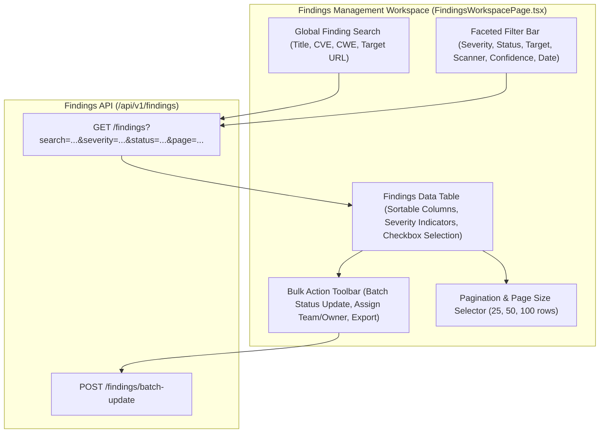

# FE-08 — Findings Management & Search Interface

**Parent Epic:** [FE-EPIC-01: Complete KELVIN Frontend Application](FE-EPIC-01_DESIGN_AND_IMPLEMENT_COMPLETE_KELVIN_FRONTEND_APPLICATION.md) (Parent Epic #399)  
**Milestone:** [Frontend Development & Product Experience](../MILESTONE_FRONTEND.md)  
**Issue ID:** `FE-08`  
**Priority:** `critical`  
**Status:** `ready-for-dev`  

---

## 🎯 Purpose

Build the enterprise findings explorer, multi-dimensional filtering, faceted search, bulk triage operations, and CSV/JSON export capabilities.

---

## 📐 Architecture & Workflow Diagram

---

## 📋 Detailed Requirements

- Implement the Findings Workspace table showing: Checkbox, ID, Title, Severity, Risk Score, Status, Target, Scanner, First Seen, Last Seen, Assignee.
- Implement comprehensive faceted filter controls: Severity (Critical, High, Medium, Low, Info), Status (Open, In Progress, Resolved, Accepted Risk, False Positive), Target Asset, Source Scanner, and Detection Date range.
- Implement real-time search with debounced keystroke handling searching title, CVE, CWE, and affected URL.
- Implement column sorting (by Severity weight, Risk Score, Last Detected, Title) with state reflected in URL query parameters.
- Implement Bulk Action toolbar appearing upon row selection allowing batch status transitions (e.g. Mark as False Positive, Assign Owner).
- Implement Findings Export feature supporting CSV, JSON, and filtered table export.
- Ensure empty search results display a clear 'No findings match your filters' message with a 'Reset Filters' button.

---

## 🛡️ Security & Architectural Invariants

- **Client-Side Data Integrity:** Form inputs must undergo strict validation before submission and reflect real backend states.
- **Sanitized Presentation:** All dynamic scanner results and evidence payloads must be sanitized to eliminate any XSS vulnerability risk.
- **Fail-Safe Error Boundaries:** Component crashes must be caught by React Error Boundaries without crashing the global application shell.
- **Responsive & Accessible:** Viewport reflow must support 320px to 1920px without horizontal scrollbars, complying with WCAG 2.2 Level AA.

---

## ✅ Acceptance Criteria

- [ ] Table smoothly renders up to 100 findings per page with quick sorting and pagination.
- [ ] URL search parameters stay perfectly synchronized with applied filters for bookmarking and sharing.
- [ ] Bulk status transitions require confirmation modal and update table data optimistically with rollback on failure.
- [ ] Keyboard shortcuts (arrow navigation, select all) enhance analyst triage efficiency.

---

## 🔗 Related Documentation & Links

- Web Client Codebase: [`apps/web/`](../../../../apps/web/)
- Parent Milestone: [`MILESTONE_FRONTEND.md`](../MILESTONE_FRONTEND.md)
- Backend API Specification: [`docs/api/API_SPECIFICATION.md`](../../../../docs/api/API_SPECIFICATION.md)
