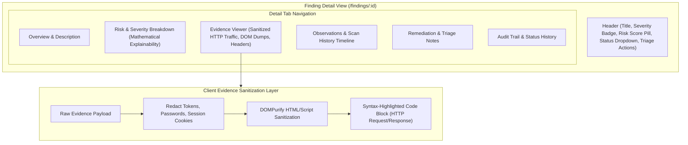

# FE-09 — Finding Detail & Evidence Viewer

**Parent Epic:** [FE-EPIC-01: Complete KELVIN Frontend Application](FE-EPIC-01_DESIGN_AND_IMPLEMENT_COMPLETE_KELVIN_FRONTEND_APPLICATION.md) (Parent Epic #399)  
**Milestone:** [Frontend Development & Product Experience](../MILESTONE_FRONTEND.md)  
**Issue ID:** `FE-09`  
**Priority:** `critical`  
**Status:** `ready-for-dev`  

---

## 🎯 Purpose

Deliver the in-depth finding detail view, explainable risk score calculator display, detection provenance, historical observations timeline, and sanitized evidence viewer.

---

## 📐 Architecture & Workflow Diagram

---

## 📋 Detailed Requirements

- Implement Finding Detail view with organized tabs: Overview, Risk Explainability, Evidence, Historical Observations, Remediation, and Activity.
- Build Risk Score Explainability card breaking down the composite score into its constituent factors (CVSS Base, Asset Criticality, Confidence Factor, Exposure).
- Build Evidence Viewer rendering raw HTTP request/response payloads, parameter reflections, and scanner outputs with syntax highlighting.
- Enforce strict client-side evidence sanitization: strip executable scripts, sanitize untrusted HTML via DOMPurify, and visually redact sensitive tokens.
- Implement Historical Observations Timeline showing recurrence across past assessment runs with date, scan ID, and status change.
- Build Triage Action bar allowing authorized analysts to transition finding state (Open -> In Progress -> Resolved / Accepted Risk / False Positive) with mandatory reasoning note.
- Support inline assignment to team members and remediation due date picker with SLA breach alerts.

---

## 🛡️ Security & Architectural Invariants

- **Client-Side Data Integrity:** Form inputs must undergo strict validation before submission and reflect real backend states.
- **Sanitized Presentation:** All dynamic scanner results and evidence payloads must be sanitized to eliminate any XSS vulnerability risk.
- **Fail-Safe Error Boundaries:** Component crashes must be caught by React Error Boundaries without crashing the global application shell.
- **Responsive & Accessible:** Viewport reflow must support 320px to 1920px without horizontal scrollbars, complying with WCAG 2.2 Level AA.

---

## ✅ Acceptance Criteria

- [ ] Untrusted scanner payloads containing XSS payloads () render purely as inert text/code blocks.
- [ ] Status changes enforce validation rules (e.g. False Positive requires explanatory justification).
- [ ] Risk explainability formula visually matches the canonical risk calculation implemented in Phase 3 backend.
- [ ] Sensitive credentials and session cookies in evidence are visibly masked with redaction indicators.

---

## 🔗 Related Documentation & Links

- Web Client Codebase: [`apps/web/`](../../../../apps/web/)
- Parent Milestone: [`MILESTONE_FRONTEND.md`](../MILESTONE_FRONTEND.md)
- Backend API Specification: [`docs/api/API_SPECIFICATION.md`](../../../../docs/api/API_SPECIFICATION.md)
