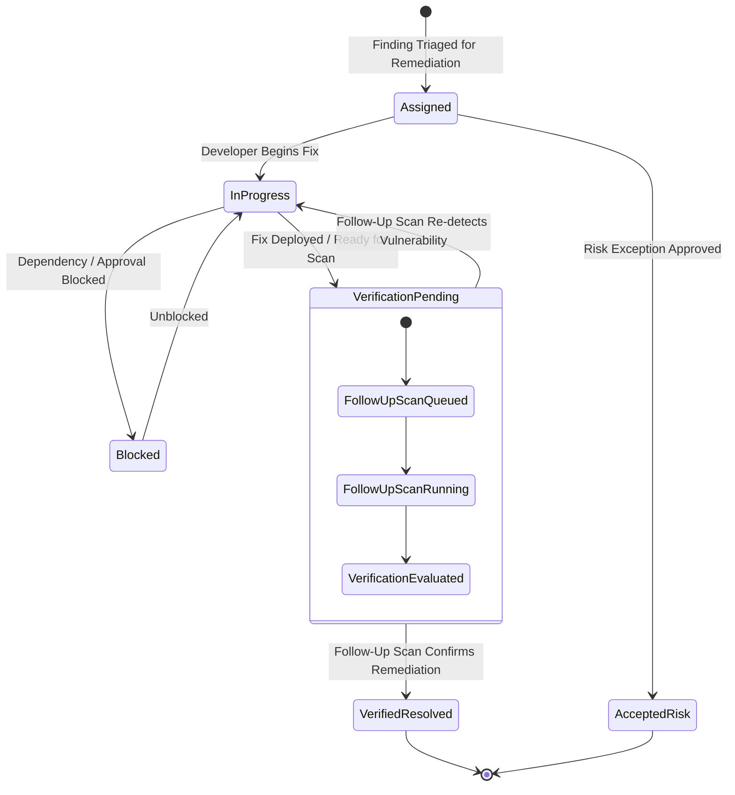

# FE-10 — Remediation Management Workspace

**Parent Epic:** [FE-EPIC-01: Complete KELVIN Frontend Application](FE-EPIC-01_DESIGN_AND_IMPLEMENT_COMPLETE_KELVIN_FRONTEND_APPLICATION.md) (Parent Epic #399)  
**Milestone:** [Frontend Development & Product Experience](../MILESTONE_FRONTEND.md)  
**Issue ID:** `FE-10`  
**Priority:** `high`  
**Status:** `ready-for-dev`  

---

## 🎯 Purpose

Implement the remediation tracking workspace with interactive List and Kanban views, owner assignment, SLA countdown timers, and automated verification triggers.

---

## 📐 Architecture & Workflow Diagram

---

## 📋 Detailed Requirements

- Build Remediation Workspace offering both List View and Kanban Board View (columns: Open, In Progress, Blocked, Ready for Verification, Resolved, Accepted Risk).
- Support drag-and-drop or status selector transitions between Kanban columns with permission checking.
- Display remediation task cards with finding title, severity, assigned owner avatar, target, and dynamic SLA Countdown timer (highlighting overdue tasks in red).
- Implement Task Detail modal/drawer showing remediation guidelines, reference links, associated commit/PR inputs, and notes thread.
- Implement 'Verify Remediation' action button that triggers an authorized follow-up assessment focused specifically on the remediated target and rule.
- Ensure tasks marked 'Resolved' clearly indicate verification status (Self-Reported vs. Verified by Assessment).
- Provide filtering by Assignee, Team, SLA Breach status, Severity, and Target.

---

## 🛡️ Security & Architectural Invariants

- **Client-Side Data Integrity:** Form inputs must undergo strict validation before submission and reflect real backend states.
- **Sanitized Presentation:** All dynamic scanner results and evidence payloads must be sanitized to eliminate any XSS vulnerability risk.
- **Fail-Safe Error Boundaries:** Component crashes must be caught by React Error Boundaries without crashing the global application shell.
- **Responsive & Accessible:** Viewport reflow must support 320px to 1920px without horizontal scrollbars, complying with WCAG 2.2 Level AA.

---

## ✅ Acceptance Criteria

- [ ] Kanban card drag-and-drop triggers backend status update and updates UI optimistically.
- [ ] SLA timer accurately reflects time remaining based on organization SLA policy rules.
- [ ] Follow-up verification action prevents duplicate scan execution if verification is already in progress.
- [ ] Clear distinction is maintained between an analyst closing a ticket and an automated scan verifying resolution.

---

## 🔗 Related Documentation & Links

- Web Client Codebase: [`apps/web/`](../../../../apps/web/)
- Parent Milestone: [`MILESTONE_FRONTEND.md`](../MILESTONE_FRONTEND.md)
- Backend API Specification: [`docs/api/API_SPECIFICATION.md`](../../../../docs/api/API_SPECIFICATION.md)
