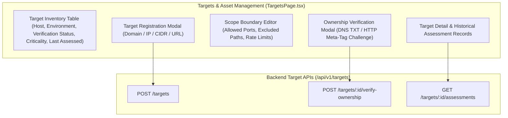

# FE-11 — Targets & Asset Management

**Parent Epic:** [FE-EPIC-01: Complete KELVIN Frontend Application](FE-EPIC-01_DESIGN_AND_IMPLEMENT_COMPLETE_KELVIN_FRONTEND_APPLICATION.md) (Parent Epic #399)  
**Milestone:** [Frontend Development & Product Experience](../MILESTONE_FRONTEND.md)  
**Issue ID:** `FE-11`  
**Priority:** `critical`  
**Status:** `ready-for-dev`  

---

## 🎯 Purpose

Build the target registry and asset management interface for onboarding authorized assessment domains, verifying ownership, and defining strict execution scope boundaries.

---

## 📐 Architecture & Workflow Diagram

---

## 📋 Detailed Requirements

- Implement Target Inventory Table displaying Target Host/URL, Environment (Production, Staging, Dev), Criticality (Tier 1 to 4), Ownership Status (Verified, Pending), and Open Finding counts.
- Build Target Registration Modal supporting single domains, IPs, URLs, and CIDR ranges with strict input syntax validation.
- Implement Target Ownership Verification interface providing DNS TXT challenge string or HTTP meta-tag challenge with a 'Check Verification' button.
- Implement Scope Boundary Configuration tab allowing administrators to define allowed port ranges, excluded subpaths (e.g. /logout, /admin/delete), and max requests per second.
- Implement Target Detail page displaying target profile, associated assessment history, discovery timeline, and active findings.
- Enforce that unverified targets display a prominent warning banner and cannot be selected in the Assessment Creation Wizard.

---

## 🛡️ Security & Architectural Invariants

- **Client-Side Data Integrity:** Form inputs must undergo strict validation before submission and reflect real backend states.
- **Sanitized Presentation:** All dynamic scanner results and evidence payloads must be sanitized to eliminate any XSS vulnerability risk.
- **Fail-Safe Error Boundaries:** Component crashes must be caught by React Error Boundaries without crashing the global application shell.
- **Responsive & Accessible:** Viewport reflow must support 320px to 1920px without horizontal scrollbars, complying with WCAG 2.2 Level AA.

---

## ✅ Acceptance Criteria

- [ ] Target inputs reject invalid schemes, malicious characters, or out-of-scope private addresses without proper authorization.
- [ ] Ownership verification triggers DNS challenge verification and updates status pill without page reload.
- [ ] Scope exclusion rules are clearly visualized with syntax preview (regex / glob path patterns).
- [ ] Delete or archive target requires confirmation and warns if active running assessments exist.

---

## 🔗 Related Documentation & Links

- Web Client Codebase: [`apps/web/`](../../../../apps/web/)
- Parent Milestone: [`MILESTONE_FRONTEND.md`](../MILESTONE_FRONTEND.md)
- Backend API Specification: [`docs/api/API_SPECIFICATION.md`](../../../../docs/api/API_SPECIFICATION.md)
