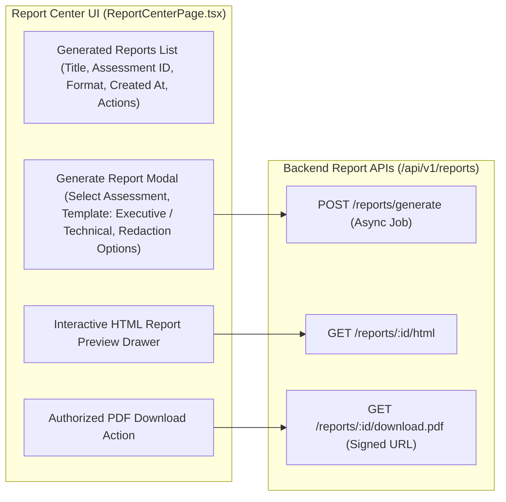

# FE-12 — Assessment Reports & PDF Viewer

**Parent Epic:** [FE-EPIC-01: Complete KELVIN Frontend Application](FE-EPIC-01_DESIGN_AND_IMPLEMENT_COMPLETE_KELVIN_FRONTEND_APPLICATION.md) (Parent Epic #399)  
**Milestone:** [Frontend Development & Product Experience](../MILESTONE_FRONTEND.md)  
**Issue ID:** `FE-12`  
**Priority:** `high`  
**Status:** `ready-for-dev`  

---

## 🎯 Purpose

Implement the assessment reporting center, on-demand report generation wizard, embedded responsive HTML report previewer, and authorized PDF download workflows.

---

## 📐 Architecture & Workflow Diagram

---

## 📋 Detailed Requirements

- Build Report Center listing previously generated assessment reports with metadata: Title, Target, Assessment ID, Template Type, Generation Date, and Status.
- Implement Generate Report modal allowing users to select an assessment, choose a report template (Executive Summary, Technical Vulnerability Report, Compliance Audit), and toggle sensitive evidence redaction.
- Build an embedded, responsive HTML Report Preview drawer allowing users to review report contents before exporting.
- Implement PDF export button that requests a pre-signed, authorized download URL and triggers browser file download with progress feedback.
- Display report generation progress indicator for long-running asynchronous report rendering.
- Ensure report preview renders executive risk charts, severity breakdown tables, and finding summaries accurately according to print stylesheets.

---

## 🛡️ Security & Architectural Invariants

- **Client-Side Data Integrity:** Form inputs must undergo strict validation before submission and reflect real backend states.
- **Sanitized Presentation:** All dynamic scanner results and evidence payloads must be sanitized to eliminate any XSS vulnerability risk.
- **Fail-Safe Error Boundaries:** Component crashes must be caught by React Error Boundaries without crashing the global application shell.
- **Responsive & Accessible:** Viewport reflow must support 320px to 1920px without horizontal scrollbars, complying with WCAG 2.2 Level AA.

---

## ✅ Acceptance Criteria

- [ ] Report generation shows active loading state and polls for report completion without freezing UI.
- [ ] HTML preview renders cleanly within an isolated, sandboxed container preventing CSS bleed.
- [ ] PDF download uses secure, authenticated endpoints and verifies user has report read permissions.
- [ ] Redacted reports hide all sensitive request/response tokens and credentials.

---

## 🔗 Related Documentation & Links

- Web Client Codebase: [`apps/web/`](../../../../apps/web/)
- Parent Milestone: [`MILESTONE_FRONTEND.md`](../MILESTONE_FRONTEND.md)
- Backend API Specification: [`docs/api/API_SPECIFICATION.md`](../../../../docs/api/API_SPECIFICATION.md)
