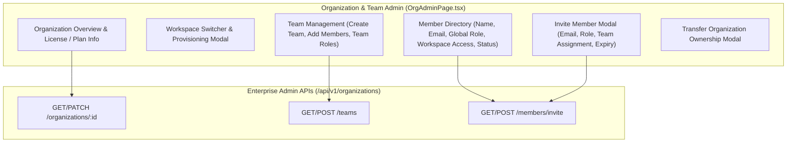

# FE-13 — Organization & Team Management

**Parent Epic:** [FE-EPIC-01: Complete KELVIN Frontend Application](FE-EPIC-01_DESIGN_AND_IMPLEMENT_COMPLETE_KELVIN_FRONTEND_APPLICATION.md) (Parent Epic #399)  
**Milestone:** [Frontend Development & Product Experience](../MILESTONE_FRONTEND.md)  
**Issue ID:** `FE-13`  
**Priority:** `high`  
**Status:** `ready-for-dev`  

---

## 🎯 Purpose

Build administrative interfaces for enterprise organization settings, workspace provisioning, team management, member invitations, and cross-team resource sharing.

---

## 📐 Architecture & Workflow Diagram

---

## 📋 Detailed Requirements

- Implement Organization Overview tab displaying organization name, slug, domain, creation date, and active workspace count.
- Implement Workspace Management tab allowing organization administrators to create, edit, suspend, and configure isolated workspaces.
- Implement Member Directory table showing member avatar, name, email, global role, assigned workspaces, two-factor status, and actions.
- Build Invite Member modal supporting email invitations with role selection (Admin, Analyst, Member, Auditor), workspace assignments, and expiration window.
- Build Team Management interface allowing creation of cross-functional teams (e.g. SecOps, Backend Team) and assigning targets or findings to teams.
- Implement Member Removal and Role Update workflows with confirmation dialogs and self-demotion prevention.
- Implement Organization Ownership Transfer modal with strict double-confirmation safeguards.

---

## 🛡️ Security & Architectural Invariants

- **Client-Side Data Integrity:** Form inputs must undergo strict validation before submission and reflect real backend states.
- **Sanitized Presentation:** All dynamic scanner results and evidence payloads must be sanitized to eliminate any XSS vulnerability risk.
- **Fail-Safe Error Boundaries:** Component crashes must be caught by React Error Boundaries without crashing the global application shell.
- **Responsive & Accessible:** Viewport reflow must support 320px to 1920px without horizontal scrollbars, complying with WCAG 2.2 Level AA.

---

## ✅ Acceptance Criteria

- [ ] All administrative screens are gated by organization admin authorization checks.
- [ ] Inviting members sends invitation request to backend and updates member directory in pending state.
- [ ] Removing a member revokes access immediately and reassigns or disassociates orphaned resources according to policy.
- [ ] UI prevents removing the last organization owner.

---

## 🔗 Related Documentation & Links

- Web Client Codebase: [`apps/web/`](../../../../apps/web/)
- Parent Milestone: [`MILESTONE_FRONTEND.md`](../MILESTONE_FRONTEND.md)
- Backend API Specification: [`docs/api/API_SPECIFICATION.md`](../../../../docs/api/API_SPECIFICATION.md)
