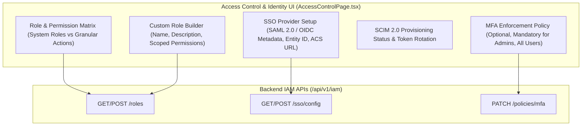

# FE-14 — Roles, Permissions & SSO Management UI

**Parent Epic:** [FE-EPIC-01: Complete KELVIN Frontend Application](FE-EPIC-01_DESIGN_AND_IMPLEMENT_COMPLETE_KELVIN_FRONTEND_APPLICATION.md) (Parent Epic #399)  
**Milestone:** [Frontend Development & Product Experience](../MILESTONE_FRONTEND.md)  
**Issue ID:** `FE-14`  
**Priority:** `high`  
**Status:** `ready-for-dev`  

---

## 🎯 Purpose

Implement the role-based access control (RBAC) permission matrix, custom role editor, SAML 2.0 / OIDC Single Sign-On configuration forms, and SCIM provisioning status viewers.

---

## 📐 Architecture & Workflow Diagram

---

## 📋 Detailed Requirements

- Implement Interactive Permission Matrix displaying standard roles (Admin, Security Analyst, Team Lead, Member, Auditor) against granular platform permissions.
- Build Custom Role Creator allowing administrators to compose custom roles by selecting fine-grained permission checkboxes (e.g. assessments:create, findings:suppress).
- Build SAML 2.0 Configuration Form with fields for IdP Entity ID, SSO URL, X.509 Certificate, and automatic metadata XML file upload.
- Build OpenID Connect (OIDC) Configuration Form with Client ID, Client Secret, Discovery URL, and Scope inputs.
- Display SP Metadata and Assertion Consumer Service (ACS) URLs with one-click copy buttons for easy IdP registration.
- Implement Enterprise MFA Policy configuration toggles: Optional, Enforced for Administrators, or Enforced for All Organization Members.
- Implement SCIM 2.0 provisioning dashboard displaying active synced groups, last sync timestamp, and SCIM token rotation modal.

---

## 🛡️ Security & Architectural Invariants

- **Client-Side Data Integrity:** Form inputs must undergo strict validation before submission and reflect real backend states.
- **Sanitized Presentation:** All dynamic scanner results and evidence payloads must be sanitized to eliminate any XSS vulnerability risk.
- **Fail-Safe Error Boundaries:** Component crashes must be caught by React Error Boundaries without crashing the global application shell.
- **Responsive & Accessible:** Viewport reflow must support 320px to 1920px without horizontal scrollbars, complying with WCAG 2.2 Level AA.

---

## ✅ Acceptance Criteria

- [ ] Permission matrix visually distinguishes system immutable roles from editable custom roles.
- [ ] SAML/OIDC forms validate URLs and X.509 certificate structure before submitting to backend.
- [ ] Client secrets in SSO forms are masked by default with reveal toggle and never logged in console.
- [ ] Enforcing MFA policy updates tenant configuration and warns about affected active sessions.

---

## 🔗 Related Documentation & Links

- Web Client Codebase: [`apps/web/`](../../../../apps/web/)
- Parent Milestone: [`MILESTONE_FRONTEND.md`](../MILESTONE_FRONTEND.md)
- Backend API Specification: [`docs/api/API_SPECIFICATION.md`](../../../../docs/api/API_SPECIFICATION.md)
