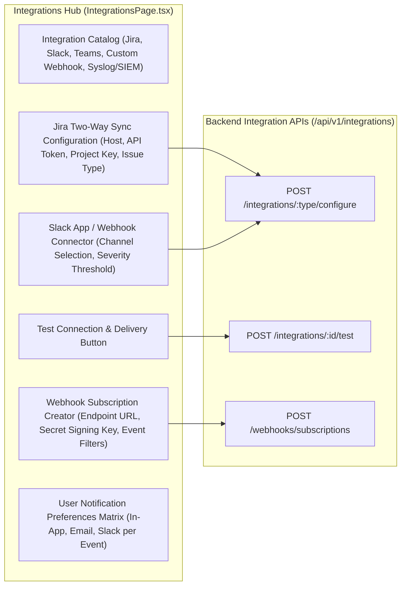

# FE-15 — Integrations & Notification Center

**Parent Epic:** [FE-EPIC-01: Complete KELVIN Frontend Application](FE-EPIC-01_DESIGN_AND_IMPLEMENT_COMPLETE_KELVIN_FRONTEND_APPLICATION.md) (Parent Epic #399)  
**Milestone:** [Frontend Development & Product Experience](../MILESTONE_FRONTEND.md)  
**Issue ID:** `FE-15`  
**Priority:** `high`  
**Status:** `ready-for-dev`  

---

## 🎯 Purpose

Build the enterprise integration hub (Jira, Slack, Microsoft Teams, Webhooks, SIEM) and a centralized notification preference center.

---

## 📐 Architecture & Workflow Diagram

---

## 📋 Detailed Requirements

- Build Integration Catalog displaying available enterprise connectors with status badges (Connected, Disconnected, Error, Not Configured).
- Implement Jira Integration Modal with fields for Jira Base URL, Username, API Token, Project Key, Default Issue Type, and bi-directional status mapping.
- Implement Slack & Microsoft Teams notification setup modals with incoming webhook URLs and notification channel rules.
- Implement Outbound Webhook Subscription manager allowing users to register webhook endpoints, select subscribed events (e.g. assessment.completed, finding.critical_detected), and generate HMAC signing secrets.
- Implement 'Test Delivery' action button on all integrations sending a ping event and displaying immediate success or diagnostic error logs.
- Build Central Notification Preferences matrix allowing users to configure delivery channels (In-App notification, Email, Slack) across different event severities.

---

## 🛡️ Security & Architectural Invariants

- **Client-Side Data Integrity:** Form inputs must undergo strict validation before submission and reflect real backend states.
- **Sanitized Presentation:** All dynamic scanner results and evidence payloads must be sanitized to eliminate any XSS vulnerability risk.
- **Fail-Safe Error Boundaries:** Component crashes must be caught by React Error Boundaries without crashing the global application shell.
- **Responsive & Accessible:** Viewport reflow must support 320px to 1920px without horizontal scrollbars, complying with WCAG 2.2 Level AA.

---

## ✅ Acceptance Criteria

- [ ] Integration secrets (Jira API tokens, webhook signing keys) are masked and securely transmitted over HTTPS.
- [ ] Test connection triggers immediate real-time feedback with HTTP status code and response payload preview.
- [ ] Webhook event selector allows selecting individual granular event types with clear descriptions.
- [ ] Notification preferences persist to backend and take effect immediately.

---

## 🔗 Related Documentation & Links

- Web Client Codebase: [`apps/web/`](../../../../apps/web/)
- Parent Milestone: [`MILESTONE_FRONTEND.md`](../MILESTONE_FRONTEND.md)
- Backend API Specification: [`docs/api/API_SPECIFICATION.md`](../../../../docs/api/API_SPECIFICATION.md)
