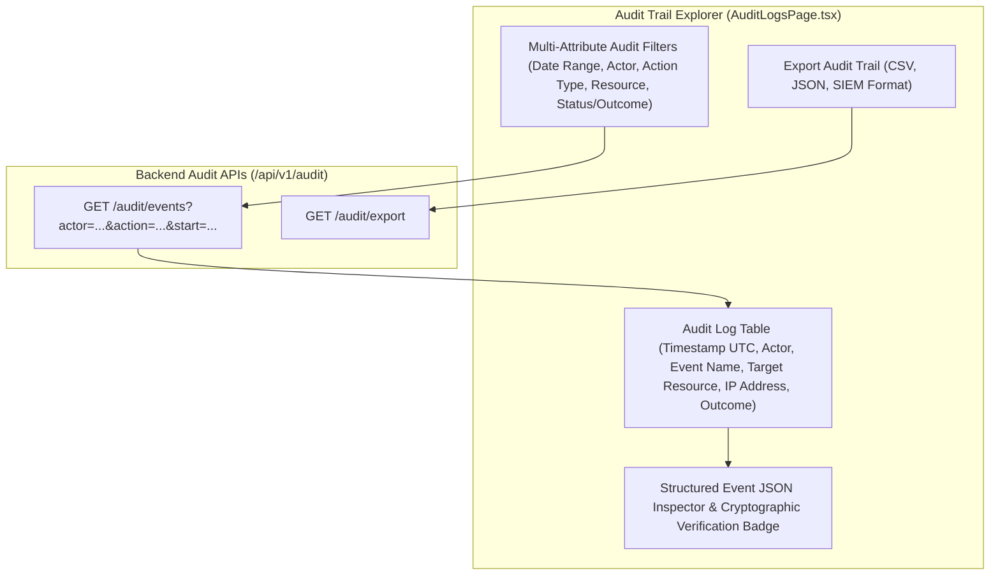

# FE-16 — Audit Logs & Activity Interface

**Parent Epic:** [FE-EPIC-01: Complete KELVIN Frontend Application](FE-EPIC-01_DESIGN_AND_IMPLEMENT_COMPLETE_KELVIN_FRONTEND_APPLICATION.md) (Parent Epic #399)  
**Milestone:** [Frontend Development & Product Experience](../MILESTONE_FRONTEND.md)  
**Issue ID:** `FE-16`  
**Priority:** `high`  
**Status:** `ready-for-dev`  

---

## 🎯 Purpose

Implement the read-only, tamper-evident audit log trail explorer, event detail inspector, multi-attribute filter suite, and audit export capabilities.

---

## 📐 Architecture & Workflow Diagram

---

## 📋 Detailed Requirements

- Build Audit Trail Explorer table showing: Timestamp (UTC and local), Actor (User / Service Account), Action Name, Target Resource, IP Address, Outcome (Success / Failure), and Correlation ID.
- Implement robust filter controls: Date/time range picker, Actor search, Action categorization (Auth, Assessment, Finding Triage, Policy Change, Admin), and Outcome filter.
- Build Audit Event Detail drawer displaying full structured event payload in syntax-highlighted JSON, user agent, and tenant context.
- Display Cryptographic Verification status badge indicating whether the audit record's HMAC / cryptographic hash matches tamper-evident chain verification.
- Implement Audit Export feature supporting filtered CSV and NDJSON downloads for compliance and security auditor workflows.
- Ensure audit interface is strictly read-only: no edit, delete, or mutation controls exist anywhere in the UI.

---

## 🛡️ Security & Architectural Invariants

- **Client-Side Data Integrity:** Form inputs must undergo strict validation before submission and reflect real backend states.
- **Sanitized Presentation:** All dynamic scanner results and evidence payloads must be sanitized to eliminate any XSS vulnerability risk.
- **Fail-Safe Error Boundaries:** Component crashes must be caught by React Error Boundaries without crashing the global application shell.
- **Responsive & Accessible:** Viewport reflow must support 320px to 1920px without horizontal scrollbars, complying with WCAG 2.2 Level AA.

---

## ✅ Acceptance Criteria

- [ ] Audit table pagination and filtering perform efficiently over high-volume log streams.
- [ ] Event detail drawer displays complete metadata without truncating critical security parameters.
- [ ] Tamper-evident verification badge clearly displays verification outcome.
- [ ] Export operations stream data cleanly without client-side memory exhaustion.

---

## 🔗 Related Documentation & Links

- Web Client Codebase: [`apps/web/`](../../../../apps/web/)
- Parent Milestone: [`MILESTONE_FRONTEND.md`](../MILESTONE_FRONTEND.md)
- Backend API Specification: [`docs/api/API_SPECIFICATION.md`](../../../../docs/api/API_SPECIFICATION.md)
