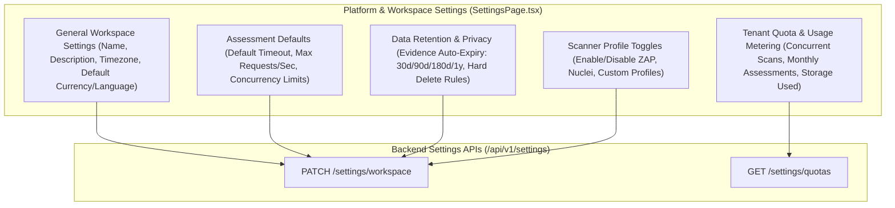

# FE-17 — Workspace & Platform Settings

**Parent Epic:** [FE-EPIC-01: Complete KELVIN Frontend Application](FE-EPIC-01_DESIGN_AND_IMPLEMENT_COMPLETE_KELVIN_FRONTEND_APPLICATION.md) (Parent Epic #399)  
**Milestone:** [Frontend Development & Product Experience](../MILESTONE_FRONTEND.md)  
**Issue ID:** `FE-17`  
**Priority:** `high`  
**Status:** `ready-for-dev`  

---

## 🎯 Purpose

Build administrative settings pages for workspace configurations, assessment defaults, evidence retention policies, scanner profile availability, and quota usage monitoring.

---

## 📐 Architecture & Workflow Diagram

---

## 📋 Detailed Requirements

- Implement General Workspace Settings tab allowing authorized workspace admins to edit workspace name, slug, timezone, and contact email.
- Implement Assessment Execution Defaults tab for setting default request pacing, execution deadlines, and concurrent job limits.
- Implement Data Retention & Privacy Settings tab allowing admins to configure evidence retention periods (30, 90, 180, 365 days) and auto-redaction rules.
- Implement Scanner Profile Management tab enabling or disabling specific scanner engines or templates at the workspace level.
- Build Tenant Quota & Usage Metering card displaying visual progress bars for monthly assessment limits, active concurrency slots, and evidence storage consumption.
- Ensure destructive settings (e.g. Purge Expired Evidence, Delete Workspace) require strict two-step confirmation with typed confirmation string.

---

## 🛡️ Security & Architectural Invariants

- **Client-Side Data Integrity:** Form inputs must undergo strict validation before submission and reflect real backend states.
- **Sanitized Presentation:** All dynamic scanner results and evidence payloads must be sanitized to eliminate any XSS vulnerability risk.
- **Fail-Safe Error Boundaries:** Component crashes must be caught by React Error Boundaries without crashing the global application shell.
- **Responsive & Accessible:** Viewport reflow must support 320px to 1920px without horizontal scrollbars, complying with WCAG 2.2 Level AA.

---

## ✅ Acceptance Criteria

- [ ] Settings changes validate inputs client-side and display clear success/error toast notifications.
- [ ] Usage progress bars dynamically change colors when approaching quota thresholds (>80% warning, >95% critical).
- [ ] Destructive actions cannot be triggered accidentally and verify admin authorization.
- [ ] Form changes prompt user if navigating away with unsaved modifications.

---

## 🔗 Related Documentation & Links

- Web Client Codebase: [`apps/web/`](../../../../apps/web/)
- Parent Milestone: [`MILESTONE_FRONTEND.md`](../MILESTONE_FRONTEND.md)
- Backend API Specification: [`docs/api/API_SPECIFICATION.md`](../../../../docs/api/API_SPECIFICATION.md)
