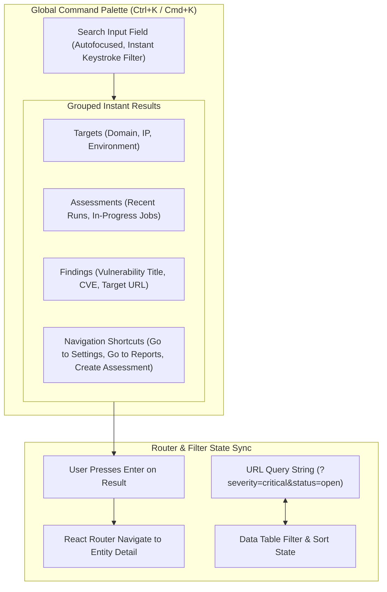

# FE-18 — Global Search, Filters & Data Navigation

**Parent Epic:** [FE-EPIC-01: Complete KELVIN Frontend Application](FE-EPIC-01_DESIGN_AND_IMPLEMENT_COMPLETE_KELVIN_FRONTEND_APPLICATION.md) (Parent Epic #399)  
**Milestone:** [Frontend Development & Product Experience](../MILESTONE_FRONTEND.md)  
**Issue ID:** `FE-18`  
**Priority:** `high`  
**Status:** `ready-for-dev`  

---

## 🎯 Purpose

Implement the platform-wide omnibar command palette (Ctrl+K / Cmd+K), global entity search, URL filter synchronization, and keyboard-driven data navigation.

---

## 📐 Architecture & Workflow Diagram

---

## 📋 Detailed Requirements

- Implement a Command Palette / Omnibar modal accessible via global shortcut (Ctrl+K / Cmd+K) or top bar search button.
- Support instant multi-entity search querying Targets, Assessments, Findings, Reports, and Admin Pages concurrently with debounced requests.
- Group search results logically: Navigation Actions, Recent Findings, Targets, and Active Assessments with distinct icons.
- Provide full keyboard navigation inside the palette (Arrow Up/Down to highlight, Enter to select, Escape to close).
- Implement bidirectional URL query string synchronization for all data tables: filtering, sorting, and pagination state must reflect in URL search params.
- Ensure users can bookmark, refresh, and share filtered table URLs with colleagues without losing filter criteria.
- Implement breadcrumb trail navigation allowing quick upward navigation through hierarchy (e.g. Home > Targets > api.example.com > Assessments > Scan #104 > Finding #22).

---

## 🛡️ Security & Architectural Invariants

- **Client-Side Data Integrity:** Form inputs must undergo strict validation before submission and reflect real backend states.
- **Sanitized Presentation:** All dynamic scanner results and evidence payloads must be sanitized to eliminate any XSS vulnerability risk.
- **Fail-Safe Error Boundaries:** Component crashes must be caught by React Error Boundaries without crashing the global application shell.
- **Responsive & Accessible:** Viewport reflow must support 320px to 1920px without horizontal scrollbars, complying with WCAG 2.2 Level AA.

---

## ✅ Acceptance Criteria

- [ ] Command palette opens instantaneously (<100ms) and traps focus cleanly.
- [ ] Navigating results via arrow keys scrolls results container automatically.
- [ ] Sharing a URL with complex query parameters loads the exact filtered state on a fresh browser tab.
- [ ] Search input handles empty states and special characters gracefully.

---

## 🔗 Related Documentation & Links

- Web Client Codebase: [`apps/web/`](../../../../apps/web/)
- Parent Milestone: [`MILESTONE_FRONTEND.md`](../MILESTONE_FRONTEND.md)
- Backend API Specification: [`docs/api/API_SPECIFICATION.md`](../../../../docs/api/API_SPECIFICATION.md)
