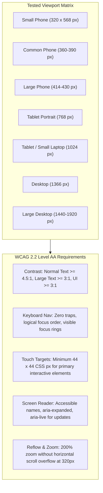

# FE-19 — Frontend Accessibility & Responsive Optimization

**Parent Epic:** [FE-EPIC-01: Complete KELVIN Frontend Application](FE-EPIC-01_DESIGN_AND_IMPLEMENT_COMPLETE_KELVIN_FRONTEND_APPLICATION.md) (Parent Epic #399)  
**Milestone:** [Frontend Development & Product Experience](../MILESTONE_FRONTEND.md)  
**Issue ID:** `FE-19`  
**Priority:** `critical`  
**Status:** `ready-for-dev`  

---

## 🎯 Purpose

Ensure full WCAG 2.2 Level AA accessibility compliance, screen-reader compatibility, keyboard navigability, and responsive reflow across all 7 device viewports.

---

## 📐 Architecture & Workflow Diagram

---

## 📋 Detailed Requirements

- Audit all views against WCAG 2.2 Level AA criteria using axe-core automated scans and manual keyboard navigation audits.
- Ensure all text and interactive UI elements achieve required contrast ratios: >= 4.5:1 for normal text, >= 3:1 for large text and non-text UI borders.
- Eliminate all keyboard traps: ensure tab navigation traverses all interactive controls in logical DOM order with high-visibility focus indicators.
- Verify all buttons, links, and inputs have accessible names (aria-label, aria-labelledby, or visible text).
- Implement aria-live regions for asynchronous state changes (e.g. scan status updates, toast alerts, form errors).
- Verify complete responsive reflow from 320px to 1920px viewports without horizontal page overflow or clipped content.
- Ensure touch targets on mobile viewports meet minimum 44 x 44 CSS pixels target size.
- Support prefers-reduced-motion media query by disabling non-essential transitions and pulsing animations.

---

## 🛡️ Security & Architectural Invariants

- **Client-Side Data Integrity:** Form inputs must undergo strict validation before submission and reflect real backend states.
- **Sanitized Presentation:** All dynamic scanner results and evidence payloads must be sanitized to eliminate any XSS vulnerability risk.
- **Fail-Safe Error Boundaries:** Component crashes must be caught by React Error Boundaries without crashing the global application shell.
- **Responsive & Accessible:** Viewport reflow must support 320px to 1920px without horizontal scrollbars, complying with WCAG 2.2 Level AA.

---

## ✅ Acceptance Criteria

- [ ] Axe-core automated accessibility scanner passes with zero violations across core user journeys.
- [ ] Entire assessment creation and findings triage workflow can be completed using keyboard alone.
- [ ] Pages zoom up to 200% with text reflowing cleanly at 320 CSS pixels without content clipping.
- [ ] Screen reader announcements correctly report dialog opening, form validation errors, and async scan completion.

---

## 🔗 Related Documentation & Links

- Web Client Codebase: [`apps/web/`](../../../../apps/web/)
- Parent Milestone: [`MILESTONE_FRONTEND.md`](../MILESTONE_FRONTEND.md)
- Backend API Specification: [`docs/api/API_SPECIFICATION.md`](../../../../docs/api/API_SPECIFICATION.md)
