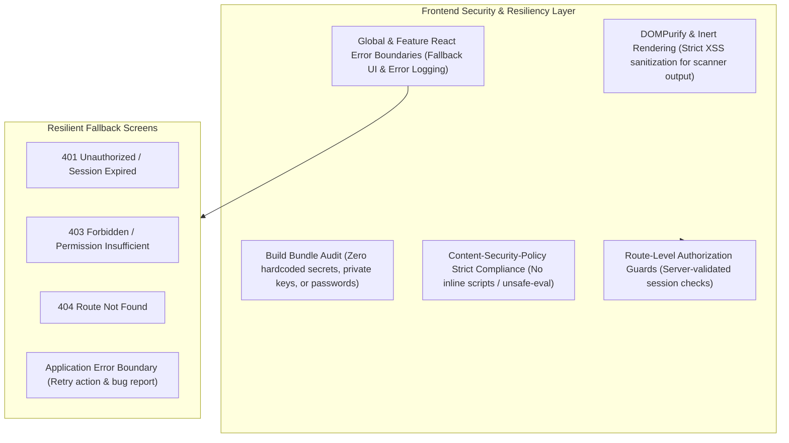

# FE-20 — Frontend Security Verification & Error Handling

**Parent Epic:** [FE-EPIC-01: Complete KELVIN Frontend Application](FE-EPIC-01_DESIGN_AND_IMPLEMENT_COMPLETE_KELVIN_FRONTEND_APPLICATION.md) (Parent Epic #399)  
**Milestone:** [Frontend Development & Product Experience](../MILESTONE_FRONTEND.md)  
**Issue ID:** `FE-20`  
**Priority:** `critical`  
**Status:** `ready-for-dev`  

---

## 🎯 Purpose

Harden the client application against XSS, token leakage, clickjacking, and unhandled runtime exceptions through strict sanitization, CSP compliance, and React Error Boundaries.

---

## 📐 Architecture & Workflow Diagram

---

## 📋 Detailed Requirements

- Implement strict DOM sanitization using DOMPurify across all views rendering untrusted scanner evidence, HTTP bodies, and finding descriptions.
- Audit frontend production build bundles (dist/) to guarantee zero private keys, API secrets, or sensitive configuration leaks.
- Ensure compatibility with strict Content Security Policy (CSP) headers without requiring 'unsafe-inline' or 'unsafe-eval' for scripts.
- Implement Global and Feature-Level React Error Boundaries preventing entire page unmounting upon component-level rendering errors.
- Build polished fallback screens for standard HTTP error statuses: 401 Unauthorized, 403 Forbidden, 404 Not Found, and 500 Application Error.
- Implement safe external link handling (rel='noopener noreferrer' and external link warning indicator).
- Sanitize console logging in production builds to prevent leaking sensitive API responses or authorization tokens.

---

## 🛡️ Security & Architectural Invariants

- **Client-Side Data Integrity:** Form inputs must undergo strict validation before submission and reflect real backend states.
- **Sanitized Presentation:** All dynamic scanner results and evidence payloads must be sanitized to eliminate any XSS vulnerability risk.
- **Fail-Safe Error Boundaries:** Component crashes must be caught by React Error Boundaries without crashing the global application shell.
- **Responsive & Accessible:** Viewport reflow must support 320px to 1920px without horizontal scrollbars, complying with WCAG 2.2 Level AA.

---

## ✅ Acceptance Criteria

- [ ] XSS fuzzing tests injecting malicious script payloads into evidence rendering demonstrate zero script execution.
- [ ] Bundle analysis confirms absence of any environment credentials or secret variables.
- [ ] Triggering an unhandled component error displays an inline error boundary card with a 'Reload Component' button without crashing the shell.
- [ ] Production builds omit console.debug and sensitive debug logs.

---

## 🔗 Related Documentation & Links

- Web Client Codebase: [`apps/web/`](../../../../apps/web/)
- Parent Milestone: [`MILESTONE_FRONTEND.md`](../MILESTONE_FRONTEND.md)
- Backend API Specification: [`docs/api/API_SPECIFICATION.md`](../../../../docs/api/API_SPECIFICATION.md)
