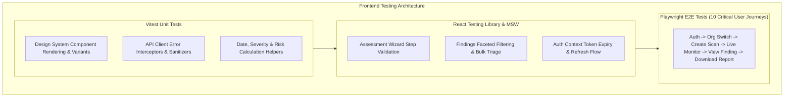

# FE-21 — Frontend Unit, Integration & E2E Testing

**Parent Epic:** [FE-EPIC-01: Complete KELVIN Frontend Application](FE-EPIC-01_DESIGN_AND_IMPLEMENT_COMPLETE_KELVIN_FRONTEND_APPLICATION.md) (Parent Epic #399)  
**Milestone:** [Frontend Development & Product Experience](../MILESTONE_FRONTEND.md)  
**Issue ID:** `FE-21`  
**Priority:** `critical`  
**Status:** `ready-for-dev`  

---

## 🎯 Purpose

Implement the complete automated testing pyramid for the frontend application: Vitest component unit tests, React Testing Library integration tests, and Playwright end-to-end user journeys.

---

## 📐 Architecture & Workflow Diagram

---

## 📋 Detailed Requirements

- Configure Vitest and React Testing Library test runner in apps/web with jsdom environment and coverage reporting.
- Write comprehensive unit tests covering all design system primitives, severity badge mappings, and formatting utilities.
- Write integration tests using Mock Service Worker (MSW) or API mocks covering:
-   - Authentication and session state transitions.
-   - 7-step Assessment Wizard validation and submission.
-   - Findings filtering, debounced search, and bulk status update.
-   - Target registration and scope boundary validation.
- Implement Playwright End-to-End (E2E) test suite executing against staging or local preview container covering the 10 critical user journeys defined in Section 11 of FE-EPIC-01.
- Integrate automated test runs into CI pipeline with threshold gates on pull requests.

---

## 🛡️ Security & Architectural Invariants

- **Client-Side Data Integrity:** Form inputs must undergo strict validation before submission and reflect real backend states.
- **Sanitized Presentation:** All dynamic scanner results and evidence payloads must be sanitized to eliminate any XSS vulnerability risk.
- **Fail-Safe Error Boundaries:** Component crashes must be caught by React Error Boundaries without crashing the global application shell.
- **Responsive & Accessible:** Viewport reflow must support 320px to 1920px without horizontal scrollbars, complying with WCAG 2.2 Level AA.

---

## ✅ Acceptance Criteria

- [ ] Vitest unit and integration test suites run cleanly with high branch coverage on critical business logic.
- [ ] Playwright E2E tests execute headlessly and reliably verify the entire assessment lifecycle end-to-end.
- [ ] Tests produce reproducible, deterministic results without flaky timing dependencies.
- [ ] CI command npm run test passes with zero failures.

---

## 🔗 Related Documentation & Links

- Web Client Codebase: [`apps/web/`](../../../../apps/web/)
- Parent Milestone: [`MILESTONE_FRONTEND.md`](../MILESTONE_FRONTEND.md)
- Backend API Specification: [`docs/api/API_SPECIFICATION.md`](../../../../docs/api/API_SPECIFICATION.md)
