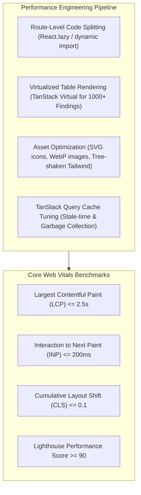

# FE-22 — Frontend Performance Optimization

**Parent Epic:** [FE-EPIC-01: Complete KELVIN Frontend Application](FE-EPIC-01_DESIGN_AND_IMPLEMENT_COMPLETE_KELVIN_FRONTEND_APPLICATION.md) (Parent Epic #399)  
**Milestone:** [Frontend Development & Product Experience](../MILESTONE_FRONTEND.md)  
**Issue ID:** `FE-22`  
**Priority:** `high`  
**Status:** `ready-for-dev`  

---

## 🎯 Purpose

Optimize frontend bundle sizes, implement route-level code splitting, virtualize high-volume data tables, tune cache lifetimes, and achieve Core Web Vitals targets.

---

## 📐 Architecture & Workflow Diagram

---

## 📋 Detailed Requirements

- Implement route-level dynamic imports (React.lazy) and Suspense boundaries for all major feature pages to minimize initial JavaScript bundle size.
- Optimize Vite bundle splitting strategy: separate vendor chunks (React, TanStack Query, Lucide icons, Charting) from application code.
- Integrate list virtualization (TanStack Virtual) for high-volume tabular views (findings, audit logs) to maintain 60 FPS scrolling.
- Tune TanStack Query caching policies: establish distinct staleTime and gcTime profiles for static versus high-frequency polling data.
- Eliminate layout shifts by reserving explicit dimensions on charts, badges, and skeleton placeholders.
- Benchmark and optimize Core Web Vitals across desktop and simulated mobile network conditions to achieve LCP <= 2.5s, INP <= 200ms, and CLS <= 0.1.
- Audit third-party dependencies with rollup-plugin-visualizer to eliminate duplicate or bloated libraries.

---

## 🛡️ Security & Architectural Invariants

- **Client-Side Data Integrity:** Form inputs must undergo strict validation before submission and reflect real backend states.
- **Sanitized Presentation:** All dynamic scanner results and evidence payloads must be sanitized to eliminate any XSS vulnerability risk.
- **Fail-Safe Error Boundaries:** Component crashes must be caught by React Error Boundaries without crashing the global application shell.
- **Responsive & Accessible:** Viewport reflow must support 320px to 1920px without horizontal scrollbars, complying with WCAG 2.2 Level AA.

---

## ✅ Acceptance Criteria

- [ ] Initial entry bundle size stays under established performance budgets (<250 KB compressed).
- [ ] Lighthouse performance audit scores >= 90 on key routes (Dashboard, Findings Explorer).
- [ ] Scrolling through 1,000+ findings rows maintains fluid 60 FPS performance without memory bloat.
- [ ] Zero cumulative layout shift occurs during chart or dynamic table loading.

---

## 🔗 Related Documentation & Links

- Web Client Codebase: [`apps/web/`](../../../../apps/web/)
- Parent Milestone: [`MILESTONE_FRONTEND.md`](../MILESTONE_FRONTEND.md)
- Backend API Specification: [`docs/api/API_SPECIFICATION.md`](../../../../docs/api/API_SPECIFICATION.md)
