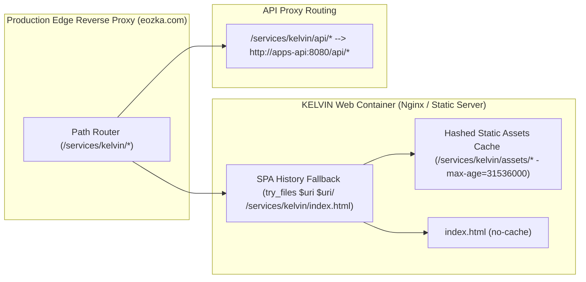

# FE-23 — Production Routing & Deployment Integration

**Parent Epic:** [FE-EPIC-01: Complete KELVIN Frontend Application](FE-EPIC-01_DESIGN_AND_IMPLEMENT_COMPLETE_KELVIN_FRONTEND_APPLICATION.md) (Parent Epic #399)  
**Milestone:** [Frontend Development & Product Experience](../MILESTONE_FRONTEND.md)  
**Issue ID:** `FE-23`  
**Priority:** `critical`  
**Status:** `ready-for-dev`  

---

## 🎯 Purpose

Configure production base-path routing under https://eozka.com/services/kelvin, static asset resolution, SPA fallback rewrites, Docker packaging, and reverse-proxy deployment.

---

## 📐 Architecture & Workflow Diagram

---

## 📋 Detailed Requirements

- Configure Vite base path configuration (base: '/services/kelvin/') to ensure all script, CSS, and asset tags resolve correctly.
- Configure React Router basename ('/services/kelvin') to support nested route navigation and browser history under the sub-path.
- Ensure page refreshes and direct URL navigation to deep links (e.g. /services/kelvin/findings/123) resolve to index.html without 404 errors.
- Configure Docker packaging (Dockerfile.web) with multi-stage build: Node.js build stage and unprivileged Nginx / Caddy static server stage.
- Implement production Nginx configuration with proper SPA rewrite rules, gzip/brotli compression, and security headers.
- Configure API proxy rules routing /services/kelvin/api/* requests to the Go API backend.
- Document environment variable injection and deployment verification procedures.

---

## 🛡️ Security & Architectural Invariants

- **Client-Side Data Integrity:** Form inputs must undergo strict validation before submission and reflect real backend states.
- **Sanitized Presentation:** All dynamic scanner results and evidence payloads must be sanitized to eliminate any XSS vulnerability risk.
- **Fail-Safe Error Boundaries:** Component crashes must be caught by React Error Boundaries without crashing the global application shell.
- **Responsive & Accessible:** Viewport reflow must support 320px to 1920px without horizontal scrollbars, complying with WCAG 2.2 Level AA.

---

## ✅ Acceptance Criteria

- [ ] Local preview and production container builds serve the application seamlessly from /services/kelvin/.
- [ ] Direct page refresh on any authenticated sub-route loads correctly without 404 Not Found errors.
- [ ] Hashed static assets serve with long-term immutable caching headers while index.html enforces revalidation.
- [ ] Docker image builds cleanly in CI with minimal image footprint.

---

## 🔗 Related Documentation & Links

- Web Client Codebase: [`apps/web/`](../../../../apps/web/)
- Parent Milestone: [`MILESTONE_FRONTEND.md`](../MILESTONE_FRONTEND.md)
- Backend API Specification: [`docs/api/API_SPECIFICATION.md`](../../../../docs/api/API_SPECIFICATION.md)
