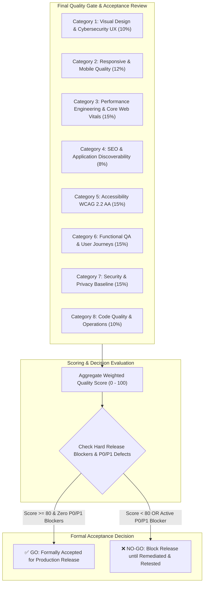

# FE-24 — Final Frontend QA Audit & Acceptance

**Parent Epic:** [FE-EPIC-01: Complete KELVIN Frontend Application](FE-EPIC-01_DESIGN_AND_IMPLEMENT_COMPLETE_KELVIN_FRONTEND_APPLICATION.md) (Parent Epic #399)  
**Milestone:** [Frontend Development & Product Experience](../MILESTONE_FRONTEND.md)  
**Issue ID:** `FE-24`  
**Priority:** `critical`  
**Status:** `ready-for-dev`  

---

## 🎯 Purpose

Execute the comprehensive 8-category quality assurance and design audit standard across the completed frontend application, ensuring zero P0/P1 blockers and formal sign-off.

---

## 📐 Architecture & Workflow Diagram

---

## 📋 Detailed Requirements

- Execute the formal 8-category quality assurance audit from PRE-P5-01 against the deployed staging build of the frontend application.
- Verify all 10 critical user journeys from Section 11 of FE-EPIC-01 end-to-end on real staging backend APIs.
- Verify the 7-device viewport matrix (320px to 1920px) to confirm zero horizontal document scrolling or UI element clipping.
- Verify WCAG 2.2 Level AA accessibility compliance with automated scans and screen reader walkthroughs.
- Confirm zero P0 (Critical) and zero P1 (High) defects remain unresolved in the defect register.
- Verify that production build and base-path routing under https://eozka.com/services/kelvin function without errors.
- Gather formal sign-offs from Lead Developer, QA Reviewer, Product/Design Reviewer, and Security Owner.
- Publish the final signed audit report and scorecard in docs/quality-audit/.

---

## 🛡️ Security & Architectural Invariants

- **Client-Side Data Integrity:** Form inputs must undergo strict validation before submission and reflect real backend states.
- **Sanitized Presentation:** All dynamic scanner results and evidence payloads must be sanitized to eliminate any XSS vulnerability risk.
- **Fail-Safe Error Boundaries:** Component crashes must be caught by React Error Boundaries without crashing the global application shell.
- **Responsive & Accessible:** Viewport reflow must support 320px to 1920px without horizontal scrollbars, complying with WCAG 2.2 Level AA.

---

## ✅ Acceptance Criteria

- [ ] Weighted overall quality score achieves >= 80 out of 100.
- [ ] Zero hard release blockers and zero P0/P1 defects are open.
- [ ] All 24 frontend sub-issues (FE-01 through FE-23) are verified as completed.
- [ ] Formal sign-off document is committed to the repository, certifying KELVIN frontend production readiness.

---

## 🔗 Related Documentation & Links

- Web Client Codebase: [`apps/web/`](../../../../apps/web/)
- Parent Milestone: [`MILESTONE_FRONTEND.md`](../MILESTONE_FRONTEND.md)
- Backend API Specification: [`docs/api/API_SPECIFICATION.md`](../../../../docs/api/API_SPECIFICATION.md)
