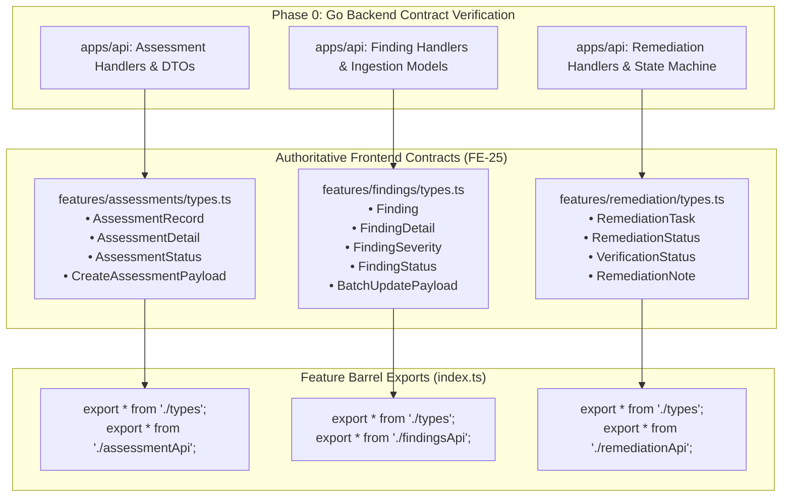

# FE-25 — Frontend Contract Reconciliation

**Parent Epic:** [FE-EPIC-02: KELVIN Frontend Repair & Release-Blocking Integration](FE-EPIC-02_KELVIN_FRONTEND_REPAIR_AND_INTEGRATION.md) (Parent Epic #451)  
**Milestone:** [Frontend Development & Product Experience](../MILESTONE_FRONTEND.md)  
**Issue ID:** `FE-25`  
**Priority:** `P0 — Critical` (Release-blocking)  
**Status:** `ready-for-dev`  
**Target Pull Request:** `fix(web): reconcile frontend feature contracts`  

---

## 🎯 Purpose

Establish one authoritative, strictly-typed frontend contract for the three incomplete feature modules (Assessments, Findings, Remediation) aligned directly with actual Go backend routes, DTOs, and response envelopes.

---

## 📐 Architecture & Workflow Diagram

---

## 📋 Detailed Requirements & Sub-Tasks

- FE-25.1: Inspect Go API routes, handlers, DTOs, and response envelopes in apps/api for assessments, findings, and remediation.
- FE-25.2: Reconcile assessment types and public exports (AssessmentRecord, AssessmentDetail, AssessmentStatus, AssessmentStage, ScannerExecution, AssessmentLog, CreateAssessmentPayload).
- FE-25.3: Reconcile findings types and public exports (FindingSeverity, FindingStatus, Finding, FindingDetail, FindingEvidence, FindingObservation, FindingsFilterParams, FindingsListResponse, BatchUpdatePayload, BatchUpdateResponse, FindingTransitionPayload).
- FE-25.4: Reconcile remediation types and public exports (RemediationStatus, VerificationStatus, RemediationNote, RemediationTask, RemediationFilterParams).
- FE-25.5: Align feature API signatures with actual backend contracts; eliminate contradictory type definitions and enforce shared services/api usage.
- FE-25.6: Add contract-level unit tests and compile-time TypeScript type fixtures verifying request/response payload alignment.

---

## 🛡️ Security & Architectural Invariants

- **Authoritative Backend Data:** The frontend must never invent endpoints, DTOs, or lifecycle statuses not supported by the Go backend (ADR-FE-05).
- **Zero Mock Fallback in Production:** When live API requests fail, the client must surface typed errors (401, 403, 404, 5xx) and never switch silently to mock stores (ADR-FE-04).
- **Strict Evidence Sanitization:** All raw scanner evidence, HTTP request/response payloads, and parameter reflections must be sanitized with DOMPurify to prevent XSS.
- **Fail-Safe Polling:** Polling intervals must automatically terminate when reaching terminal execution states (COMPLETED, FAILED, CANCELLED) to avoid memory leaks.
- **Sub-Path Hosting Integrity:** All routes, asset URLs, and API endpoints must function cleanly under `https://eozka.com/services/kelvin/`.

---

## ✅ Acceptance Criteria

- [x] No duplicate, contradictory, or orphaned feature types remain in apps/web.
- [x] Zero invented backend endpoints or fabricated request/response envelopes exist.
- [x] All three feature barrel files (features/{assessments,findings,remediation}/index.ts) export their intended public interfaces without circular dependencies.
- [x] TypeScript type check passes across all feature contracts without any or @ts-ignore overrides.
- [x] Contract-level unit tests verify JSON serialization and deserialization against mock backend payloads.

---

## 🔗 Related Documentation & Links

- Web Client Source: [`apps/web/`](../../../../apps/web/)
- Parent Repair Epic: [`FE-EPIC-02_KELVIN_FRONTEND_REPAIR_AND_INTEGRATION.md`](FE-EPIC-02_KELVIN_FRONTEND_REPAIR_AND_INTEGRATION.md)
- Go API Handlers: [`apps/api/internal/`](../../../../apps/api/internal/)
- API Specification: [`docs/api/API_SPECIFICATION.md`](../../../../docs/api/API_SPECIFICATION.md)
