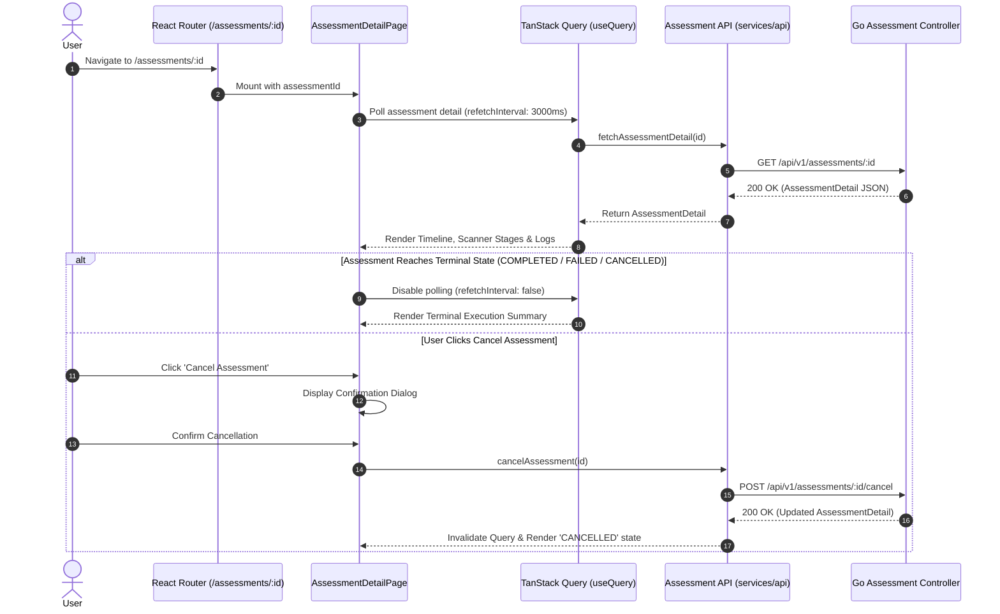

# FE-26 — Assessment Integration

**Parent Epic:** [FE-EPIC-02: KELVIN Frontend Repair & Release-Blocking Integration](FE-EPIC-02_KELVIN_FRONTEND_REPAIR_AND_INTEGRATION.md) (Parent Epic #451)  
**Milestone:** [Frontend Development & Product Experience](../MILESTONE_FRONTEND.md)  
**Issue ID:** `FE-26`  
**Priority:** `P0 — Critical` (Release-blocking)  
**Status:** `ready-for-dev`  
**Target Pull Request:** `fix(web): complete assessment lifecycle integration`  

---

## 🎯 Purpose

Complete the end-to-end assessment lifecycle in the web client, integrating assessment detail inspection, terminal-state polling, safe cancellation, route registration, and real execution log streaming.

---

## 📐 Architecture & Workflow Diagram

---

## 📋 Detailed Requirements & Sub-Tasks

- FE-26.1: Implement and test assessment detail API (fetchAssessmentDetail(id)) matching verified Go backend response structures.
- FE-26.2: Implement cancellation API (cancelAssessment(id)) with structured error handling and mutation rollback.
- FE-26.3: Integrate AssessmentDetailPage.tsx with authoritative feature contracts (no mock fallback in production mode).
- FE-26.4: Register assessment catalog (/assessments) and detail (/assessments/:id) routes in App.tsx and sidebar navigation.
- FE-26.5: Implement intelligent terminal-state polling via TanStack Query: poll active jobs (QUEUED, RUNNING) and automatically halt polling upon terminal states (COMPLETED, FAILED, CANCELLED).
- FE-26.6: Connect scanner status, execution logs, and findings count cards directly to actual backend execution manifests without fabricating percentages.

---

## 🛡️ Security & Architectural Invariants

- **Authoritative Backend Data:** The frontend must never invent endpoints, DTOs, or lifecycle statuses not supported by the Go backend (ADR-FE-05).
- **Zero Mock Fallback in Production:** When live API requests fail, the client must surface typed errors (401, 403, 404, 5xx) and never switch silently to mock stores (ADR-FE-04).
- **Strict Evidence Sanitization:** All raw scanner evidence, HTTP request/response payloads, and parameter reflections must be sanitized with DOMPurify to prevent XSS.
- **Fail-Safe Polling:** Polling intervals must automatically terminate when reaching terminal execution states (COMPLETED, FAILED, CANCELLED) to avoid memory leaks.
- **Sub-Path Hosting Integrity:** All routes, asset URLs, and API endpoints must function cleanly under `https://eozka.com/services/kelvin/`.

---

## ✅ Acceptance Criteria

- [ ] fetchAssessmentDetail and cancelAssessment are fully implemented, typed, and tested.
- [ ] Navigating directly to /assessments/:id loads the assessment detail and updates in real-time.
- [ ] Polling stops immediately when the assessment reaches terminal status (COMPLETED, FAILED, or CANCELLED).
- [ ] Cancellation requires explicit user confirmation and displays clear error banners if the backend rejects cancellation.
- [ ] The UI never reports a scan as cancelled unless confirmed by a successful 200/204 response from the Go API.

---

## 🔗 Related Documentation & Links

- Web Client Source: [`apps/web/`](../../../../apps/web/)
- Parent Repair Epic: [`FE-EPIC-02_KELVIN_FRONTEND_REPAIR_AND_INTEGRATION.md`](FE-EPIC-02_KELVIN_FRONTEND_REPAIR_AND_INTEGRATION.md)
- Go API Handlers: [`apps/api/internal/`](../../../../apps/api/internal/)
- API Specification: [`docs/api/API_SPECIFICATION.md`](../../../../docs/api/API_SPECIFICATION.md)
