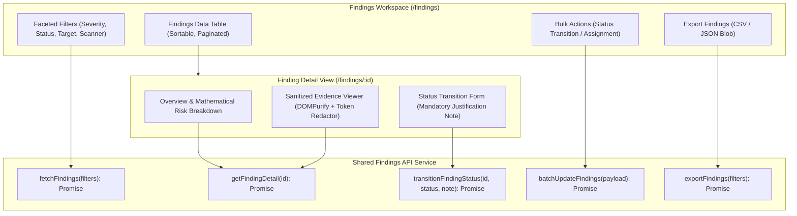

# FE-27 — Findings Integration

**Parent Epic:** [FE-EPIC-02: KELVIN Frontend Repair & Release-Blocking Integration](FE-EPIC-02_KELVIN_FRONTEND_REPAIR_AND_INTEGRATION.md) (Parent Epic #451)  
**Milestone:** [Frontend Development & Product Experience](../MILESTONE_FRONTEND.md)  
**Issue ID:** `FE-27`  
**Priority:** `P0 — Critical` (Release-blocking)  
**Status:** `completed`  
**Target Pull Request:** `fix(web): complete findings workspace integration`  

---

## 🎯 Purpose

Align findings list, detail views, multi-parameter filtering, bulk status updates, export, and triage workflows with real backend endpoints while maintaining strict evidence sanitization.

---

## 📐 Architecture & Workflow Diagram

---

## 📋 Detailed Requirements & Sub-Tasks

- FE-27.1: Reconcile finding status and severity models, eliminating contradictions between FindingSummary, workspace filters, and remediation.
- FE-27.2: Implement authoritative Finding and FindingDetail types with clear separation between list rows and rich detail records.
- FE-27.3: Reconcile fetchFindings API function, supporting debounced search, faceted filters, column sorting, and pagination envelopes.
- FE-27.4: Implement getFindingDetail and transitionFindingStatus API operations, requiring explanatory justification notes for status changes.
- FE-27.5: Implement batchUpdateFindings and exportFindings (returning typed Blob for authenticated download).
- FE-27.6: Register /findings/:id route in React Router and connect table row clicks to detail view navigation.
- FE-27.7: Test filters, pagination, bulk triage, and evidence rendering with DOMPurify sanitization against XSS payloads.

---

## 🛡️ Security & Architectural Invariants

- **Authoritative Backend Data:** The frontend must never invent endpoints, DTOs, or lifecycle statuses not supported by the Go backend (ADR-FE-05).
- **Zero Mock Fallback in Production:** When live API requests fail, the client must surface typed errors (401, 403, 404, 5xx) and never switch silently to mock stores (ADR-FE-04).
- **Strict Evidence Sanitization:** All raw scanner evidence, HTTP request/response payloads, and parameter reflections must be sanitized with DOMPurify to prevent XSS.
- **Fail-Safe Polling:** Polling intervals must automatically terminate when reaching terminal execution states (COMPLETED, FAILED, CANCELLED) to avoid memory leaks.
- **Sub-Path Hosting Integrity:** All routes, asset URLs, and API endpoints must function cleanly under `https://eozka.com/services/kelvin/`.

---

## ✅ Acceptance Criteria

- [x] List and detail data models accurately represent data returned by the Go findings controllers.
- [x] Bulk status transitions handle partial batch failures gracefully without reporting all records updated.
- [x] Direct navigation to /findings/:id renders finding overview, risk breakdown, and historical observations.
- [x] Untrusted scanner evidence is sanitized with DOMPurify and sensitive tokens/passwords are visibly redacted.
- [x] Status transitions enforce mandatory justification notes where required by backend business rules.
- [x] CSV and JSON export operations reflect active filters and handle download stream failures.

---

## 🔗 Related Documentation & Links

- Web Client Source: [`apps/web/`](../../../../apps/web/)
- Parent Repair Epic: [`FE-EPIC-02_KELVIN_FRONTEND_REPAIR_AND_INTEGRATION.md`](FE-EPIC-02_KELVIN_FRONTEND_REPAIR_AND_INTEGRATION.md)
- Go API Handlers: [`apps/api/internal/`](../../../../apps/api/internal/)
- API Specification: [`docs/api/API_SPECIFICATION.md`](../../../../docs/api/API_SPECIFICATION.md)
