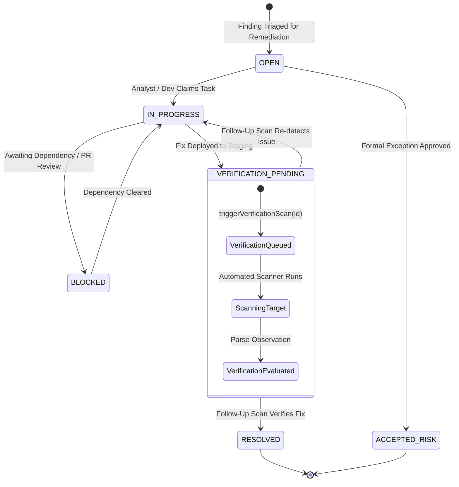

# FE-28 — Remediation Integration

**Parent Epic:** [FE-EPIC-02: KELVIN Frontend Repair & Release-Blocking Integration](FE-EPIC-02_KELVIN_FRONTEND_REPAIR_AND_INTEGRATION.md) (Parent Epic #451)  
**Milestone:** [Frontend Development & Product Experience](../MILESTONE_FRONTEND.md)  
**Issue ID:** `FE-28`  
**Priority:** `P0 — Critical` (Release-blocking)  
**Status:** `ready-for-dev`  
**Target Pull Request:** `fix(web): complete remediation workflow integration`  

---

## 🎯 Purpose

Complete the remediation workspace lifecycle using real Go backend operations for task status updates, note persistence, SLA tracking, and follow-up verification scan triggers.

---

## 📐 Architecture & Workflow Diagram

---

## 📋 Detailed Requirements & Sub-Tasks

- FE-28.1: Reconcile RemediationTask, RemediationStatus, and VerificationStatus types with Go backend models.
- FE-28.2: Implement fetchRemediationTasks API contract supporting filtering by assignee, status, target, and SLA breach.
- FE-28.3: Implement updateTaskStatus mutation with optimistic UI updates and error rollback if the backend rejects transition.
- FE-28.4: Replace mock addRemediationNote with real API mutation using authenticated session identity for author attribution.
- FE-28.5: Implement triggerVerificationScan API contract dispatching an authorized follow-up assessment for the remediated finding.
- FE-28.6: Reconcile Kanban and List views with authoritative backend statuses (OPEN, IN_PROGRESS, BLOCKED, VERIFICATION_PENDING, RESOLVED, ACCEPTED_RISK).
- FE-28.7: Add comprehensive unit and integration tests for SLA calculations, lifecycle state changes, and mutation failure handling.

---

## 🛡️ Security & Architectural Invariants

- **Authoritative Backend Data:** The frontend must never invent endpoints, DTOs, or lifecycle statuses not supported by the Go backend (ADR-FE-05).
- **Zero Mock Fallback in Production:** When live API requests fail, the client must surface typed errors (401, 403, 404, 5xx) and never switch silently to mock stores (ADR-FE-04).
- **Strict Evidence Sanitization:** All raw scanner evidence, HTTP request/response payloads, and parameter reflections must be sanitized with DOMPurify to prevent XSS.
- **Fail-Safe Polling:** Polling intervals must automatically terminate when reaching terminal execution states (COMPLETED, FAILED, CANCELLED) to avoid memory leaks.
- **Sub-Path Hosting Integrity:** All routes, asset URLs, and API endpoints must function cleanly under `https://eozka.com/services/kelvin/`.

---

## ✅ Acceptance Criteria

- [ ] All remediation statuses conform strictly to the backend domain model (ADR-FE-05).
- [ ] Notes persist through the backend API and attribute the real authenticated user (no hardcoded analyst emails).
- [ ] Verification scan action triggers a real follow-up assessment job with verifiable backend job ID.
- [ ] Failed status mutations revert Kanban card or list row back to previous state and display actionable error message.
- [ ] SLA hours remaining and overdue flags are derived from verified backend dates or documented algorithms.

---

## 🔗 Related Documentation & Links

- Web Client Source: [`apps/web/`](../../../../apps/web/)
- Parent Repair Epic: [`FE-EPIC-02_KELVIN_FRONTEND_REPAIR_AND_INTEGRATION.md`](FE-EPIC-02_KELVIN_FRONTEND_REPAIR_AND_INTEGRATION.md)
- Go API Handlers: [`apps/api/internal/`](../../../../apps/api/internal/)
- API Specification: [`docs/api/API_SPECIFICATION.md`](../../../../docs/api/API_SPECIFICATION.md)
