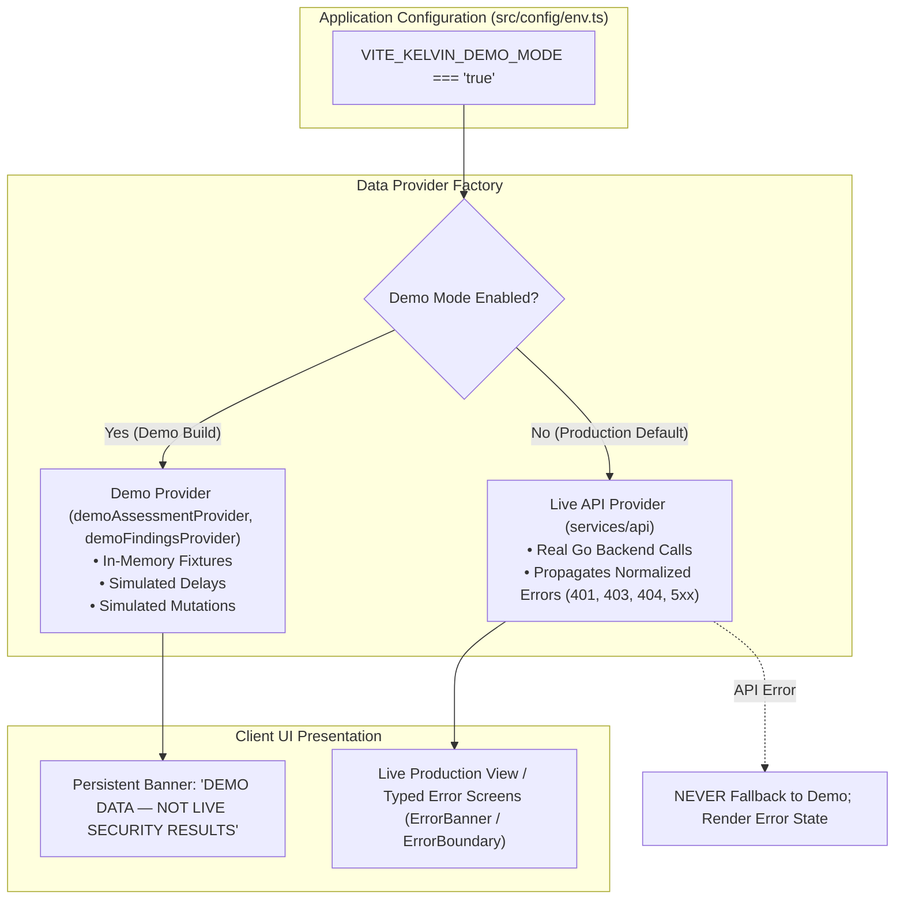

# FE-29 — Explicit Demo Mode & Data Isolation

**Parent Epic:** [FE-EPIC-02: KELVIN Frontend Repair & Release-Blocking Integration](FE-EPIC-02_KELVIN_FRONTEND_REPAIR_AND_INTEGRATION.md) (Parent Epic #451)  
**Milestone:** [Frontend Development & Product Experience](../MILESTONE_FRONTEND.md)  
**Issue ID:** `FE-29`  
**Priority:** `P0 — Critical` (Release-blocking)  
**Status:** `ready-for-dev`  
**Target Pull Request:** `fix(web): isolate explicit demo data from production`  

---

## 🎯 Purpose

Eliminate all silent mock data fallbacks upon production API failures and isolate mock fixtures behind an explicit, build-time demo configuration flag with a persistent visual indicator.

---

## 📐 Architecture & Workflow Diagram

---

## 📋 Detailed Requirements & Sub-Tasks

- FE-29.1: Implement centralized build-time demo mode configuration (VITE_KELVIN_DEMO_MODE=false by default; true for demo builds).
- FE-29.2: Extract assessment mock fixtures out of production API modules into dedicated features/assessments/demoProvider.ts.
- FE-29.3: Extract findings mock fixtures out of production API modules into dedicated features/findings/demoProvider.ts.
- FE-29.4: Extract remediation mock fixtures out of production API modules into dedicated features/remediation/demoProvider.ts.
- FE-29.5: Remove all silent mock fallbacks: when live API requests fail in production mode, immediately propagate typed ApiError.
- FE-29.6: Add persistent, high-contrast visual banner across all pages when demo mode is active ('DEMO DATA — NOT LIVE SECURITY RESULTS').
- FE-29.7: Add automated isolation tests verifying that API network failures in production mode render error states and never fall back to mock data.

---

## 🛡️ Security & Architectural Invariants

- **Authoritative Backend Data:** The frontend must never invent endpoints, DTOs, or lifecycle statuses not supported by the Go backend (ADR-FE-05).
- **Zero Mock Fallback in Production:** When live API requests fail, the client must surface typed errors (401, 403, 404, 5xx) and never switch silently to mock stores (ADR-FE-04).
- **Strict Evidence Sanitization:** All raw scanner evidence, HTTP request/response payloads, and parameter reflections must be sanitized with DOMPurify to prevent XSS.
- **Fail-Safe Polling:** Polling intervals must automatically terminate when reaching terminal execution states (COMPLETED, FAILED, CANCELLED) to avoid memory leaks.
- **Sub-Path Hosting Integrity:** All routes, asset URLs, and API endpoints must function cleanly under `https://eozka.com/services/kelvin/`.

---

## ✅ Acceptance Criteria

- [ ] Demo mode is strictly disabled by default in production builds (ADR-FE-03, ADR-FE-04).
- [ ] No fictional mock findings, assessments, or remediation tasks appear when connected to a live backend.
- [ ] When the backend is down or returns 500/404, the UI renders the proper ErrorBanner or ErrorBoundary, never demo data.
- [ ] Demo mutations are strictly simulated in-memory and never dispatched to the live backend.
- [ ] Automated unit tests prove that production provider rejects simulated fallback under simulated HTTP 500 errors.

---

## 🔗 Related Documentation & Links

- Web Client Source: [`apps/web/`](../../../../apps/web/)
- Parent Repair Epic: [`FE-EPIC-02_KELVIN_FRONTEND_REPAIR_AND_INTEGRATION.md`](FE-EPIC-02_KELVIN_FRONTEND_REPAIR_AND_INTEGRATION.md)
- Go API Handlers: [`apps/api/internal/`](../../../../apps/api/internal/)
- API Specification: [`docs/api/API_SPECIFICATION.md`](../../../../docs/api/API_SPECIFICATION.md)
