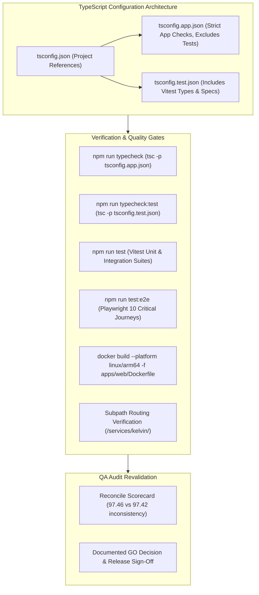

# FE-30 — Build, Test and Release Acceptance

**Parent Epic:** [FE-EPIC-02: KELVIN Frontend Repair & Release-Blocking Integration](FE-EPIC-02_KELVIN_FRONTEND_REPAIR_AND_INTEGRATION.md) (Parent Epic #451)  
**Milestone:** [Frontend Development & Product Experience](../MILESTONE_FRONTEND.md)  
**Issue ID:** `FE-30`  
**Priority:** `P0 — Critical` (Release-blocking)  
**Status:** `completed`  
**Target Pull Request:** `fix(web): complete production build and release verification`  

---

## 🎯 Purpose

Separate application and test TypeScript configurations, reconcile workspace dependencies, validate Docker ARM64 compilation, verify subpath routing, and execute formal QA acceptance.

---

## 📐 Architecture & Workflow Diagram

---

## 📋 Detailed Requirements & Sub-Tasks

- FE-30.1: Separate application and test TypeScript configurations into tsconfig.app.json and tsconfig.test.json in apps/web.
- FE-30.2: Reconcile workspace package.json and root lockfile, ensuring Vitest and testing library types are properly declared.
- FE-30.3: Clean up unused imports, dead references, and missing component imports across all page modules.
- FE-30.4: Validate that all 11 documented routes (/, /dashboard, /assessments, /assessments/:id, /findings, /findings/:id, /remediation, /reports, /profile, /audit, /settings) are registered in App.tsx.
- FE-30.5: Validate direct navigation and deep-link browser refresh under the /services/kelvin/ subpath with Nginx SPA fallback.
- FE-30.6: Execute frontend unit and integration suites, verifying zero test regressions and full coverage over error paths.
- FE-30.7: Execute critical user journey Playwright E2E tests against local/staging build.
- FE-30.8: Build and validate the production Docker image on linux/arm64 architecture.
- FE-30.9: Re-run accessibility (WCAG 2.2 AA), Content Security Policy (CSP), and client security audits.
- FE-30.10: Update the QA audit report with exact commands, test execution logs, and resolve the 97.46 vs 97.42 scorecard inconsistency.

---

## 🛡️ Security & Architectural Invariants

- **Authoritative Backend Data:** The frontend must never invent endpoints, DTOs, or lifecycle statuses not supported by the Go backend (ADR-FE-05).
- **Zero Mock Fallback in Production:** When live API requests fail, the client must surface typed errors (401, 403, 404, 5xx) and never switch silently to mock stores (ADR-FE-04).
- **Strict Evidence Sanitization:** All raw scanner evidence, HTTP request/response payloads, and parameter reflections must be sanitized with DOMPurify to prevent XSS.
- **Fail-Safe Polling:** Polling intervals must automatically terminate when reaching terminal execution states (COMPLETED, FAILED, CANCELLED) to avoid memory leaks.
- **Sub-Path Hosting Integrity:** All routes, asset URLs, and API endpoints must function cleanly under `https://eozka.com/services/kelvin/`.

---

## ✅ Acceptance Criteria

- [x] npm run typecheck (app) and npm run typecheck:test pass with zero TypeScript errors under strict mode.
- [x] Vitest and Playwright test suites execute cleanly and pass 100% of tests.
- [x] Vite production build succeeds without warnings or bundle size budget violations.
- [x] Docker image compiles cleanly on linux/arm64 and passes container health checks on port 8088.
- [x] Deep linking and browser refresh on /services/kelvin/findings/123 load correctly without 404 errors.
- [x] No P0 or P1 defects remain open; QA audit report is published with reproducible evidence and signed off.

---

## 🔗 Related Documentation & Links

- Web Client Source: [`apps/web/`](../../../../apps/web/)
- Parent Repair Epic: [`FE-EPIC-02_KELVIN_FRONTEND_REPAIR_AND_INTEGRATION.md`](FE-EPIC-02_KELVIN_FRONTEND_REPAIR_AND_INTEGRATION.md)
- Go API Handlers: [`apps/api/internal/`](../../../../apps/api/internal/)
- API Specification: [`docs/api/API_SPECIFICATION.md`](../../../../docs/api/API_SPECIFICATION.md)
