# FE-EPIC-01 — Design & Implement the Complete KELVIN Frontend Application

**Project:** KELVIN — Enterprise Security Assessment Platform  
**Type:** `kind/epic`  
**Milestone:** [Frontend Development & Product Experience](../MILESTONE_FRONTEND.md)  
**Parent Roadmap:** [ISSUE-02: Engineering Roadmap](../ISSUE-02_ENGINEERING_ROADMAP.md)  
**Phase:** Post-Phase 5  
**Priority:** `P0 — Critical`  
**Status:** `ready-for-dev`  
**Dependencies:** Phase 1–5 completion and verified backend API contracts  

---

## 🎯 1. Objective

Design, architect, implement and deliver the complete production-grade frontend application for KELVIN, transforming backend assessment capabilities into a cohesive, enterprise-grade user experience connected to real APIs.

The frontend must provide a unified interface through which users can:
- Manage organizations, workspaces and teams.
- Register and manage authorized assessment targets.
- Create, configure and monitor security assessments.
- Inspect security findings and their supporting evidence.
- Manage remediation workflows.
- Generate and review assessment reports.
- Manage access control, roles and permissions.
- Configure integrations and enterprise policies.
- Review audit events and platform activity.
- Manage account and workspace settings.

> [!IMPORTANT]
> **Core Requirement:** Build the frontend as a complete product, not as a collection of disconnected pages. All interfaces must be connected to the actual KELVIN backend APIs and must reflect real application states.

---

## 📐 2. Architecture & Subsystem Diagram

```mermaid
flowchart TD
    subgraph UI ["KELVIN Frontend Client (apps/web - Vite + React 19 + TypeScript)"]
        Shell["Application Shell & Responsive Navigation"]
        AuthModule["FE-01/04: Auth & Session Layer"]
        DashboardModule["FE-05: Security Overview Dashboard"]
        AssessModule["FE-06/07: Assessment Wizard & Execution Monitor"]
        FindingsModule["FE-08/09: Findings Management & Evidence Viewer"]
        RemediationModule["FE-10: Remediation Workspace (List/Kanban)"]
        TargetModule["FE-11: Targets & Scope Management"]
        ReportModule["FE-12: Assessment Reports & PDF Viewer"]
        AdminModule["FE-13/14: Org, Teams, Roles & SSO Admin"]
        IntegrationModule["FE-15: Integrations & Notifications"]
        AuditModule["FE-16: Tamper-Evident Audit Trail"]
        SettingsModule["FE-17: Platform & Tenant Settings"]
    end

    subgraph CoreInfra ["Core Frontend Foundation & Platform Quality"]
        DS["FE-02: Design System & Accessible Component Primitives"]
        APIClient["FE-01/18: Typed API Client & TanStack Query Layer"]
        Security["FE-20: Client Hardening, DOM Sanitization & Error Boundaries"]
        A11yPerf["FE-19/22: WCAG 2.2 AA & Core Web Vitals Optimization"]
        TestSuite["FE-21: Vitest, RTL & Playwright E2E Suite"]
        Deploy["FE-23: Sub-path Routing (/services/kelvin) & Build"]
        QA["FE-24: 8-Category QA Gate & Acceptance Review"]
    end

    subgraph BackendAPI ["Go Control Plane API (apps/api)"]
        APIGateway["HTTP REST API Gateway (/api/v1)"]
        AuthAPI["Auth & Session Endpoints"]
        AssessmentAPI["Assessment & Worker Orchestration"]
        FindingsAPI["Findings & Redacted Evidence Storage"]
        AdminAPI["Multi-Tenant Org & RBAC Engine"]
        ReportAPI["Report Engine (HTML/PDF)"]
    end

    Shell --> DS
    UI --> APIClient
    APIClient -->|"Typed Requests & Bearer Token"| APIGateway
    APIGateway --> AuthAPI
    APIGateway --> AssessmentAPI
    APIGateway --> FindingsAPI
    APIGateway --> AdminAPI
    APIGateway --> ReportAPI
    UI -.-> CoreInfra
```

---

## 🗂️ 3. Child Sub-Issues Index (24 Issues Total)

- [ ] **[FE-01: Frontend Architecture & API Integration Foundation](frontend/FE-01_FRONTEND_ARCHITECTURE_AND_API_INTEGRATION_FOUNDATION.md)** (`critical`)
- [ ] **[FE-02: KELVIN Design System & Shared Component Library](frontend/FE-02_KELVIN_DESIGN_SYSTEM_AND_SHARED_COMPONENT_LIBRARY.md)** (`critical`)
- [ ] **[FE-03: Application Shell, Navigation & Responsive Layout](frontend/FE-03_APPLICATION_SHELL_NAVIGATION_AND_RESPONSIVE_LAYOUT.md)** (`critical`)
- [ ] **[FE-04: Authentication & Account Management UI](frontend/FE-04_AUTHENTICATION_AND_ACCOUNT_MANAGEMENT_UI.md)** (`critical`)
- [ ] **[FE-05: Security Overview Dashboard](frontend/FE-05_SECURITY_OVERVIEW_DASHBOARD.md)** (`critical`)
- [ ] **[FE-06: Assessment Management & Creation Wizard](frontend/FE-06_ASSESSMENT_MANAGEMENT_AND_CREATION_WIZARD.md)** (`critical`)
- [ ] **[FE-07: Assessment Execution Monitoring & Details](frontend/FE-07_ASSESSMENT_EXECUTION_MONITORING_AND_DETAILS.md)** (`critical`)
- [ ] **[FE-08: Findings Management & Search Interface](frontend/FE-08_FINDINGS_MANAGEMENT_AND_SEARCH_INTERFACE.md)** (`critical`)
- [ ] **[FE-09: Finding Detail & Evidence Viewer](frontend/FE-09_FINDING_DETAIL_AND_EVIDENCE_VIEWER.md)** (`critical`)
- [ ] **[FE-10: Remediation Management Workspace](frontend/FE-10_REMEDIATION_MANAGEMENT_WORKSPACE.md)** (`high`)
- [ ] **[FE-11: Targets & Asset Management](frontend/FE-11_TARGETS_AND_ASSET_MANAGEMENT.md)** (`critical`)
- [ ] **[FE-12: Assessment Reports & PDF Viewer](frontend/FE-12_ASSESSMENT_REPORTS_AND_PDF_VIEWER.md)** (`high`)
- [ ] **[FE-13: Organization & Team Management](frontend/FE-13_ORGANIZATION_AND_TEAM_MANAGEMENT.md)** (`high`)
- [ ] **[FE-14: Roles, Permissions & SSO Management UI](frontend/FE-14_ROLES_PERMISSIONS_AND_SSO_MANAGEMENT_UI.md)** (`high`)
- [ ] **[FE-15: Integrations & Notification Center](frontend/FE-15_INTEGRATIONS_AND_NOTIFICATION_CENTER.md)** (`high`)
- [ ] **[FE-16: Audit Logs & Activity Interface](frontend/FE-16_AUDIT_LOGS_AND_ACTIVITY_INTERFACE.md)** (`high`)
- [ ] **[FE-17: Workspace & Platform Settings](frontend/FE-17_WORKSPACE_AND_PLATFORM_SETTINGS.md)** (`high`)
- [ ] **[FE-18: Global Search, Filters & Data Navigation](frontend/FE-18_GLOBAL_SEARCH_FILTERS_AND_DATA_NAVIGATION.md)** (`high`)
- [ ] **[FE-19: Frontend Accessibility & Responsive Optimization](frontend/FE-19_FRONTEND_ACCESSIBILITY_AND_RESPONSIVE_OPTIMIZATION.md)** (`critical`)
- [ ] **[FE-20: Frontend Security Verification & Error Handling](frontend/FE-20_FRONTEND_SECURITY_VERIFICATION_AND_ERROR_HANDLING.md)** (`critical`)
- [ ] **[FE-21: Frontend Unit, Integration & E2E Testing](frontend/FE-21_FRONTEND_UNIT_INTEGRATION_AND_E2E_TESTING.md)** (`critical`)
- [ ] **[FE-22: Frontend Performance Optimization](frontend/FE-22_FRONTEND_PERFORMANCE_OPTIMIZATION.md)** (`high`)
- [ ] **[FE-23: Production Routing & Deployment Integration](frontend/FE-23_PRODUCTION_ROUTING_AND_DEPLOYMENT_INTEGRATION.md)** (`critical`)
- [ ] **[FE-24: Final Frontend QA Audit & Acceptance](frontend/FE-24_FINAL_FRONTEND_QA_AUDIT_AND_ACCEPTANCE.md)** (`critical`)

---

## 📋 4. Detailed Requirements

- Conduct mandatory pre-implementation audit of existing Vite + React frontend (apps/web) and backend Go API routes.
- Implement a unified cyber-security enterprise design system with dark-first theme and consistent semantic severity tokens.
- Establish a centralized typed API client layer with TanStack Query, error boundaries, request cancellation, and session management.
- Deliver full lifecycle assessment creation wizard and real-time execution monitoring without fake progress percentages.
- Deliver findings explorer and sanitized evidence viewer with strict XSS defenses against untrusted scanner payloads.
- Implement remediation workspace with List and Kanban views linked to verification follow-up scans.
- Implement enterprise organization, workspace, team, RBAC, SSO, integration, and audit log interfaces.
- Ensure full responsive layout support (320px to 1920px viewports) without horizontal scroll overflow.
- Achieve WCAG 2.2 Level AA accessibility compliance with keyboard navigation, visible focus rings, and screen-reader support.
- Configure production base-path routing for deployment under https://eozka.com/services/kelvin.

---

## 🛡️ 5. Security & Architectural Invariants

- **Zero Client-Side Secrets:** Private keys, service credentials, database passwords, and privileged API tokens must never appear in browser bundles or client logs.
- **Strict Evidence Sanitization:** All untrusted scanner output, HTTP request/response payloads, and parameter reflections must be sanitized with DOMPurify and rendered in inert containers.
- **Authoritative Backend Security:** The frontend is not an authorization boundary; all actions and permissions are enforced strictly by server-side Go middleware.
- **Zero Mock Data in Production:** All dashboard metrics, findings, and assessment statuses must originate from real backend API endpoints.
- **Universal Accessibility & Responsive Reflow:** The application must adhere to WCAG 2.2 Level AA and support 320px to 1920px viewports without horizontal document overflow.
- **Sub-Path Routing Integrity:** All asset URLs, React Router paths, and API calls must support production base-path hosting under `https://eozka.com/services/kelvin`.

---

## ✅ 6. Acceptance Criteria

- [ ] API-to-frontend contract mapping is fully documented and verified against apps/api.
- [ ] All 24 sub-issues (FE-01 to FE-24) are completed with verified backend connectivity.
- [ ] Zero mock or placeholder data remains in production views; real loading, empty, and error states exist.
- [ ] Unit test, integration test, and Playwright E2E test suites pass with zero regressions.
- [ ] Production build succeeds and base-path routing functions cleanly under /services/kelvin.
- [ ] Final frontend QA audit passes with score >= 80 and zero P0/P1 hard blockers.

---

## 🔗 7. Related Documentation & Links

- Web Application Source: [`apps/web/`](../../../apps/web/)
- Control Plane API: [`apps/api/`](../../../apps/api/)
- Quality Audit Standard: [`docs/quality-audit/`](../../../docs/quality-audit/)
- API Specification: [`docs/api/API_SPECIFICATION.md`](../../../docs/api/API_SPECIFICATION.md)
