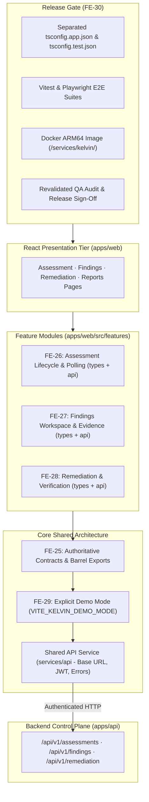

# FE-EPIC-02 — KELVIN Frontend Repair & Release-Blocking Integration

**Project:** KELVIN — Enterprise Security Assessment Platform  
**Type:** `kind/epic` (Release-Blocking Repair Epic)  
**Milestone:** [Frontend Development & Product Experience](../MILESTONE_FRONTEND.md)  
**Parent Roadmap:** [ISSUE-02: Engineering Roadmap](../ISSUE-02_ENGINEERING_ROADMAP.md)  
**Priority:** `P0 — Critical` (Release-blocking)  
**Status:** `ready-for-dev`  
**Execution Sequence:** FE-25 → FE-26 → FE-27 → FE-28 → FE-29 → FE-30  

---

## 🎯 1. Objective

Execute release-blocking repairs across the KELVIN web application (FE-25 through FE-30), reconciling feature API contracts, assessment/finding/remediation lifecycles, explicit demo-mode isolation, TypeScript compilation separation, ARM64 container builds, and formal release acceptance.

The objective is **not** to redesign KELVIN or replace its frontend stack. It is to make the existing React application, feature APIs, routing, shared types, and production build work together reliably.

### Preserved Architectural Baseline
- **Framework & Language:** React 19, TypeScript (strict mode), Vite 7, and Tailwind CSS.
- **Routing:** React Router with sub-path routing under `/services/kelvin/`.
- **Server-State Management:** TanStack Query with query invalidation and cancellation.
- **Feature Modules:** Assessment, findings, and remediation modules with local type definitions.
- **HTTP Client:** Centralized Go API communication via `services/api`.
- **Production Deployment:** Docker / Nginx reverse proxy image on `linux/arm64`.

---

## 📐 2. Architecture & Subsystem Repair Diagram

---

## 🗂️ 3. Repair Phased Issues & PR Breakdown

- [ ] **[FE-25: Frontend Contract Reconciliation](frontend/FE-25_FRONTEND_CONTRACT_RECONCILIATION.md)** (`critical`) — PR: `fix(web): reconcile frontend feature contracts`
- [ ] **[FE-26: Assessment Integration](frontend/FE-26_ASSESSMENT_INTEGRATION.md)** (`critical`) — PR: `fix(web): complete assessment lifecycle integration`
- [ ] **[FE-27: Findings Integration](frontend/FE-27_FINDINGS_INTEGRATION.md)** (`critical`) — PR: `fix(web): complete findings workspace integration`
- [ ] **[FE-28: Remediation Integration](frontend/FE-28_REMEDIATION_INTEGRATION.md)** (`critical`) — PR: `fix(web): complete remediation workflow integration`
- [ ] **[FE-29: Explicit Demo Mode & Data Isolation](frontend/FE-29_EXPLICIT_DEMO_MODE_AND_DATA_ISOLATION.md)** (`critical`) — PR: `fix(web): isolate explicit demo data from production`
- [ ] **[FE-30: Build, Test and Release Acceptance](frontend/FE-30_BUILD_TEST_AND_RELEASE_ACCEPTANCE.md)** (`critical`) — PR: `fix(web): complete production build and release verification`

---

## 📋 4. Release Objectives & Requirements

| Objective | Required Result |
| :--- | :--- |
| **Type Safety** | All feature types, API contracts, and consumers compile under strict TypeScript without `any` or `@ts-ignore` overrides. |
| **Routing** | Every intended page is reachable through its documented route and survives page refreshes under `/services/kelvin/`. |
| **Production Data Integrity** | No mock data fallback occurs after production API failures; typed errors are rendered. |
| **Demo Experience** | Mock data is available exclusively through explicit build-time flag (`VITE_KELVIN_DEMO_MODE=true`) with persistent warning banner. |
| **API Consistency** | Reads, mutations, error mapping, and response parsing follow a single authoritative contract. |
| **Container Build** | Docker production build succeeds on `linux/arm64`. |
| **Testing Pyramid** | Unit, integration, and Playwright E2E tests run independently of production compilation. |
| **QA Revalidation** | Release claims backed by executable tests, reproducible logs, and reconciled scorecard (resolving 97.46 vs 97.42). |

- Preserve existing architecture: React 19, TypeScript, Vite 7, Tailwind CSS, React Router, TanStack Query, and existing Go backend.
- Reconcile feature types and API contracts across assessments, findings, and remediation without inventing backend endpoints.
- Complete assessment execution monitoring, terminal-state polling, and safe cancellation workflows in FE-26.
- Align findings workspace, evidence viewer, detail views, triage transitions, and bulk updates in FE-27.
- Implement remediation status lifecycle, notes persistence, and verification scan triggers in FE-28.
- Enforce explicit demo mode (VITE_KELVIN_DEMO_MODE=true) and guarantee zero silent mock fallback on production API errors in FE-29.
- Separate application and test TypeScript configurations, fix Vitest dependencies, validate ARM64 Docker builds, and update QA audit in FE-30.
- Deliver changes across 6 phased, independently reviewable PRs following approved ADRs (ADR-FE-01 through ADR-FE-08).

---

## 🛡️ 5. Architectural Decision Records (ADRs)

| ADR | Decision & Scope |
| :--- | :--- |
| **ADR-FE-01** | Feature modules own their domain types and API contracts internally. |
| **ADR-FE-02** | Shared API service (`services/api`) is the sole HTTP network boundary. |
| **ADR-FE-03** | Demo mode is strictly explicit (`VITE_KELVIN_DEMO_MODE`) and isolated from production. |
| **ADR-FE-04** | Production API failures never trigger mock data fallback; typed errors are rendered. |
| **ADR-FE-05** | Backend Go domain statuses are authoritative; frontend maps to UI labels where needed. |
| **ADR-FE-06** | Application (`tsconfig.app.json`) and test (`tsconfig.test.json`) TypeScript configs are strictly separated. |
| **ADR-FE-07** | TanStack Query manages server-state caching, polling lifecycle, and mutation invalidation. |
| **ADR-FE-08** | Existing `/services/kelvin/` deployment subpath and Nginx SPA fallback are preserved. |

---

## ✅ 6. Acceptance Criteria

- [ ] Type safety: All feature types, API contracts, and consumers compile under strict TypeScript checks.
- [ ] Routing: All documented routes are registered and survive direct browser refreshes under /services/kelvin/.
- [ ] Production data integrity: No mock fallback occurs after production API failures; typed errors are rendered.
- [ ] Demo experience: Mock data is strictly gated behind VITE_KELVIN_DEMO_MODE=true with visual banner.
- [ ] API consistency: All HTTP communication routes through shared services/api with uniform error envelopes.
- [ ] Build & Verification: Docker ARM64 image builds cleanly and QA audit report is revalidated with executable proof.

---

## 🔗 7. Related Documentation & Links

- Web Application Source: [`apps/web/`](../../../apps/web/)
- Control Plane API: [`apps/api/`](../../../apps/api/)
- Quality Audit Standard: [`docs/quality-audit/`](../../../docs/quality-audit/)
- API Specification: [`docs/api/API_SPECIFICATION.md`](../../../docs/api/API_SPECIFICATION.md)
