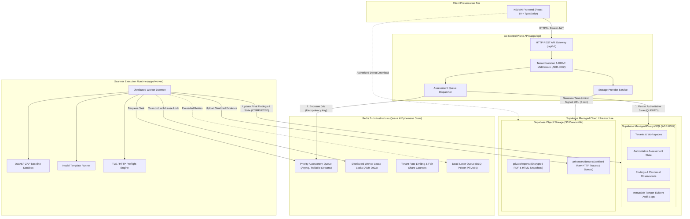
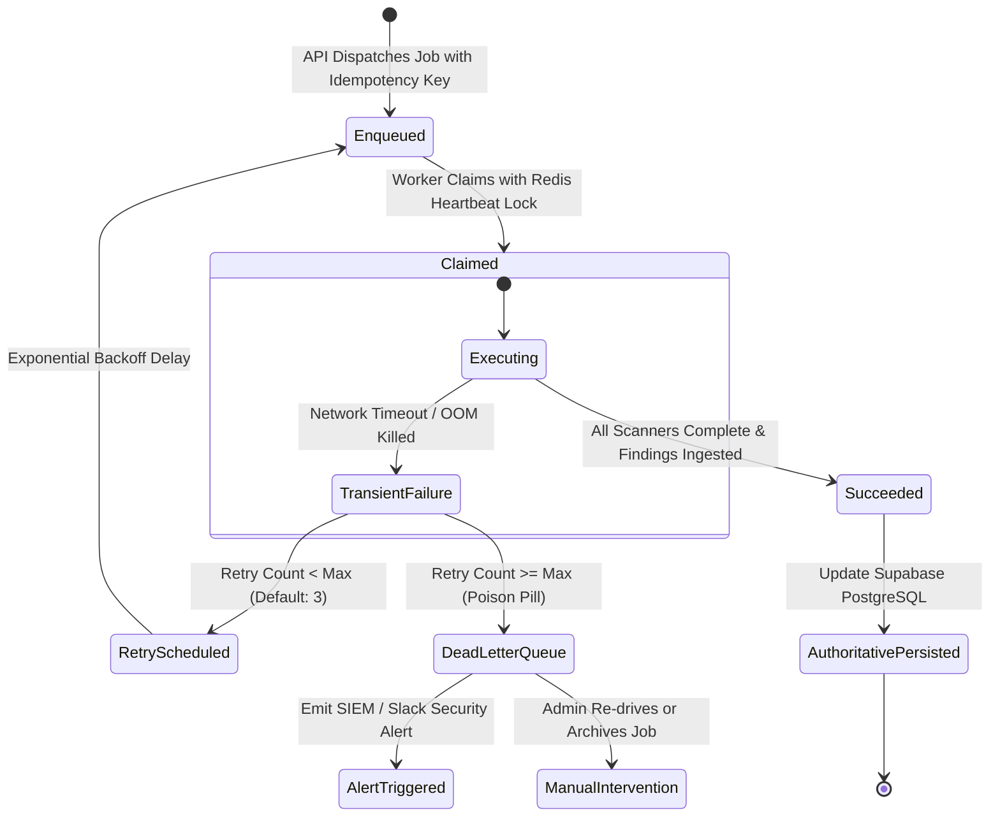

# INFRA-01 — Implement Redis & Supabase Infrastructure Integration

**Project:** KELVIN — Enterprise Security Assessment Platform  
**Type:** `kind/infra` (Infrastructure / Backend Integration)  
**Priority:** `P0 — Critical`  
**Milestone:** [Post-Phase 5 — Infrastructure & Production Integration](../MILESTONE_INFRASTRUCTURE.md)  
**Phase:** Post-Phase 5 — Infrastructure & Production Integration  
**Labels:** `infrastructure`, `backend`, `redis`, `supabase`, `database`, `production-readiness`  
**Status:** `completed`  

---

## 🎯 1. Objective

Implement and integrate **Redis** and **Supabase** into the existing KELVIN backend infrastructure to establish a reliable, scalable, and maintainable foundation for background assessment processing, application data persistence, caching, and evidence management.

The implementation must integrate with the existing Go backend (`apps/api`, `apps/worker`) and TypeScript frontend (`apps/web`) without disrupting existing assessment workflows, authentication, authorization, tenant isolation, or previously implemented platform capabilities.

> [!IMPORTANT]
> **Audit-First Principle:** This issue must begin with a comprehensive audit of the existing infrastructure. Do not blindly replace existing PostgreSQL, queue, authentication, or storage implementations. Preserve existing schema migrations and domain models.

---

## 📐 2. Architecture & Subsystem Workflow Diagrams

### 2.1 Unified Infrastructure Topology



### 2.2 End-to-End Assessment Execution & Job Coordination

```mermaid
sequenceDiagram
    autonumber
    actor Analyst as Security Analyst
    participant Web as Web Client (apps/web)
    participant API as Go Control Plane (apps/api)
    participant PG as Supabase PostgreSQL
    participant Redis as Redis Queue Broker
    participant Worker as Scanner Worker (apps/worker)
    participant Storage as Supabase Storage

    Analyst->>Web: Submit Assessment Request
    Web->>API: POST /api/v1/assessments (Payload + Idempotency-Key)
    API->>PG: BEGIN TX; Validate Target Scope & AuthZ; Insert Assessment (state: QUEUED); COMMIT TX;
    API->>Redis: Enqueue Job (assessment_id, tenant_id, profile, priority)
    API-->>Web: 201 Created (assessment_id, status: QUEUED)
    
    Note over Redis,Worker: Asynchronous Background Processing
    Worker->>Redis: Acquire Distributed Lease Lock (kelvin:lease:{assessment_id})
    Worker->>PG: UPDATE assessments SET status = 'RUNNING', started_at = NOW()
    Worker->>Worker: Execute Preflight -> Scanners (ZAP / Nuclei / TLS)
    
    Worker->>Storage: PUT /evidence/{tenant_id}/{assessment_id}/{finding_id}.raw (Private)
    Storage-->>Worker: 200 OK (Object URI)
    
    Worker->>PG: BEGIN TX; Upsert Canonical Findings & Observations; Update Assessment (state: COMPLETED); COMMIT TX;
    Worker->>Redis: Acknowledge & Remove Job; Release Lease Lock;
    
    Analyst->>Web: View Assessment & Download Evidence
    Web->>API: GET /api/v1/evidence/{evidence_id}/download
    API->>PG: Verify Tenant Access (tenant_id = current_tenant_id())
    API->>Storage: Generate Short-Lived Signed Download URL (Expires in 300s)
    Storage-->>API: Signed URL
    API-->>Web: 200 OK (Signed Download URL)
    Web->>Storage: GET Signed URL (Direct Stream to Browser)
```

### 2.3 Queue Reliability & Dead-Letter Queue (DLQ) Lifecycle



---

## 🏛️ 3. Architecture Responsibilities

### A. Redis — Queue, Cache & Coordination

Redis provides high-performance infrastructure for:
- Background assessment job coordination and priority dispatching.
- Queue-based scanner execution and worker task pools.
- Job status and temporary execution state tracking.
- Distributed locking for scanner execution lease management (preventing duplicate execution across worker replicas).
- API response caching for computationally expensive, read-heavy queries.
- Tenant rate-limiting and request-pacing counters.
- Ephemeral tokens and short-lived execution states.
- Worker heartbeat monitoring and graceful cancellation signaling.

#### Queue Reliability Requirements
1. **Authoritative Separation:** Do not treat ordinary cache entries as durable job records. Authoritative assessment records, lifecycle timestamps, and findings MUST be persisted in PostgreSQL.
2. **Deterministic Idempotency:** Enforce idempotency keys for all assessment creation requests. Duplicate enqueuing of the same assessment job must be intercepted and rejected.
3. **Poison-Pill Protection:** Implement strict retry bounds (default max: 3 retries) with exponential backoff and jitter. Jobs exceeding retry thresholds must automatically route to a Dead-Letter Queue (DLQ).
4. **Lease Heartbeats & Abandoned Job Recovery:** Implement distributed lease locking with heartbeat renewals. If a worker crashes or is OOM-killed, the abandoned job lease must expire, and an orphaned job reaper must re-queue or fail the job cleanly without state corruption.
5. **Tenant-Scoped Caching:** All cache keys must be strictly prefixed with tenant namespace (`kelvin:{tenant_id}:{resource}:{id}`) to prevent cross-tenant cache contamination.

### B. Supabase — Managed Database & Storage Integration

Use Supabase as the enterprise cloud infrastructure provider for KELVIN's persistent data layer, fully compatible with the existing PostgreSQL 15+ database architecture.

#### 1. PostgreSQL Integration
- Connect the Go backend (`apps/api`, `apps/worker`) to Supabase PostgreSQL using `pgxpool` with TLS encryption (`sslmode=verify-full`).
- Reconcile and execute all existing database migrations (`apps/api/db/migrations/000001_...` through `000045_...`) cleanly without dropping tables or indexes.
- Preserve all existing database constraints, foreign keys, row-level security (RLS) policies, and performance indexes.
- Configure connection pooling parameters (max connections, idle timeouts, health-check keepalives) tailored for Supabase Transaction Pooler (PgBouncer) or direct connection.
- Keep privileged database access strictly inside trusted backend services using least-privilege database roles.
- **Security Rule:** Never expose database credentials or the Supabase `service_role` key to frontend code or browser-delivered bundles.

#### 2. Supabase Storage Integration
Implement Supabase Storage (S3-compatible API) for:
- Generated executive and technical assessment reports (PDF / HTML).
- Sanitized raw scanner evidence files, HTTP request/response payloads, and DOM dumps.
- Exported audit logs and compliance snapshots.

**Storage Requirements:**
1. Implement a unified, interface-driven storage provider abstraction in Go (`StorageService` interface: `Upload`, `Download`, `GetSignedURL`, `Delete`).
2. Enforce private buckets by default (`private/reports`, `private/evidence`). No evidence or report may ever reside in a public bucket.
3. Generate time-limited (max 300 seconds), cryptographically signed URLs for authorized report/evidence downloads.
4. Validate file MIME types, magic numbers, and maximum size bounds before uploading.
5. Enforce strict tenant isolation on storage paths: `{tenant_id}/{assessment_id}/{file_id}`.
6. Support automated retention and lifecycle purge policies according to workspace compliance rules.

---

## 📋 4. Implementation Task Breakdown

### Task 1 — Existing Infrastructure Audit
- [ ] Inspect the current Go backend architecture (`apps/api`, `apps/worker`).
- [ ] Audit existing PostgreSQL schemas and all 45 migrations in `apps/api/db/migrations/`.
- [ ] Review current queue and concurrency implementations in `apps/worker/internal/concurrency/redis.go` and `apps/worker/internal/queue/`.
- [ ] Inspect current evidence storage service in `apps/api/internal/evidence/`.
- [ ] Document integration gaps in an Architecture Decision Record (`ADR-0006: Redis and Supabase Integration`).

### Task 2 — Redis Client & Queue Integration
- [ ] Implement robust Go Redis client package with `go-redis/v9` supporting connection pooling, keepalive timeouts, and TLS.
- [ ] Implement health and readiness checks (`PING` probe with timeout).
- [ ] Integrate reliable queue processing using an established library (Asynq or Redis Streams).
- [ ] Implement job idempotency verification using Redis SETNX with expiration.
- [ ] Implement retry policies with exponential backoff and Dead-Letter Queue (DLQ) routing.
- [ ] Implement distributed lease lock mechanism (`AcquireLease`, `RenewLease`, `ReleaseLease`).
- [ ] Implement tenant-scoped cache key generator with strict namespace isolation.
- [ ] Support graceful worker shutdown on `SIGINT` / `SIGTERM` without dropping active jobs.

### Task 3 — Supabase PostgreSQL Integration
- [ ] Configure Supabase project database connection parameters in `apps/api` and `apps/worker`.
- [ ] Reconcile `golang-migrate` runner with Supabase PostgreSQL instance.
- [ ] Verify execution of all migrations, triggers, and indexes.
- [ ] Configure TLS connection verification (`sslmode=verify-full` with root certificates).
- [ ] Validate connection pooling settings for high-concurrency worker loads.
- [ ] Implement database connectivity health and ping endpoints (`/health/db`).
- [ ] Run transaction rollback and recovery tests under simulated network partitions.
- [ ] Validate tenant isolation under strict multi-tenant test suites.

### Task 4 — Supabase Storage Integration
- [ ] Define private storage buckets in Supabase (`private-reports`, `private-evidence`).
- [ ] Implement Go storage abstraction in `apps/api/internal/storage/` supporting S3/Supabase Storage.
- [ ] Implement secure upload with content-type and size validation (max 50 MB per artifact).
- [ ] Implement short-lived pre-signed download URL generation.
- [ ] Enforce tenant authorization checks prior to issuing signed download URLs.
- [ ] Implement evidence retention and automated object deletion routines.
- [ ] Write integration tests verifying cross-tenant access rejection on storage objects.

### Task 5 — Backend Orchestrator & Worker Integration
- [ ] Integrate Redis queue dispatcher into assessment creation pipeline (`apps/api/internal/orchestrator/`).
- [ ] Update worker execution daemon (`apps/worker/internal/daemon/`) to consume jobs from Redis.
- [ ] Guarantee dual-write consistency: authoritative job state in PostgreSQL, execution coordination in Redis.
- [ ] Integrate storage provider with report generation engine and evidence ingestion pipeline.
- [ ] Implement orphaned job reaper recovering interrupted or abandoned jobs after worker failure.
- [ ] Verify audit trail emission for all queue state changes and storage downloads.

### Task 6 — Configuration, Docker Compose & Deployment
- [ ] Update `.env.example` with documented Redis and Supabase configuration variables.
- [ ] Update local `docker-compose.yml` to support local Redis 7 and PostgreSQL/Supabase emulation.
- [ ] Add Docker healthchecks for Redis and database containers.
- [ ] Configure production secrets management guidelines (no secrets in Git or frontend code).
- [ ] Document development, staging, and production deployment runbooks.
- [ ] Document backup, restore, and disaster recovery procedures.

---

## ⚙️ 5. Configuration & Environment Variables

```dotenv
# ==============================================================================
# Redis Infrastructure Configuration
# ==============================================================================
REDIS_URL=redis://localhost:6379/0
REDIS_PASSWORD=
REDIS_DB=0
REDIS_TLS_ENABLED=false
REDIS_POOL_SIZE=20
REDIS_MIN_IDLE_CONNS=5
REDIS_DIAL_TIMEOUT=5s
REDIS_READ_TIMEOUT=3s
REDIS_WRITE_TIMEOUT=3s

# ==============================================================================
# Supabase PostgreSQL Configuration
# ==============================================================================
SUPABASE_DB_HOST=db.example.supabase.co
SUPABASE_DB_PORT=5432
SUPABASE_DB_NAME=postgres
SUPABASE_DB_USER=postgres
SUPABASE_DB_PASSWORD=
SUPABASE_DB_SSLMODE=verify-full
SUPABASE_DB_MAX_OPEN_CONNS=25
SUPABASE_DB_MAX_IDLE_CONNS=5
SUPABASE_DB_CONN_MAX_LIFETIME=1h

# ==============================================================================
# Supabase API & Object Storage Configuration
# ==============================================================================
SUPABASE_URL=https://example.supabase.co
SUPABASE_ANON_KEY=
SUPABASE_SERVICE_ROLE_KEY=
SUPABASE_STORAGE_BUCKET_REPORTS=kelvin-reports-private
SUPABASE_STORAGE_BUCKET_EVIDENCE=kelvin-evidence-private
SUPABASE_STORAGE_SIGNED_URL_EXPIRY=300s
```

> [!CAUTION]
> **Credential Protection:**
> - Never expose `SUPABASE_SERVICE_ROLE_KEY` or `SUPABASE_DB_PASSWORD` to frontend code or client-side environment bundles.
> - Never commit `.env` or credentials to version control.
> - Redact all passwords, tokens, and authorization headers in structured application logs.

---

## 🧪 6. Testing & Quality Verification

### Redis Tests
- [ ] Connection initialization, pool scaling, and timeout recovery.
- [ ] Queue creation, priority task ordering, and concurrent consumption.
- [ ] Duplicate job submission prevention via idempotency keys.
- [ ] Exponential backoff retry execution and Dead-Letter Queue (DLQ) routing.
- [ ] Distributed lease lock acquisition, renewal, and expiration.
- [ ] Cache TTL expiration and tenant-prefix isolation.
- [ ] Worker interruption (`SIGTERM`) and clean task re-queueing.

### Supabase / PostgreSQL Tests
- [ ] Full migration execution against clean Supabase PostgreSQL instance.
- [ ] Foreign key cascade, unique constraint, and check constraint validation.
- [ ] Transaction rollbacks under simulated query errors.
- [ ] Multi-tenant isolation verification (`tenant_id` query scoping).
- [ ] Connection exhaustion simulation and connection pool recovery.

### Storage Tests
- [ ] Successful upload and download of binary PDF reports and JSON evidence.
- [ ] Rejection of mismatched MIME types or oversized files.
- [ ] Validation that signed URLs expire after 300 seconds.
- [ ] Cross-tenant object retrieval rejection (Tenant A cannot access Tenant B's signed URL).
- [ ] Object deletion and retention purge verification.

### End-to-End Workflow Verification
Verify the complete 10-step assessment lifecycle:
1. User authenticates via API / Web.
2. User creates an authorized assessment.
3. Go API validates scope and inputs.
4. Assessment record is persisted in PostgreSQL as `QUEUED`.
5. Job is dispatched to Redis queue with idempotency key.
6. Worker claims job with lease lock and begins execution.
7. Scanners complete and output is normalized.
8. Raw evidence and reports are uploaded to Supabase private storage.
9. Final findings, observations, and status (`COMPLETED`) are persisted in PostgreSQL.
10. Authorized user retrieves assessment details and downloads evidence via signed URL.

---

## 📊 7. Observability & Telemetry

- **Redis Metrics:** Active connections, memory consumption, queue depth per workstream, processing latency, and DLQ message count.
- **Database Metrics:** Connection pool saturation, active queries, transaction duration, and migration status.
- **Storage Metrics:** Upload/download operations, failure counts, and latency percentiles (P95/P99).
- **Structured Logging:** Unified JSON logging with `correlation_id`, `tenant_id`, and `assessment_id` across API, Redis broker, and workers.
- **Health Probes:** `/health/ready` and `/health/live` endpoints validating Redis and PostgreSQL connectivity.

---

## 📑 8. Documentation Deliverables

Produce or update the following technical documentation in the repository:
- `docs/architecture/redis-integration.md` — Redis queue, caching, and locking architecture.
- `docs/architecture/supabase-integration.md` — Supabase database and storage topology.
- `docs/deployment/redis-setup.md` — Local, Docker Compose, and production Redis setup guide.
- `docs/deployment/supabase-setup.md` — Supabase project configuration and migration guide.
- `docs/deployment/production-configuration.md` — Production environment variable reference.
- `docs/operations/backup-and-recovery.md` — Database backup, restoration, and disaster recovery procedures.
- `docs/operations/queue-failure-recovery.md` — DLQ re-drive, worker recovery, and poison pill troubleshooting runbook.
- `docs/architecture/decisions/ADR-0006-redis-supabase-integration.md` — Architecture Decision Record.

---

## 🚫 9. Out of Scope

- Rewriting KELVIN's core Go backend architecture.
- Moving business logic or scanner orchestration into Supabase Edge Functions.
- Exposing Redis or PostgreSQL directly to client browsers.
- Treating Redis as permanent application storage.
- Discarding existing database migrations or schema history.
- Rewriting third-party scanner adapters (ZAP, Nuclei, TLS).

---

## ✅ 10. Definition of Done

This issue may be closed only when:
- [ ] Existing Go backend and PostgreSQL schemas have been audited and documented in ADR-0006.
- [ ] Redis client, queue dispatcher, and worker lease manager are implemented and tested in Go.
- [ ] Supabase PostgreSQL connectivity is verified with TLS and existing migrations execute cleanly.
- [ ] Supabase Storage provider is integrated with private buckets and time-limited signed URLs.
- [ ] Queue processing is idempotent, with verified retry policies and Dead-Letter Queue handling.
- [ ] Tenant isolation is mathematically and functionally enforced across database, cache, and storage.
- [ ] End-to-end assessment creation, execution, storage, and retrieval pass cleanly.
- [ ] Unit, integration, and E2E tests pass with zero regressions.
- [ ] Docker Compose and `.env.example` configurations are updated for local development.
- [ ] All 8 architecture and operations documentation deliverables are published.
- [ ] Pull request is reviewed, approved, and merged.
