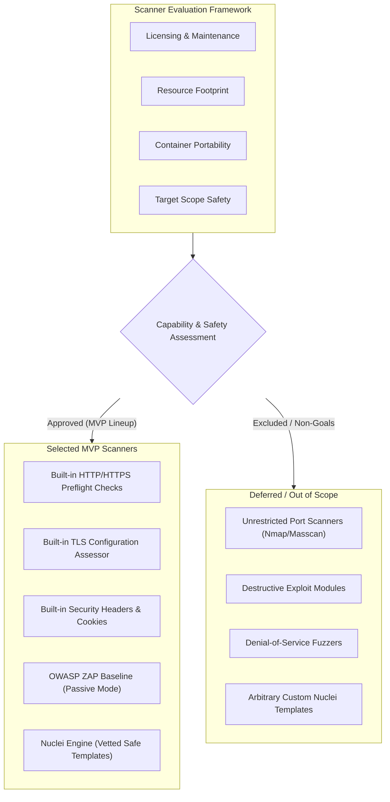

# P2-01 — Define the MVP Scanner Selection and Capability Matrix

**Parent Epic:** [ISSUE-03: MVP Definition, Scope Bifurcation & Phase 2 Scanner Engine Execution Plan](../ISSUE-03_MVP_AND_PHASE_BIFURCATION.md)  
**Milestone:** [Phase 2 — Assessment Engine & Scanner Integrations](../MILESTONE_PHASE_2.md)  
**Workstream:** Workstream A — Scanner Architecture & Integration Foundation  
**Status:** `ready-for-dev`  

---

## 🎯 Purpose

Select the initial scanner technologies that KELVIN will support in its MVP. Avoid integrating tools without a clear product requirement or creating unnecessary dependencies.

---

---

## 📐 Architecture & Workflow Diagram

---

## 📋 Detailed Requirements

- Evaluate potential scanners based on their capabilities, maintenance status, licensing, integration complexity, resource requirements, and compatibility with containerized workers.
- Define the initial MVP scanner lineup: Built-in HTTP/HTTPS preflight checks, Built-in TLS configuration assessment, Built-in HTTP security header and cookie checks, OWASP ZAP Baseline, and Nuclei with a curated, vetted safe-template set.
- Define what each scanner is responsible for detecting.
- Identify overlapping capabilities between scanners.
- Define which checks are passive, which generate requests, and what operational impact they may have.
- Explicitly exclude unrestricted port scanning, arbitrary template execution, exploit execution, and denial-of-service testing from default MVP profiles.
- Document deferred scanners and the reasoning for excluding them.

---

## 🛡️ Security & Architectural Invariants

- **Execution Isolation:** All external scanner execution must adhere strictly to ADR-0005 (Rootless OCI container workers, non-root `UID 10001`, dropped capabilities).
- **Scope Enforcement:** Scanners must never access or follow targets outside the validated scope context established in Phase 1.
- **Resource Constraints:** Timeouts, request pacing, and memory/CPU limits must be strictly applied at the worker runtime boundary.
- **Data Integrity:** Outputs must be treated as untrusted and normalized into Kelvin's Canonical Finding Schema (`finding.v1.json`, ADR-0002).

---

## ✅ Acceptance Criteria

- [ ] An approved scanner selection matrix exists.
- [ ] Each selected scanner has a documented purpose and capability boundary.
- [ ] Licensing and distribution considerations are documented.
- [ ] Default MVP scanning behavior is explicitly defined as non-intrusive and bounded.
- [ ] Deferred integrations are documented separately.

---

## 🔗 Related Documentation & Links

- Architecture Baseline: [`docs/architecture/SYSTEM_ARCHITECTURE.md`](../../../docs/architecture/SYSTEM_ARCHITECTURE.md)
- Target Scope Enforcement: [`docs/architecture/TARGET_SCOPE_ENFORCEMENT.md`](../../../docs/architecture/TARGET_SCOPE_ENFORCEMENT.md)
- Worker Execution Isolation: [`docs/architecture/EXECUTION_ISOLATION.md`](../../../docs/architecture/EXECUTION_ISOLATION.md)
- Canonical Finding Schema: [`docs/architecture/FINDING_SCHEMA.md`](../../../docs/architecture/FINDING_SCHEMA.md)
- Scan Profiles Specification: [`docs/architecture/SCAN_PROFILES.md`](../../../docs/architecture/SCAN_PROFILES.md)
