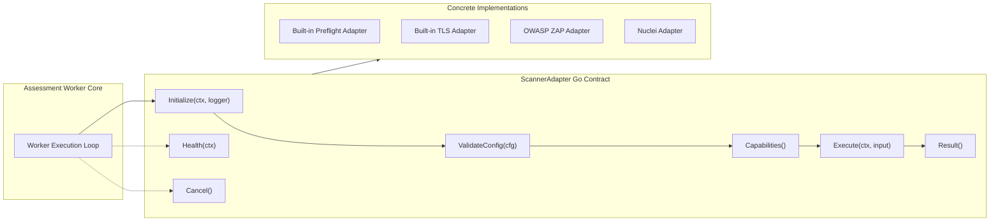

# P2-02 — Define the Scanner Adapter Interface

**Parent Epic:** [ISSUE-03: MVP Definition, Scope Bifurcation & Phase 2 Scanner Engine Execution Plan](../ISSUE-03_MVP_AND_PHASE_BIFURCATION.md)  
**Milestone:** [Phase 2 — Assessment Engine & Scanner Integrations](../MILESTONE_PHASE_2.md)  
**Workstream:** Workstream A — Scanner Architecture & Integration Foundation  
**Status:** `ready-for-dev`  

---

## 🎯 Purpose

Establish a consistent Go interface through which KELVIN can integrate built-in checks and external scanner tools.

---

## 📐 Architecture & Workflow Diagram

---

## 📋 Detailed Requirements

- Define a common scanner adapter interface (`ScannerAdapter`).
- Include operations for: Scanner initialization (`Initialize`), Configuration validation (`ValidateConfig`), Capability discovery (`Capabilities`), Execution (`Execute`), Cancellation (`Cancel`), Health or availability checks (`Health`), and Result retrieval (`Result`).
- Define how adapters receive validated assessment inputs.
- Define how adapters interact with the existing assessment worker.
- Ensure scanner-specific implementation details remain isolated from the domain and application layers.
- Avoid direct database access from scanner adapters.
- Define consistent error and execution-status semantics.

---

## 🛡️ Security & Architectural Invariants

- **Execution Isolation:** All external scanner execution must adhere strictly to ADR-0005 (Rootless OCI container workers, non-root `UID 10001`, dropped capabilities).
- **Scope Enforcement:** Scanners must never access or follow targets outside the validated scope context established in Phase 1.
- **Resource Constraints:** Timeouts, request pacing, and memory/CPU limits must be strictly applied at the worker runtime boundary.
- **Data Integrity:** Outputs must be treated as untrusted and normalized into Kelvin's Canonical Finding Schema (`finding.v1.json`, ADR-0002).

---

## ✅ Acceptance Criteria

- [x] A documented Go adapter interface exists in `apps/worker/internal/adapter/`.
- [x] Adapter implementations follow the same lifecycle contract.
- [x] Scanner-specific code does not leak into unrelated application modules.
- [x] Unit tests verify the expected adapter behavior.
- [x] A reference implementation demonstrates the contract.

---

## 🔗 Related Documentation & Links

- Architecture Baseline: [`docs/architecture/SYSTEM_ARCHITECTURE.md`](../../../docs/architecture/SYSTEM_ARCHITECTURE.md)
- Scanner Adapter Interface Specification: [`docs/architecture/SCANNER_ADAPTER_INTERFACE.md`](../../../docs/architecture/SCANNER_ADAPTER_INTERFACE.md)
- MVP Scanner Selection Matrix: [`docs/architecture/MVP_SCANNER_SELECTION.md`](../../../docs/architecture/MVP_SCANNER_SELECTION.md)
- Target Scope Enforcement: [`docs/architecture/TARGET_SCOPE_ENFORCEMENT.md`](../../../docs/architecture/TARGET_SCOPE_ENFORCEMENT.md)
- Worker Execution Isolation: [`docs/architecture/EXECUTION_ISOLATION.md`](../../../docs/architecture/EXECUTION_ISOLATION.md)
- Canonical Finding Schema: [`docs/architecture/FINDING_SCHEMA.md`](../../../docs/architecture/FINDING_SCHEMA.md)
- Scan Profiles Specification: [`docs/architecture/SCAN_PROFILES.md`](../../../docs/architecture/SCAN_PROFILES.md)
