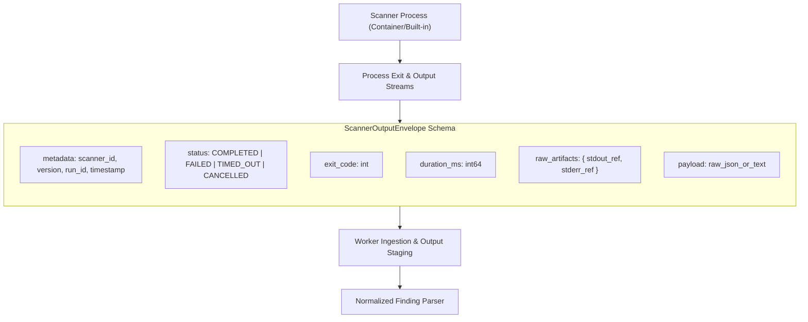

# P2-04 — Define the Scanner Output Envelope

**Parent Epic:** [ISSUE-03: MVP Definition, Scope Bifurcation & Phase 2 Scanner Engine Execution Plan](../ISSUE-03_MVP_AND_PHASE_BIFURCATION.md)  
**Milestone:** [Phase 2 — Assessment Engine & Scanner Integrations](../MILESTONE_PHASE_2.md)  
**Workstream:** Workstream A — Scanner Architecture & Integration Foundation  
**Status:** `ready-for-dev`  

---

## 🎯 Purpose

Create a consistent output envelope for results and diagnostics returned by different scanner adapters.

---

---

## 📐 Architecture & Workflow Diagram

---

## 📋 Detailed Requirements

- Define a common output structure containing: Assessment ID, Scanner identifier and version, Execution status, Start and completion timestamps, Findings collection, Execution diagnostics, Scanner-specific metadata, Partial-result indicator.
- Distinguish successful execution, completed-with-warnings, partial completion, and failure.
- Define how adapters represent scanner crashes and malformed output.
- Keep raw output separate from normalized findings.
- Include correlation identifiers for tracing.
- Ensure output structures are versioned.

---

## 🛡️ Security & Architectural Invariants

- **Execution Isolation:** All external scanner execution must adhere strictly to ADR-0005 (Rootless OCI container workers, non-root `UID 10001`, dropped capabilities).
- **Scope Enforcement:** Scanners must never access or follow targets outside the validated scope context established in Phase 1.
- **Resource Constraints:** Timeouts, request pacing, and memory/CPU limits must be strictly applied at the worker runtime boundary.
- **Data Integrity:** Outputs must be treated as untrusted and normalized into Kelvin's Canonical Finding Schema (`finding.v1.json`, ADR-0002).

---

## ✅ Acceptance Criteria

- [ ] A documented, versioned output contract exists.
- [ ] All adapters use the common envelope.
- [ ] Failure and partial-result states are unambiguous.
- [ ] Raw scanner output cannot be mistaken for normalized findings.
- [ ] Contract tests validate serialization and deserialization.

---

## 🔗 Related Documentation & Links

- Architecture Baseline: [`docs/architecture/SYSTEM_ARCHITECTURE.md`](../../../docs/architecture/SYSTEM_ARCHITECTURE.md)
- Target Scope Enforcement: [`docs/architecture/TARGET_SCOPE_ENFORCEMENT.md`](../../../docs/architecture/TARGET_SCOPE_ENFORCEMENT.md)
- Worker Execution Isolation: [`docs/architecture/EXECUTION_ISOLATION.md`](../../../docs/architecture/EXECUTION_ISOLATION.md)
- Canonical Finding Schema: [`docs/architecture/FINDING_SCHEMA.md`](../../../docs/architecture/FINDING_SCHEMA.md)
- Scan Profiles Specification: [`docs/architecture/SCAN_PROFILES.md`](../../../docs/architecture/SCAN_PROFILES.md)
