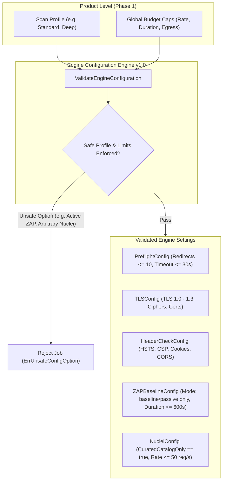

# P2-05 — Define the Scanner Configuration Schema

**Parent Epic:** [ISSUE-03: MVP Definition, Scope Bifurcation & Phase 2 Scanner Engine Execution Plan](../ISSUE-03_MVP_AND_PHASE_BIFURCATION.md)  
**Milestone:** [Phase 2 — Assessment Engine & Scanner Integrations](../MILESTONE_PHASE_2.md)  
**Workstream:** Workstream A — Scanner Architecture & Integration Foundation  
**Status:** `ready-for-dev`  

---

## 🎯 Purpose

Establish a validated configuration model for controlling scanner behavior without exposing unsafe or unrestricted execution options.

---

## 📐 Architecture & Workflow Diagram

---

## 📋 Detailed Requirements

- Define configuration schemas for each selected scanner.
- Include supported settings such as: Request timeout, Maximum request rate, Maximum scan duration, Approved scan mode, Template or ruleset reference, Scanner-specific safe options.
- Define defaults and upper/lower bounds.
- Reject unsupported and unknown configuration fields where appropriate.
- Prevent user-provided configuration from overriding security restrictions.
- Separate product-level scan profiles from scanner-specific implementation settings.
- Ensure schemas are versioned.

---

## 🛡️ Security & Architectural Invariants

- **Execution Isolation:** All external scanner execution must adhere strictly to ADR-0005 (Rootless OCI container workers, non-root `UID 10001`, dropped capabilities).
- **Scope Enforcement:** Scanners must never access or follow targets outside the validated scope context established in Phase 1.
- **Resource Constraints:** Timeouts, request pacing, and memory/CPU limits must be strictly applied at the worker runtime boundary.
- **Data Integrity:** Outputs must be treated as untrusted and normalized into Kelvin's Canonical Finding Schema (`finding.v1.json`, ADR-0002).

---

## ✅ Acceptance Criteria

- [x] Every selected scanner has a documented configuration schema.
- [x] Invalid values are rejected before execution.
- [x] Unsafe settings cannot be enabled through ordinary user input.
- [x] Defaults are documented and tested.
- [x] Configuration versions can be identified in assessment metadata.

---

## 🔗 Related Documentation & Links

- Architecture Baseline: [`docs/architecture/SYSTEM_ARCHITECTURE.md`](../../../docs/architecture/SYSTEM_ARCHITECTURE.md)
- Scanner Configuration Schema Specification: [`docs/architecture/SCANNER_CONFIGURATION_SCHEMA.md`](../../../docs/architecture/SCANNER_CONFIGURATION_SCHEMA.md)
- Scanner Output Envelope Specification: [`docs/architecture/SCANNER_OUTPUT_ENVELOPE.md`](../../../docs/architecture/SCANNER_OUTPUT_ENVELOPE.md)
- Scanner Invocation Contract Specification: [`docs/architecture/SCANNER_INVOCATION_CONTRACT.md`](../../../docs/architecture/SCANNER_INVOCATION_CONTRACT.md)
- Scanner Adapter Interface Specification: [`docs/architecture/SCANNER_ADAPTER_INTERFACE.md`](../../../docs/architecture/SCANNER_ADAPTER_INTERFACE.md)
- MVP Scanner Selection Matrix: [`docs/architecture/MVP_SCANNER_SELECTION.md`](../../../docs/architecture/MVP_SCANNER_SELECTION.md)
- Target Scope Enforcement: [`docs/architecture/TARGET_SCOPE_ENFORCEMENT.md`](../../../docs/architecture/TARGET_SCOPE_ENFORCEMENT.md)
- Worker Execution Isolation: [`docs/architecture/EXECUTION_ISOLATION.md`](../../../docs/architecture/EXECUTION_ISOLATION.md)
- Canonical Finding Schema: [`docs/architecture/FINDING_SCHEMA.md`](../../../docs/architecture/FINDING_SCHEMA.md)
- Scan Profiles Specification: [`docs/architecture/SCAN_PROFILES.md`](../../../docs/architecture/SCAN_PROFILES.md)
