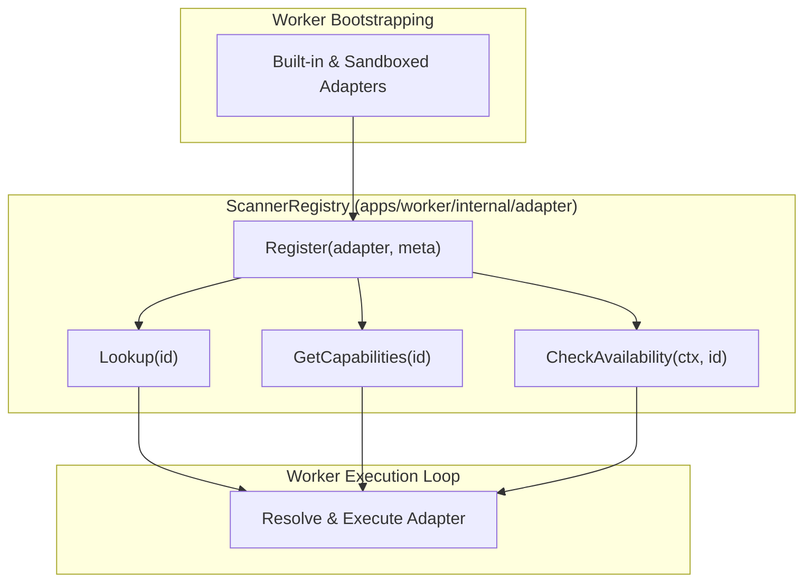

# P2-06 — Implement the Scanner Registry and Capability Discovery

**Parent Epic:** [ISSUE-03: MVP Definition, Scope Bifurcation & Phase 2 Scanner Engine Execution Plan](../ISSUE-03_MVP_AND_PHASE_BIFURCATION.md)  
**Milestone:** [Phase 2 — Assessment Engine & Scanner Integrations](../MILESTONE_PHASE_2.md)  
**Workstream:** Workstream A — Scanner Architecture & Integration Foundation  
**Status:** `ready-for-dev`  

---

## 🎯 Purpose

Provide a central registry through which KELVIN discovers and manages available scanner adapters.

---

## 📐 Architecture & Workflow Diagram

---

## 📋 Detailed Requirements

- Implement a registry for scanner adapters.
- Register each scanner with: Unique identifier, Display name, Version, Supported target types, Supported assessment capabilities, Supported configuration version, Availability status.
- Allow the assessment engine to resolve a scanner by identifier.
- Prevent duplicate or conflicting scanner registration.
- Define behavior when a requested scanner is unavailable.
- Keep registry metadata separate from individual scan execution records.

---

## 🛡️ Security & Architectural Invariants

- **Execution Isolation:** All external scanner execution must adhere strictly to ADR-0005 (Rootless OCI container workers, non-root `UID 10001`, dropped capabilities).
- **Scope Enforcement:** Scanners must never access or follow targets outside the validated scope context established in Phase 1.
- **Resource Constraints:** Timeouts, request pacing, and memory/CPU limits must be strictly applied at the worker runtime boundary.
- **Data Integrity:** Outputs must be treated as untrusted and normalized into Kelvin's Canonical Finding Schema (`finding.v1.json`, ADR-0002).

---

## ✅ Acceptance Criteria

- [x] Scanner adapters can register with the registry.
- [x] The engine can discover available capabilities.
- [x] Unknown scanner identifiers are rejected safely.
- [x] Duplicate registrations are handled deterministically.
- [x] Registry behavior is covered by automated tests.

---

## 🔗 Related Documentation & Links

- Architecture Baseline: [`docs/architecture/SYSTEM_ARCHITECTURE.md`](../../../docs/architecture/SYSTEM_ARCHITECTURE.md)
- Scanner Registry Specification: [`docs/architecture/SCANNER_REGISTRY.md`](../../../docs/architecture/SCANNER_REGISTRY.md)
- Scanner Configuration Schema Specification: [`docs/architecture/SCANNER_CONFIGURATION_SCHEMA.md`](../../../docs/architecture/SCANNER_CONFIGURATION_SCHEMA.md)
- Scanner Output Envelope Specification: [`docs/architecture/SCANNER_OUTPUT_ENVELOPE.md`](../../../docs/architecture/SCANNER_OUTPUT_ENVELOPE.md)
- Scanner Invocation Contract Specification: [`docs/architecture/SCANNER_INVOCATION_CONTRACT.md`](../../../docs/architecture/SCANNER_INVOCATION_CONTRACT.md)
- Scanner Adapter Interface Specification: [`docs/architecture/SCANNER_ADAPTER_INTERFACE.md`](../../../docs/architecture/SCANNER_ADAPTER_INTERFACE.md)
- MVP Scanner Selection Matrix: [`docs/architecture/MVP_SCANNER_SELECTION.md`](../../../docs/architecture/MVP_SCANNER_SELECTION.md)
- Worker Execution Isolation: [`docs/architecture/EXECUTION_ISOLATION.md`](../../../docs/architecture/EXECUTION_ISOLATION.md)
