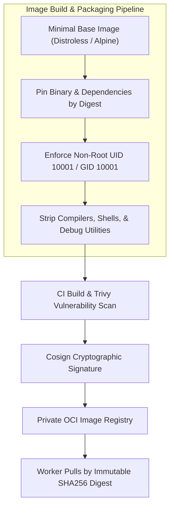

# P2-08 — Package Scanners as Controlled Runtime Images

**Parent Epic:** [ISSUE-03: MVP Definition, Scope Bifurcation & Phase 2 Scanner Engine Execution Plan](../ISSUE-03_MVP_AND_PHASE_BIFURCATION.md)  
**Milestone:** [Phase 2 — Assessment Engine & Scanner Integrations](../MILESTONE_PHASE_2.md)  
**Workstream:** Workstream A — Scanner Architecture & Integration Foundation  
**Status:** `ready-for-dev`  

---

## 🎯 Purpose

Create reproducible scanner runtime environments that can be deployed consistently across development, testing, and production.

---

---

## 📐 Architecture & Workflow Diagram

---

## 📋 Detailed Requirements

- Package external scanner dependencies in controlled container images.
- Use pinned base images and dependency versions.
- Prefer minimal runtime images.
- Avoid including unnecessary compilers, shells, debugging utilities, or unrelated packages in production images.
- Run scanner containers as non-root wherever supported.
- Define image build and verification processes.
- Record image digests and scanner versions.
- Integrate image builds into CI.
- Document vulnerability scanning and update requirements for scanner images.

---

## 🛡️ Security & Architectural Invariants

- **Execution Isolation:** All external scanner execution must adhere strictly to ADR-0005 (Rootless OCI container workers, non-root `UID 10001`, dropped capabilities).
- **Scope Enforcement:** Scanners must never access or follow targets outside the validated scope context established in Phase 1.
- **Resource Constraints:** Timeouts, request pacing, and memory/CPU limits must be strictly applied at the worker runtime boundary.
- **Data Integrity:** Outputs must be treated as untrusted and normalized into Kelvin's Canonical Finding Schema (`finding.v1.json`, ADR-0002).

---

## ✅ Acceptance Criteria

- [ ] Each external scanner has a reproducible runtime image.
- [ ] Image versions and digests are traceable.
- [ ] Images follow the Phase 1 worker security architecture.
- [ ] CI verifies image builds.
- [ ] Image update and rollback procedures are documented.

---

## 🔗 Related Documentation & Links

- Architecture Baseline: [`docs/architecture/SYSTEM_ARCHITECTURE.md`](../../../docs/architecture/SYSTEM_ARCHITECTURE.md)
- Target Scope Enforcement: [`docs/architecture/TARGET_SCOPE_ENFORCEMENT.md`](../../../docs/architecture/TARGET_SCOPE_ENFORCEMENT.md)
- Worker Execution Isolation: [`docs/architecture/EXECUTION_ISOLATION.md`](../../../docs/architecture/EXECUTION_ISOLATION.md)
- Canonical Finding Schema: [`docs/architecture/FINDING_SCHEMA.md`](../../../docs/architecture/FINDING_SCHEMA.md)
- Scan Profiles Specification: [`docs/architecture/SCAN_PROFILES.md`](../../../docs/architecture/SCAN_PROFILES.md)
