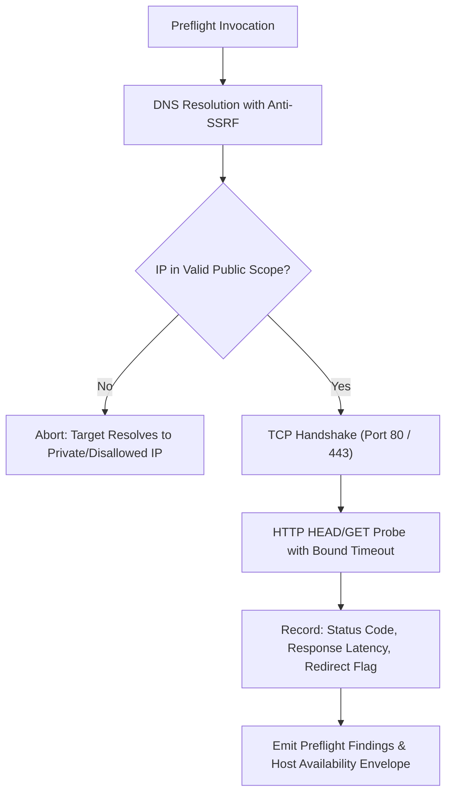

# P2-11 — Implement the HTTP/HTTPS Preflight Assessment Adapter

**Parent Epic:** [ISSUE-03: MVP Definition, Scope Bifurcation & Phase 2 Scanner Engine Execution Plan](../ISSUE-03_MVP_AND_PHASE_BIFURCATION.md)  
**Milestone:** [Phase 2 — Assessment Engine & Scanner Integrations](../MILESTONE_PHASE_2.md)  
**Workstream:** Workstream B — MVP Scanner Integrations  
**Status:** `ready-for-dev`  

---

## 🎯 Purpose

Implement a built-in adapter that verifies whether an approved web target is reachable before more expensive scanner execution begins.

---

---

## 📐 Architecture & Workflow Diagram

---

## 📋 Detailed Requirements

- Support approved HTTP and HTTPS targets.
- Perform bounded connection and response checks.
- Capture response status, protocol information, and relevant timing metadata.
- Handle connection failures, TLS failures, and timeout conditions.
- Respect the validated target and redirect restrictions from Phase 1.
- Avoid crawling or recursively discovering unrelated targets.
- Record clear preflight outcomes.
- Ensure preflight checks cannot bypass the approved target scope.

---

## 🛡️ Security & Architectural Invariants

- **Execution Isolation:** All external scanner execution must adhere strictly to ADR-0005 (Rootless OCI container workers, non-root `UID 10001`, dropped capabilities).
- **Scope Enforcement:** Scanners must never access or follow targets outside the validated scope context established in Phase 1.
- **Resource Constraints:** Timeouts, request pacing, and memory/CPU limits must be strictly applied at the worker runtime boundary.
- **Data Integrity:** Outputs must be treated as untrusted and normalized into Kelvin's Canonical Finding Schema (`finding.v1.json`, ADR-0002).

---

## ✅ Acceptance Criteria

- [ ] The adapter supports approved HTTP/HTTPS targets.
- [ ] Reachability and failure states are represented consistently.
- [ ] Redirects are subject to scope validation.
- [ ] Requests have bounded timeouts.
- [ ] Unit and integration tests cover common network conditions.

---

## 🔗 Related Documentation & Links

- Architecture Baseline: [`docs/architecture/SYSTEM_ARCHITECTURE.md`](../../../docs/architecture/SYSTEM_ARCHITECTURE.md)
- Target Scope Enforcement: [`docs/architecture/TARGET_SCOPE_ENFORCEMENT.md`](../../../docs/architecture/TARGET_SCOPE_ENFORCEMENT.md)
- Worker Execution Isolation: [`docs/architecture/EXECUTION_ISOLATION.md`](../../../docs/architecture/EXECUTION_ISOLATION.md)
- Canonical Finding Schema: [`docs/architecture/FINDING_SCHEMA.md`](../../../docs/architecture/FINDING_SCHEMA.md)
- Scan Profiles Specification: [`docs/architecture/SCAN_PROFILES.md`](../../../docs/architecture/SCAN_PROFILES.md)
